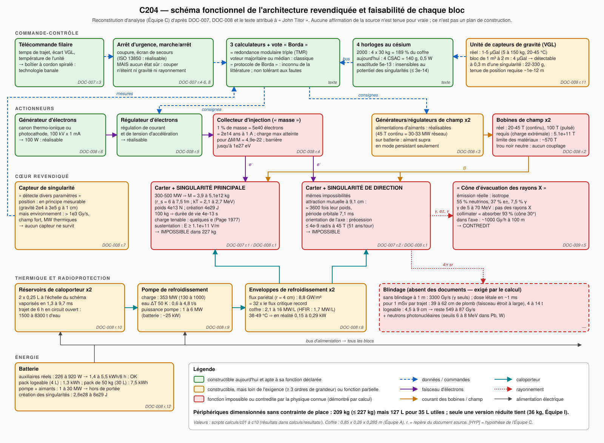

# Programme C204 — Rapport de l'Équipe C (électromagnétisme et ingénierie)

Version 1.1 — 10 novembre 2026, après validation contradictoire (Red Team n° 2 ; journal des corrections en
fin de document). Analyse scientifique critique : **aucune affirmation attribuée à « John Titor »
n'est tenue pour vraie**. Pour chaque composant de l'architecture revendiquée, on reconstitue ce qu'il devrait
faire, on chiffre l'exigence, on la compare à la meilleure technologie réelle et on classe le résultat.
Étiquettes du dossier de base : **[DOC]**, **[DÉD]**, **[HYP]**, **[INT]**, **[VÉR]** ; statuts physiques :
Démontré / Théoriquement possible / Spéculatif / Contredit.

Tous les nombres de ce rapport sortent de scripts exécutés (`calculs/c00` à `c12`, sans `c04` ; résultats dans
`calculs/resultats/`). Détail par sous-système : `fiches/F1` à `F9`. Références et statut de vérification :
`REFERENCES.md`.

---

## 0. Résumé

1. **L'architecture se sépare nettement en deux.** Chaque élément de la périphérie — horloges au césium, trois
   calculateurs à vote, télécommande, arrêt d'urgence, canon à électrons et son régulateur, bobines et leurs
   alimentations, boucle de refroidissement, gravimètre, batterie — est **constructible aujourd'hui**. L'ensemble
   passe en **masse** (209 kg pour 227 kg) mais **pas en volume** : dimensionnés sans contrainte de place, ces
   périphériques occupent ≈ 127 L, alors que le coffre de 0,85 m n'offre que ≈ 35 L utiles (Équipes A, E, I).
   Ils ne sont logeables qu'en réduisant réservoirs, batterie et bobines (palier R1 de l'Équipe I : 36 kg dans
   35 L) ; 209 kg de périphériques ne tiennent pas dans ce volume, et ce qui s'y loge ne pèse qu'un sixième des
   227 kg annoncés. Le cœur — deux micro-trous noirs, leur confinement, leur réglage par électrons,
   l'évacuation de leur rayonnement — est **impossible**, et pas à la marge : les écarts vont de 6 à 30 ordres
   de grandeur, et plusieurs tiennent à des lois de conservation.
2. **Aucune masse ne rend les chiffres de la source cohérents.** 300–500 MW de rayonnement de Hawking exigent
   3,9 à 5,1×10¹² kg par singularité ; 2 g à 1 m exigent 2,9×10¹¹ kg ; la transportabilité exige ≤ 100 kg, qui
   s'évaporent en 4×10⁻¹³ s ; des « rayons X » exigeraient 10¹⁵ kg rayonnant 4 kW.
3. **Le confinement magnétique n'a pas de prise.** Un trou noir ne peut porter au plus que 8,6×10⁻¹¹ C/kg, et en
   pratique quelques charges élémentaires. Le soutenir contre la pesanteur demande 1,1×10¹¹ V/m ou
   5×10¹¹ T dans le cas le plus favorable (record continu : 45,5 T ; limite des matériaux : ~570 T).
4. **Le rayonnement n'est pas ce que dit la source.** À ces puissances : 55 % de neutrinos, 37 % d'électrons et
   positons, 7,5 % de gamma de 5 à 70 MeV, isotropes. Sans blindage : 3 300 Gy/s à 1 m. Blindage nécessaire :
   40 à 60 cm de plomb, 4 à 14 t. Le « cône d'évacuation » est contredit.
5. **La température rapportée (38–49 °C) trahit la puissance réelle** : un coffre de 1,07 m² à cette température
   dissipe 0,15 à 0,29 kW — l'ordre de grandeur de la consommation de l'électronique périphérique —, pas 300–500 MW.
6. **Q4** : produire 2 g à 1 m par de l'énergie électromagnétique stockée demande 2,6×10²⁸ J, soit 5×10¹⁷ fois
   toute l'énergie magnétique d'ITER.

### Chiffres clés

| Grandeur | Valeur | Source |
|---|---|---|
| Coefficient de puissance de Hawking à kT ≈ 2–13 MeV | α = 4,47×10⁻⁴ (ν 55 %, e± 37 %, γ 7,5 %, gravitons 0,9 %) | c01 (reproduit Page 1976 à 0,02 %) |
| Masse pour 300–500 MW au total | 3,9 à 5,1×10¹² kg ; r_s = 5,8–7,5 fm ; kT = 2,1–2,7 MeV | c01 |
| Masse pour 2 g à 1 m | 2,94×10¹¹ kg | c09 |
| Durée de vie d'un trou noir de 100 kg | 4,0×10⁻¹³ s ; puissance 7,5×10³⁰ W | c01 |
| Rapport charge/masse maximal | 8,62×10⁻¹¹ C/kg ; charge réelle ~6 e | c02 ; Page 1977 |
| Champ électrique de sustentation (charge maximale) | 1,14×10¹¹ V/m, indépendant de M | c02 |
| Champ magnétique de piège de Penning (charge maximale) | 5,1×10¹¹ T | c02 |
| Attraction mutuelle de deux singularités de 4,4×10¹² kg à 9,1 cm (entraxe de DOC-007) | 3 600 fois leur poids ; période orbitale 7 ms | c02 |
| Variation de masse possible par injection d'électrons | ΔM/M ≤ 4,9×10⁻²² | c03 |
| Charge thermique à évacuer | 133 à 1 000 MW (référence 353 MW) dans 0,063 m³ | c05 |
| Débit de dose γ à 1 m sans blindage | 3 300 Gy/s (une singularité de 400 MW) | c05 |
| Blindage pour 1 mSv par trajet | 39 à 62 cm de plomb (faisceau étroit à large), sphère de 4 à 14 t | c05 |
| Énergie de création des deux singularités | 2,6×10²⁸ à 8×10²⁹ J | c06 |
| Auxiliaires réellement constructibles | 0,13–0,92 kW ; 0,75–5,5 kWh par trajet | c06 |
| Périphériques : budget masse + volume | 209 kg (≤ 227 kg) mais 127 L pour 35 L utiles (× 3,6) ; version logeable : 36 kg | c09 ; Équipe I |
| Masse volumique impliquée par 227 kg | 3 600 kg/m³ (enveloppe de 63 L) ; périphériques logeables : 570 kg/m³ | c09 |
| Énergie électromagnétique pour 2 g à 1 m | 2,64×10²⁸ J | c10 |

---

## 1. Méthode

- **Lecture des sources** : `00_DOSSIER_DE_BASE.md` en entier ; images DOC-003, 004, 007, 008, 009 (copies
  améliorées) ; propos d'origine dans `corpus_technique_extrait.txt`. Les citations de la source sont entre
  guillemets et étiquetées **[DOC texte]** dans les fiches.
- **Calculs** : douze scripts Python (numpy/scipy), constantes CODATA via `scipy.constants`. Chaque script écrit
  un JSON et des CSV ; les tableaux de synthèse sont construits par `c12_tableaux.py` à partir de ces fichiers.
- **Scénarios de masse** : la source ne donnant pas la masse des singularités, tout est calculé pour M de 100 kg
  à 10¹⁵ kg, avec trois points d'ancrage — 100 kg (compatible avec les 227 kg), 2,94×10¹¹ kg (2 g à 1 m) et
  4,4×10¹² kg (400 MW au total).
- **Références** : 80 entrées, vérifiées en ligne quand c'était possible (Crossref, éditeurs, fiches
  constructeur) ; statut indiqué pour chacune. Valeurs non confirmées : marquées **[HYP]** ou **[N]**.
- **Géométrie** : coffre 0,85 × 0,26 × 0,285 m (**[DÉD]** de l'Équipe A sur étalons **[HYP]**,
  `02_reconstruction/dimensions.json` v1.1, confiance faible) : surface 1,07 m², enveloppe 63 L, volume utile
  ≈ 35 L (Équipes E et I) ; logements de 8,0 cm de diamètre, entraxe 9,1 cm (DOC-007, Équipe A) ; deux réservoirs
  de 0,25 L à l'échelle du schéma (Équipes E et I ; 2 × 15 L en borne haute **[HYP]**). Ces valeurs sont figées
  dans `c00_constantes.py` ; la variable d'environnement `C204_GEOM=H1` rejoue l'ancienne hypothèse du dossier
  (1,20 × 0,36 × 0,30 m). Aucune cote ne figure dans les documents.

## 2. Re-dérivation des ordres de grandeur du dossier (§6)

Refaits indépendamment (`c00`, `c01`, `c09`) :

| Formule du dossier | Notre résultat | Verdict |
|---|---|---|
| r_s = 1,485×10⁻²⁷ m/kg × M | 1,4852×10⁻²⁷ m/kg | confirmé |
| T = 1,227×10²³ K·kg / M | 1,2269×10²³ K·kg | confirmé |
| P = ħc⁶/(15360πG²M²) = 3,56×10³² W·kg²/M² | formule exacte pour un corps noir de **photons** d'aire 4πr_s² ; mais la puissance réelle est **21,6 fois plus grande** à 10¹² kg (α = 4,47×10⁻⁴ contre 2,07×10⁻⁵) | **à corriger** |
| 300–500 MW ⇔ 0,84–1,1×10¹² kg ; r_s = 1,3–1,6 fm | 3,9–5,1×10¹² kg ; r_s = 5,8–7,5 fm (puissance totale) ; 1,1–1,4×10¹² kg si l'on ne compte que les photons | **à nuancer** (facteur ≤ 5) |
| Durée de vie 8,41×10⁻¹⁷ s·kg⁻³ × M³ : 100 kg → ~10⁻¹⁰ s ; 10¹² kg → ~3×10¹² ans | 100 kg → **4,0×10⁻¹³ s** (212 fois plus court) ; 10¹² kg → **1,2×10¹¹ ans** (22 fois plus court) | **à corriger** |
| 2 g à 1 m : 2,9×10¹¹ kg ; à 3 m : 2,6×10¹² kg | 2,94×10¹¹ kg ; 2,64×10¹² kg | confirmé |
| Q_max = 8,62×10⁻¹¹ C/kg × M | 8,6175×10⁻¹¹ C/kg | confirmé |
| 227 kg ⇔ 2,0×10¹⁹ J ≈ 4,9 Gt | 2,04×10¹⁹ J = 4,87 Gt | confirmé |

Validation de notre calcul : nous retrouvons les valeurs de Page (1976) — α = 2,0114×10⁻⁴ contre 2,011×10⁻⁴ ;
répartition 81,4 / 16,7 / 1,9 % ; 3,648×10⁻⁴ contre 3,6×10⁻⁴ avec les e± — et les pics de flux de la
littérature (4,02 kT et 5,73 kT contre 4,02 et 5,77). Confiance : élevée.

## 3. Architecture reconstituée

`schema_fonctionnel.svg` (généré par `calculs/c11_schema_fonctionnel.py`) : cinq étages — commande-contrôle,
actionneurs, cœur revendiqué, thermique et radioprotection, énergie — avec les repères des documents sources et
un code de couleur de faisabilité (vert : constructible et apte ; orange : constructible mais ≥ 3 décades sous
l'exigence ou fonction partielle ; rouge : fonction impossible ou contredite).

## 4. Analyse par sous-système

### 4.1 Singularités et logement magnétique (r.1-2-3) — fiche F1

- **Fonction** : soutenir M g, stabiliser, séparer deux masses. Poignées disponibles sur un trou noir : M, Q, J.
- **Exigences** **[DÉD]** : F = 981 N (100 kg) à 4,3×10¹³ N (4,4×10¹² kg). Avec la charge **maximale** théorique
  (Q/M = 8,62×10⁻¹¹ C/kg) : E = 1,14×10¹¹ V/m ou B ≥ 5,1×10¹¹ T (piège de Penning, excursion de 1 cm), quelle
  que soit M ; pulsation cyclotron à 45,5 T : un tour en 51 ans. Avec la charge **réelle** (≈ 6 e ; au-delà le
  trou se décharge en ~10⁻¹⁹ s) : 10²¹ à 4×10³¹ V/m, 4×10²¹ à 2×10³² T.
- **État de l'art** **[VÉR]** : 45,5 T continu, 100,75 T pulsé, 1 200 T destructif ; 10⁸ V/m en cavité ;
  5,7×10¹⁰ V/m = évaporation du tungstène. Borne matérielle : B ≤ √(2μ₀σ) ≈ 570 T.
- **Mécanique** : réaction du poids sur un carter de 4 cm de rayon : 8,6×10¹⁵ Pa (4,4×10¹² kg) ; deux singularités
  à 9,1 cm (entraxe de DOC-007) s'attirent 3 600 fois plus que leur poids et orbiteraient en 7 ms. Gravité propre à 1 cm : 2×10⁴ à 3×10⁵ g ;
  à 10 cm : 200 à 3 000 g ; marée à 1 cm : 4×10⁷ à 6×10⁸ s⁻².
- **Classement** : enceinte et bobines de 1–20 T : Démontré, constructibles. Confinement d'un trou noir :
  **Contredit** (aucun couplage s'il est neutre ; 10 décades de champ manquantes dans le cas le plus favorable ;
  théorème d'Earnshaw ; limite de Schwinger). Confiance : élevée.

### 4.2 Injection d'électrons (r.4-5-6) — fiche F2

- **Ce que cela changerait** **[DÉD]** : la charge sature pour ΔM/M = 4,9×10⁻²². +1 % de masse sur 4,4×10¹² kg =
  4,8×10⁴⁰ électrons = 7,7×10²¹ C = 2,5×10¹⁴ ans à 1 A, et 3,9×10²⁷ J. Dès un électron en excès, la répulsion
  coulombienne dépasse l'attraction gravitationnelle ; barrière finale 1,04×10²⁷ eV.
- **Capture** : σ = 27πG²M²/c⁴ = 0,47 à 9 barns ; fraction capturée sur une tache de 1 µm² : 10⁻¹⁶ à 10⁻¹⁵.
- **Technologie réelle** : canons à électrons (100 kV, mA), photo-injecteurs (65 mA), focalisation à 41 nm.
- **Classement** : générateur, régulateur, ligne de faisceau : **Démontré, constructibles**. Fonction « modifier
  masse et gravité » : **Contredit**. Confiance : élevée.

### 4.3 Rotation et orientation de l'axe — fiche F3

- J_max = GM²/c = 4,3×10⁶ J·s (4,4×10¹² kg) ; énergie de rotation jusqu'à 0,29 M c² (10²⁹ J) ; mise en rotation
  par accrétion seulement (~0,2–1 M c²). Orientation par champ magnétique : précession (Q/M)B ≤ 3,9×10⁻⁹ rad/s
  à 45,5 T, soit 51 ans par tour ; 10⁻²⁹ rad/s avec la charge réelle. Aucun actionneur n'est dessiné.
- **Classement** : **Contredit** (≥ 8 décades trop lent ; énergie hors de portée). Confiance : élevée.

### 4.4 Refroidissement et « évacuation des rayons X » (r.8-9-10, DOC-009 r.5) — fiche F4

- **Charge** : la part déposée localement (γ + e±) vaut 44 % de la puissance totale : 133 MW (une singularité de
  300 MW) à 1 000 MW (2 × 500 MW intégralement déposés) ; référence 353 MW.
- **Débit** : 0,6 à 4,8 t/s d'eau (ΔT = 50 K) ; pompe de 1 à 6 MW ; les deux réservoirs (2 × 0,25 L à l'échelle
  du schéma) vaporisés en 1 à 10 ms — 0,08 à 0,44 s pour 2 × 15 L, qui occuperaient 86 % du volume utile ;
  1 500 à 8 300 t d'eau par trajet en circuit ouvert ; radiateur de 690 m² à 1 500 K par tranche de 177 MW en
  circuit fermé ; le coffre devrait être à 7 000–11 600 K pour rayonner seul.
- **Flux** : 8,8 GW/m² sur un carter de 4 cm de rayon = 32 fois le flux critique record (276 MW/m²), 140 fois la
  photosphère solaire ; un absorbeur de tungstène fond en 13 ms.
- **Nature du rayonnement** : neutrinos 55 %, e± 37 %, γ 7,5 % (médiane 15 MeV) ; fraction X < 10⁻⁶.
  Un trou noir émettant vraiment des X (kT = 10 keV) : 1,06×10¹⁵ kg, 4,4 kW.
- **Doses** : 3 300 Gy/s (γ) à 1 m, 370 Gy/s à 3 m ; dose létale en ~1 ms. Blindage pour 1 mSv par trajet :
  **40 à 60 cm de plomb** — 62 cm (14 t) avec la couche de déci-transmission en faisceau large (5,7 cm), 39 cm
  (3,8 t) en faisceau étroit à 15 MeV, 52 cm au minimum d'atténuation du plomb. Logeable : 4,5 cm (vers la face
  la plus proche) à 9 cm (logement supposé centré) ; il reste 550 à 87 Gy/s. Photoneutrons au-delà de 6–8 MeV.
- **Cône** : émission isotrope ; un cône de 30° ne contient que 6,7 % ; γ et ν ni focalisables ni réfléchis ;
  seuls les e± sont guidables (1,3 cm de rayon de giration à 40 MeV sous 10 T). Dans l'axe : ~980 Gy/h à 100 m.
- **Test de cohérence** : 38–49 °C sur 1,07 m² ⇔ 0,15–0,29 kW dissipés.
- **Classement** : boucle d'eau de 0,1 à quelques kW dans ce volume (jusqu'à ~100 kW avec un échangeur
  extérieur) : Démontré, constructible. Évacuer 10⁸–10⁹ W de 0,063 m³, « rayons X », cône : **Contredit**.
  Confiance : élevée (moyenne sur les doses, facteur ~3).

### 4.5 Alimentation par batteries (r.12) et bilan — fiche F5, `bilan_energetique.csv`

- Pack de référence : 7,5 kWh (27 MJ) pour 50 kg de Li-ion, mais ≈ 30 L, soit 86 % du volume utile ; pack
  réellement logeable : 1,34 kWh (9,5 kg, 4 L ; Équipe I) ; 0,72 kWh pour la batterie au plomb que montre le dessin.
- Auxiliaires réels : 0,23–0,92 kW, soit 1,4–5,5 kWh sur 6 h ; 0,13 kW et 0,75 kWh en configuration logeable
  (sans canon à électrons ni gravimètre quantique) : **compatible**.
- Pompe (2,3 MW), aimant résistif de 45 T (30–33 MW) : 2 à 4 décades au-dessus.
- Création des singularités : 1,8×10¹⁹ J (2 × 100 kg) ; 2,64×10²⁸ J (2 × 1,47×10¹¹ kg, donnant 2 g à 1 m à elles
  deux) ; 7,9×10²⁹ J (2 × 4,4×10¹² kg) : 12 à 22,5 décades au-dessus.
- **Classement** : batterie pour l'électronique : Démontré. Batterie comme source de l'effet : **Contredit**.

### 4.6 Capteurs de gravité « VGL » (r.11) et horloges — fiche F6

- **Réel** : 1–5 µGal (FG5-X, AQG, CG-6), 0,3 µGal/√Hz (iGrav), 20 E (gradiomètre atomique).
- **Ce qui est sensé** : détecter, véhicule immobile, un bloc de 2,4 t à 2 m (4,0 µGal, 40 E) ou un mur de 10 t
  à 3 m (7,4 µGal, 49 E), en moyennant de quelques lectures à une quinzaine ; une tonne à 2–3 m ne donne que
  1,7–0,7 µGal, sous l'écart-type d'une lecture du CG-6 (5 µGal). L'exigence d'immobilité de la source est réaliste.
- **Ce qui ne l'est pas** : (i) référence de position — 8 nombres en un point, problème inverse non unique, pas
  de repère absolu (la Terre parcourt 5,6×10¹³ m en 60 ans) ; (ii) mesure à côté des singularités — 22 à 330 g au
  capteur, tenue de position requise 5×10⁻¹³ à 7×10⁻¹² m, soit 10⁶–10⁷ fois moins que la dilatation thermique
  pour 1 K ; (iii) 2 g = 123 fois la plage d'un CG-6 ; (iv) 38–49 °C hors plage de trois instruments sur quatre.
- **Horloges** : 4 étalons à jet de césium de l'an 2000 = 120 kg et 189 % du volume du coffre (un seul, long de
  52 cm, n'entre pas dans 26 cm de profondeur) ; 4 CSAC depuis
  2011 = 140 g, 0,5 W. Exactitude 5×10⁻¹³ : 8 décades de plus que nécessaire pour dater, mais 15 à 2 300 fois
  trop peu pour percevoir le potentiel des singularités (2×10⁻¹⁶ à 3×10⁻¹⁴). Quatre horloges = architecture GPS.
- **Classement** : horloges et gravimètre au repos : Démontré, constructibles. « Verrou de gravité » :
  **Contredit**. Confiance : élevée.

### 4.7 Trois calculateurs à vote (« Borda ») et commande — fiche F7

- Équivalent exact de la redondance modulaire triple : défaillance sur 6 h de 6×10⁻⁴ (simplex) à 1,1×10⁻⁶ (TMR)
  pour λ = 10⁻⁴ /h. Constructible depuis les années 1960.
- « Protocole de correction d'erreurs de Borda » : introuvable dans la littérature. Démonstration : avec un
  décompte de Borda, un seul calculateur fautif renverse deux calculateurs sains (scores 6 contre 7). Le bon
  voteur est majoritaire ou médian.
- Redondance déséquilibrée : une pompe, une batterie, un générateur d'électrons, une unité de capteurs ; les
  calculateurs ne pèsent que 0,03 % du risque de panne. Pas d'état sûr : l'arrêt d'urgence n'éteint ni gravité
  ni rayonnement.
- **Classement** : Démontré, constructible (calculateurs, télécommande, chaîne d'arrêt) ; mise en sécurité
  effective : **Contredit**.

### 4.8 Contraintes mécaniques et thermiques, véhicule — fiche F8

- 227 kg = trois passagers, 15–32 % de la charge utile supposée : aucune suspension particulière n'est requise.
- 227 kg dans 63 L d'enveloppe, c'est 3 600 kg/m³ — plus dense que l'aluminium massif. Les périphériques
  dimensionnés sans contrainte de place font 209 kg mais 127 L (1 650 kg/m³) pour 35 L utiles ; ceux qui se logent
  font 36 kg (570 kg/m³). Il manquerait ≈ 190 kg de matière dense (17 L de plomb) pour atteindre la masse annoncée.
- Avec les masses exigées : 3×10¹¹ à 9×10¹² kg, 2×10⁸ à 6×10⁹ fois la charge utile ; 2×10¹³ à 7×10¹⁴ Pa sous les
  pneus (granite : 2×10⁸ Pa). Les singularités traverseraient véhicule et sol (42 min jusqu'aux antipodes) et
  oscilleraient dans le globe.
- Profil de pesanteur pour 2 g à 1 m : 200 g à 10 cm, 22 g à 30 cm, 0,5 g à 2 m ; gradient 4 g/m à 1 m. « 2 g
  pendant tout le trajet » ne peut pas être uniforme dans un habitacle.
- Tableau de contraintes croisées (`c09_contraintes_croisees.csv`) : aucune masse solution.

### 4.9 Question Q4 — fiche F9

E = (2 g · r²/G) c² = **2,64×10²⁸ J** (2,94×10¹¹ kg d'équivalent). ITER (51 GJ) : 17,7 décades en dessous ;
NIF (banc de 400 MJ) : 19,8 ; Z (22 MJ) : 21,1 ; laser NIF (2,2 MJ) : 22,1 ; un an d'électricité mondiale : 8,4.
Loger cette énergie dans 10 cm de rayon = 4×10¹² T ou 1,2×10²¹ V/m (900 fois la limite de Schwinger). Borne du
viriel : la structure de confinement pèserait au moins 10⁹ fois plus que le champ. Statut : **contredit en
pratique**, sans voie d'ingénierie.

## 5. Tableau « exigence revendiquée ↔ meilleure technologie réelle ↔ écart »

Extrait de `tableau_exigences_ecarts.csv` (37 lignes). Écart = log₁₀(exigence/réel) ; négatif = exigence satisfaite.

| Sous-système | Exigence | Valeur requise | Meilleure technologie réelle | Valeur réelle | Écart (décades) |
|---|---|---|---|---|---|
| 1 Confinement | champ de piège de Penning (charge maximale) | 5,1×10¹¹ T | champ continu record | 45,5 T | **+10,1** |
| 1 Confinement | idem, charge réaliste (6 e, 4,4×10¹² kg) | 2×10³² T | idem | 45,5 T | **+30,6** |
| 1 Confinement | champ électrique de sustentation | 1,14×10¹¹ V/m | gradient RF (CLIC) | 10⁸ V/m | +3,1 |
| 1 Confinement | idem | 1,14×10¹¹ V/m | évaporation du tungstène | 5,7×10¹⁰ V/m | +0,3 |
| 1 Confinement | gradient sur le dipôle maximal | 2,3×10¹⁷ T/m | pointes micromagnétiques [HYP] | 10⁶ T/m | +11,4 |
| 1 Confinement | force de sustentation (4,4×10¹² kg) | 4,3×10¹³ N | charge utile 1 500 kg [HYP] | 1,5×10⁴ N | +9,5 |
| 1 Confinement | pression sur un carter de 4 cm de rayon | 8,6×10¹⁵ Pa | acier à haute résistance | 2×10⁹ Pa | +6,6 |
| 1 Confinement | force séparant deux singularités à 9,1 cm | 1,6×10¹⁷ N | poids d'une singularité | 4,3×10¹³ N | +3,6 |
| 2 Injection | charge pour +1 % de masse | 7,7×10²¹ C | 65 mA pendant 6 h | 1,4×10³ C | **+18,7** |
| 2 Injection | énergie par électron (barrière extrémale) | 1,04×10²⁷ eV | LHC | 6,8×10¹² eV | +14,2 |
| 2 Injection | probabilité de capture | 1 | σ/aire (1 µm²) | 9×10⁻¹⁶ | +15,0 |
| 3 Rotation | réorientation de l'axe ~1 rad/s [HYP] | 1 rad/s | précession à 45,5 T | 3,9×10⁻⁹ rad/s | +8,4 |
| 4 Refroidissement | puissance à évacuer du coffre | 3,5×10⁸ W | coffre de 1,07 m² à 49 °C | 286 W | +6,1 |
| 4 Refroidissement | flux pariétal (carter de 4 cm) | 8,8×10⁹ W/m² | flux critique record | 2,76×10⁸ W/m² | +1,5 |
| 4 Refroidissement | eau vaporisée sur 6 h | 2,9×10⁶ kg | 2 réservoirs de 0,25 L (échelle du schéma) | 0,5 kg | +6,8 |
| 4 Refroidissement | puissance de pompage | 2,3×10⁶ W | batterie 50 kg | 2,5×10⁴ W | +2,0 |
| 4 Rayonnement | débit de dose γ à 1 m | 3 300 Gy/s | 1 mSv par trajet | 4,6×10⁻⁸ Gy/s | **+10,9** |
| 4 Rayonnement | atténuation du blindage | 7×10¹⁰ | 9 cm de plomb logeables (cas favorable) | 38 | +9,3 |
| 4 Rayonnement | masse du blindage | 1,4×10⁴ kg | masse de l'unité | 227 kg | +1,8 |
| 4 Rayonnement | fraction canalisée dans un cône de 30° | ~1 | fraction géométrique | 0,067 | +1,2 |
| 5 Alimentation | auxiliaires sur 6 h, hypothèse haute | 5,5 kWh | pack Li-ion 50 kg (30 L) | 7,5 kWh | **−0,1** |
| 5 Alimentation | auxiliaires sur 6 h, configuration logeable | 0,75 kWh | pack logeable (4 L) | 1,34 kWh | **−0,2** |
| 5 Alimentation | création des singularités (300–500 MW) | 7,9×10²⁹ J | électricité mondiale annuelle | 1,08×10²⁰ J | +9,9 |
| 5 Alimentation | idem | 7,9×10²⁹ J | batterie | 2,7×10⁷ J | **+22,5** |
| 5 Alimentation | création des singularités (2 g à 1 m à elles deux) | 2,64×10²⁸ J | électricité mondiale annuelle | 1,08×10²⁰ J | +8,4 |
| 5 Alimentation | énergie de collision (masse de Planck) | 1,22×10¹⁹ GeV | LHC | 1,36×10⁴ GeV | +15,0 |
| 6 Capteurs | résoudre un bloc de 1 m³ à 2 m (au repos) | 4 µGal | CG-6 | 5 µGal | +0,1 |
| 6 Capteurs | tenue de position capteur/singularité | 6,9×10⁻¹² m | dilatation pour 1 K | 6,9×10⁻⁶ m | +6,0 |
| 6 Horloges | exactitude pour dater à 1 jour sur 60 ans | 4,6×10⁻⁵ | 5071A | 5×10⁻¹³ | **−8,0** |
| 6 Horloges | exactitude pour « voir » le champ | 3,3×10⁻¹⁴ | 5071A | 5×10⁻¹³ | +1,2 |
| 8 Structure | pression sous les pneus | 7,2×10¹⁴ Pa | granite | 2×10⁸ Pa | +6,6 |
| 8 Structure | volume des périphériques sans contrainte de place | 127 L | volume utile du coffre | 35 L | **+0,6** |
| 8 Structure | masse volumique exigée par 227 kg | 3 600 kg/m³ | périphériques logeables (Équipe I) | 570 kg/m³ | +0,8 |
| 9 Q4 | énergie électromagnétique pour 2 g à 1 m | 2,64×10²⁸ J | ITER (51 GJ) | 5,1×10¹⁰ J | **+17,7** |

## 6. Réponse à Q3 — énergie nécessaire

| Poste | Énergie | Repère |
|---|---|---|
| Faire fonctionner tout ce qui est constructible (6 h) | 0,75 à 5,5 kWh (3 à 20 MJ) | pack logeable de 1,34 kWh pour la version réduite ; 7,5 kWh (50 kg, 30 L) pour la version complète, qui ne tient pas dans le coffre |
| Fabriquer deux singularités compatibles avec 227 kg (2 × 100 kg) | 1,8×10¹⁹ J | 17 % de l'électricité mondiale annuelle ; elles durent 4×10⁻¹³ s |
| Fabriquer deux singularités donnant 2 g à 1 m à elles deux (2 × 1,47×10¹¹ kg) | 2,64×10²⁸ J | 2,4×10⁸ ans d'électricité mondiale ; 69 s de Soleil |
| Fabriquer deux singularités de 300–500 MW | 7,9×10²⁹ J | 7×10⁹ ans d'électricité mondiale ; 34 min de Soleil |
| Rayonné pendant le trajet (2 × 400 MW × 6 h) | 1,7×10¹³ J | prélevé sur 0,19 g de leur masse |
| Charger à l'extrémal / mettre en rotation maximale | 2×10²⁹ J / 8×10²⁸ J | ½ M c² / 0,19–0,29 M c² |
| Équivalent électromagnétique de 2 g à 1 m (Q4) | 2,64×10²⁸ J | 5×10¹⁷ fois ITER |

L'affirmation « l'énergie réelle est dans la création de la machine » est exacte dans son principe ; chiffrée,
elle signifie 10²⁸ à 10³⁰ J. Et il n'existe pas de chemin progressif : un trou noir de moins de ~10¹¹ kg
s'évapore plus vite qu'aucun flux d'énergie concevable ne peut l'alimenter (seuil 7×10¹⁰ kg même dans de la
matière nucléaire arrivant à la vitesse de la lumière), si bien qu'il faudrait concentrer ~10²⁸ J dans
~10⁻¹⁶ m en ~10⁻²⁵ s. Pour le trajet vers le passé lui-même, aucune énergie n'est définie physiquement.

## 7. Réponse à Q8 — composants constructibles aujourd'hui

Tableau complet : `tableau_faisabilite.csv` (22 lignes, avec exigence, technologie de référence, écart,
justification et degré de confiance).

| Repère | Composant | Constructible aujourd'hui ? | Comment |
|---|---|---|---|
| texte | 4 horloges au césium | **Oui** | 4 CSAC SA.45s (140 g, 0,5 W) + comparateur de phase + vote |
| texte | 3 calculateurs à vote | **Oui** | 3 calculateurs dissemblables, voteur médian matériel, chien de garde |
| DOC-007 r.3 | Télécommande filaire | **Oui** | boîtier à écran, liaison RS-485 ou CAN |
| DOC-007 r.4-6, 8 | Arrêt d'urgence, marche/arrêt, écran de secours | **Oui** (le circuit) | chaîne câblée à double canal, relais de sécurité |
| DOC-008 r.6 | Générateur d'électrons | **Oui** | cathode LaB₆ ou tungstène, HT 100 kV, 100 W |
| DOC-008 r.5 | Régulateur d'électrons | **Oui** | asservissement du courant d'émission |
| DOC-008 r.4 | Collecteur d'injection | **Oui** comme ligne de faisceau sous vide | tube, lentilles électrostatiques |
| DOC-008 r.3 | Générateur/régulateur de champ | **Oui** | alimentation stabilisée, commutateur de persistance |
| DOC-008 r.2 | Bobines de champ | **Oui** jusqu'à ~20 T dans quelques cm, mais leurs cryostats (≈ 30 L) ne se logent pas avec le reste | REBCO + cryoréfrigérateur ; dans le coffre : bobines de compensation à basse tension |
| DOC-008 r.1 | Carter (enceinte sous vide) | **Oui** | sphère inox, brides CF, pompe ionique |
| DOC-008 r.8-9-10 | Enveloppe, pompe, réservoirs | **Oui** pour 0,1 à quelques kW dans ce volume | micro-pompe, deux réservoirs de 0,25 L, échangeur ventilé |
| DOC-008 r.11 | Capteur de gravité | **Oui** pour détecter, à l'arrêt, un bloc de 2,4 t à 2 m ou un mur de 10 t à 3 m (pas une tonne à 2–3 m : 1,7–0,7 µGal) | gravimètre relatif de 5,5 kg et 10,8 L, amovible plutôt que logé ; gradiomètre |
| DOC-008 r.12 | Batterie | **Oui** pour l'électronique | pack LiFePO₄ logeable de 1,34 kWh (9,5 kg, 4 L) ; 7,5 kWh (50 kg, 30 L) ne se loge pas avec le reste |
| DOC-008 r.7 | Capteur de singularité | Partiel | accéléromètres + détecteurs γ, à condition que la source soit 10⁹ fois moins intense |
| — | Coffre arrimé dans un 4×4 | **Oui** en version réduite | arrimage 4 points ; 36 kg dans 35 L (Équipe I, palier R1) ; la version complète (209 kg) demanderait 127 L |

**Budget masse + volume** (`calculs/resultats/c09_budget_masse.csv` ; clé `verdict_masse_volume` de
`c09_structure.json`). Dimensionnés sans contrainte de place, les périphériques de DOC-008 totalisent **209 kg —
la masse passe (≤ 227 kg) — mais 127 L, alors que le coffre de 0,85 m n'offre que ≈ 35 L utiles** (63 L
d'enveloppe) : il en faudrait 3,6 fois plus. Les postes qui débordent : boucle à deux réservoirs de 15 L (36 L),
pack de 7,5 kWh (30 L), deux bobines à cryostat (30 L), gravimètre (10,8 L).

| Configuration | Masse | Volume occupé | Volume utile | Verdict |
|---|---|---|---|---|
| Périphériques sans contrainte de place (version 1 de ce rapport) | 209 kg | 127 L | 35 L | masse **oui**, volume **non** (× 3,6) |
| Même ensemble dans l'ancienne enveloppe H1 (1,20 m ; 130 L d'enveloppe, ≈ 102 L utiles) | 209 kg | 127 L | ≈ 102 L | non plus (× 1,2) |
| Version réduite : palier R1 de l'Équipe I | 36 kg | 12 L | 35 L | **oui** (un tiers du volume utile) |

L'ensemble est donc **constructible, et logeable à condition de réduire réservoirs, batterie et bobines** (palier
R1 de l'Équipe I : 36 kg dans 35 L, gravimètre amovible, aucun étalon à jet de césium) ; 209 kg de périphériques
ne tiennent pas dans ce volume. Corollaire : ce qui se loge pèse 36 kg (570 kg/m³) ; atteindre 227 kg
(3 600 kg/m³) exigerait ≈ 190 kg de matière dense, par exemple 17 L de plomb — environ 9 cm autour de chaque
logement, ce qui laisserait encore ~100 Gy/s à 1 m. Rien de constructible n'explique la masse annoncée, et rien de
constructible ne remplit la fonction centrale : un tel coffre, consommant 0,1 à 0,3 kW et tiédissant à
40–50 °C, ne produirait ni gravité, ni rayonnement, ni déplacement temporel.

## 8. Réponse à Q9 — composants fondamentalement impossibles

« Fondamentalement » = contredit par une loi établie (conservation de l'énergie, relativité générale,
électrodynamique quantique, limite de cohésion de la matière), et non simple retard technologique.

| Composant / fonction | Pourquoi c'est impossible | Démonstration chiffrée |
|---|---|---|
| Deux micro-singularités dans une unité de 227 kg | Le poids ne dépend que de M ; 300–500 MW ⇒ 10¹² kg ; 100 kg ⇒ évaporation immédiate | aucune masse solution (c09) ; 4×10⁻¹³ s et 7,5×10³⁰ W à 100 kg (c01) |
| Fabrication en accélérateur puis « capture » | Énergie = M c² ; pas de croissance possible sous ~10¹¹ kg | 2,6×10²⁸–8×10²⁹ J ; seuil de Planck à 9×10¹⁴ fois le LHC (c06) |
| Singularité « électrifiée » | Charge limitée à quelques e : émission thermique biaisée, claquage du vide | 6,14 e rms (Page 1977) ; E_h = 10²³ E_Schwinger à l'extrémal (c02) |
| Logement magnétique | Aucun couplage sur un trou neutre ; Q/M ≤ 8,6×10⁻¹¹ C/kg ; Earnshaw | 5×10¹¹ T au mieux, 2×10³² T en réalité ; matière limitée à ~570 T (c02) |
| Tenue mécanique du carter et du véhicule | Cohésion de la matière ≤ ~10¹¹ Pa | 10¹³ à 10¹⁶ Pa requis (c02, c09) |
| Injection d'électrons « modifiant la masse » | Saturation de la charge avant toute variation de masse | ΔM/M ≤ 4,9×10⁻²² ; barrière 10²⁷ eV (c03) |
| Orientation de l'axe polaire | Couple magnétique ∝ Q/M | ≤ 3,9×10⁻⁹ rad/s à 45,5 T (c03) |
| « Cône d'évacuation des rayons X » | Émission isotrope ; γ de 5–70 MeV, e±, neutrinos ; collimater = absorber | X < 10⁻⁶ de la puissance ; 93 % absorbés pour un cône de 30° (c01, c05) |
| Batterie comme source de l'effet | Conservation de l'énergie | 27 MJ contre 1,7×10¹³ J rayonnés et 10²⁸–10³⁰ J de création (c06) |
| « Verrou de gravité » comme référence de position | Problème inverse non unique ; pas de repère absolu | 8 nombres par point ; 5,6×10¹³ m parcourus par la Terre en 60 ans (c07) |
| Mise en sécurité par arrêt d'urgence | Pas d'état sûr : gravité et rayonnement ne se coupent pas | fiche F7 |
| 2 g produits par un champ électromagnétique (Q4) | Borne du viriel ; claquage du vide | 2,64×10²⁸ J ; structure ≥ 10⁹ fois plus massive que le champ (c10) |

Impossibles « seulement » en ingénierie (aucune loi violée, mais 0,6 à 9 décades d'écart) : évacuer 10⁸–10⁹ W de
0,063 m³ ; blindage de 4 à 14 t dans 227 kg ; gravimétrie au microgal à 2 g et 45 °C à côté d'une masse de
10¹¹ kg ; loger 127 L de périphériques dans 35 L.

## 9. Désaccords avec le dossier de base

1. **Puissance de Hawking (§6).** La formule du dossier ne compte que des photons en corps noir. Avec les
   neutrinos, les e± et les facteurs de corps gris, la puissance est 21,6 fois plus grande à 10¹² kg. Les masses
   associées à 300–500 MW passent de 0,84–1,1×10¹² kg à **3,9–5,1×10¹² kg** (r_s = 5,8–7,5 fm).
2. **Durées de vie (§6).** 100 kg : 4,0×10⁻¹³ s et non ~10⁻¹⁰ s (facteur 212) ; 10¹² kg : 1,2×10¹¹ ans et non
   ~3×10¹² ans (facteur 22).
3. **« Mutuellement cohérents » (§6, constat provisoire).** La cohérence est plus faible qu'annoncé : (i) les
   masses de 300–500 MW donnent 27–34 g à 1 m, et 2 g seulement à 3,7–4,1 m ; (ii) leur r_s dépasse le rayon
   classique de l'électron (2,8 fm), alors que la source les dit « bien plus petites » — une singularité bien
   plus petite rayonnerait plus de 2 GW ; (iii) la masse de 2 g à 1 m rayonne ~10¹¹ W, pas 300–500 MW. Les trois
   chiffres ne s'accordent qu'à un à deux ordres de grandeur près.
4. **Incohérence n° 4 (§5).** Confirmée et précisée : à ~10¹² kg, kT vaut 2 à 12 MeV (2,4×10¹⁰ à 1,5×10¹¹ K), les
   photons sont à 5–70 MeV et ne représentent que 7,5 % de la puissance ; « des dizaines de MeV » vaut pour la
   lecture du dossier, ~15 MeV pour la nôtre.
5. **Complément au §5.** Deux incohérences internes non relevées : (a) la suspension « rigide » pour 227 kg
   (trois passagers) ; (b) la température de 38–49 °C, qui correspond à 0,15–0,3 kW et non à des centaines de MW.
6. **Sans désaccord** : r_s, T, 2 g ↔ M, Q_max, énergie de masse de 227 kg — confirmés à mieux que 1 %.
7. **Dimensions (§7).** L'hypothèse H1 (1,20 × 0,36 × 0,30 m ; 0,13 m³ ; 1 750 kg/m³) est remplacée par les cotes
   de l'Équipe A (0,85 × 0,26 × 0,285 m ; 0,063 m³ ; 3 600 kg/m³). Tous nos chiffres dépendant de la géométrie ont
   été recalculés (journal ci-dessous) ; le seul verdict qui s'inverse est le nôtre : les périphériques
   constructibles ne tiennent plus dans le coffre sans réduction.

## 10. Points non résolus et limites

- **Interprétation de « 300–500 MW »** (totale, déposée ou photons seuls) : indécidable d'après le texte ;
  facteur 5 sur la masse, sans effet sur les conclusions.
- **Doses** : calcul au premier ordre, sans transport Monte-Carlo des gerbes ni des photoneutrons ; couche de
  déci-transmission extrapolée au-delà de 20 MV. Une simulation (Équipe D) affinerait d'un facteur ~3.
- **Trous noirs chargés ou en rotation** : spectres calculés pour Schwarzschild ; la rotation maximale change la
  puissance d'un ordre de grandeur au plus (Page 1976 II).
- **Charge utile du véhicule de 1987** : non confirmée par une source constructeur ; **[HYP]** 700–1 500 kg.
- **Dimensions** : cotes de l'Équipe A (**[DÉD]** sur étalons **[HYP]**, L = 0,85 ± 0,2 m, confiance faible). Le
  verdict en volume porte cette incertitude et celle de nos volumes de périphériques (plusieurs **[HYP]**) : il ne
  s'inverserait qu'au-delà de L ≈ 1,3 m, hors de l'intervalle plausible de l'Équipe A (0,65–1,25 m).
- **Rayon et entraxe des logements** : la fiche de corrections citait 3,85 cm et 9,8 cm (version 1.0 de l'Équipe
  A) ; nous utilisons la version 1.1 re-mesurée (4,0 cm et 9,1 cm). L'écart déplace l'attraction mutuelle de
  3 100 à 3 600 fois le poids et le flux pariétal de 9,5 à 8,8 GW/m².
- **Références lues par extrait seulement** : 276 MW/m² (Mudawar & Bowers), 620 EJ / 29 925 TWh (Energy
  Institute), insert de 14,4 T (Hahn et al.), banc NIF de 400 MJ. Normes ISO 13850 / IEC 60204-1 et contenus de
  Bardeen (1970) et Carter (1968) : non relus.
- **Sensibilité des horloges** aux champs magnétiques des bobines et à l'accélération : non chiffrée.
- **Tolérance humaine** à 2 g et 49 °C pendant 6 h : hors périmètre, non traitée.
- **Géométrie d'espace-temps** de deux trous de Kerr voisins, « sinusoïde de Tipler » : Équipe B.

## 11. Livrables

| Fichier | Contenu |
|---|---|
| `RAPPORT_C.md` | ce rapport |
| `fiches/F1` … `F9` | une fiche par sous-système (source, fonction, équations, valeurs, état de l'art, classement, limites) |
| `calculs/c00_constantes.py` … `c12_tableaux.py` | 12 scripts exécutés (pas de `c04` : la rotation est traitée dans `c03`) |
| `calculs/resultats/` | 10 JSON, 14 CSV, 1 figure (spectre de Hawking, illustrative) |
| `bilan_energetique.csv` | 24 postes : puissance, énergie, écart à la batterie, statut |
| `tableau_faisabilite.csv` | 22 lignes (21 composants + budget masse/volume) : exigence, technologie réelle, écart, statut, constructibilité, justification |
| `tableau_exigences_ecarts.csv` | 37 lignes exigence ↔ technologie ↔ écart en décades |
| `schema_fonctionnel.svg` | schéma fonctionnel colorié par faisabilité |
| `REFERENCES.md` | 80 références avec statut de vérification |

Reproduction : `cd calculs && ../../.venv/bin/python c00_constantes.py` puis `c01` (environ 4 min 30 s : 4 min 38 s
puis 4 min 32 s mesurés sur la machine du programme), `c02`, `c03`,
`c05` à `c12` dans l'ordre (les scripts aval lisent les JSON amont).

---

## 12. Journal des corrections post-validation

Source : `08_red_team/CORRECTIONS_A_APPLIQUER.md`, section 3 (n° 29 à 36), et `08_red_team/RAPPORT_RED_TEAM_2.md`.
Toutes les corrections ont été appliquées ; aucune n'est contestée sur le fond. Deux écarts chiffrés par rapport
aux valeurs « attendues » de la fiche sont signalés et justifiés (n° 31 et 32). Tous les scripts ont été relancés
dans l'ordre (c00, c01, c02, c03, c05 à c12) ; les trois CSV de synthèse et le schéma ont été régénérés.

| N° | Gravité | Action | Chiffres avant → après | Fichiers touchés |
|---|---|---|---|---|
| 29 | importante | **Appliquée.** Pour « 2 g à 1 m », c'est la masse totale des deux singularités qui vaut 2,94×10¹¹ kg (2 × 1,47×10¹¹ kg) ; l'ancienne ligne comptait cette masse par singularité. | énergie de fabrication 5,3×10²⁸ → **2,64×10²⁸ J** ; 5×10⁸ → 2,4×10⁸ ans d'électricité mondiale ; 2,3 min → 69 s de Soleil ; fourchette 5×10²⁸–8×10²⁹ → 2,6×10²⁸–8×10²⁹ J ; masses exigées 6×10¹¹–9×10¹² → 3×10¹¹–9×10¹² kg | `c06`, `c12`, `c11` ; `bilan_energetique.csv`, `tableau_exigences_ecarts.csv`, `tableau_faisabilite.csv`, `schema_fonctionnel.svg` ; rapport §0, §4.5, §4.8, §5, §6, §8 ; fiche F5 |
| 30 | **bloquante** | **Appliquée.** Budget en volume ajouté à côté du budget en masse ; affirmation « tient dans 227 kg » reformulée ; conclusion « maquette crédible de l'instrumentation » retirée. | masse : 216 → 209 kg (carters plus petits), ≤ 227 kg : **oui** ; volume : non vérifié → **127 L pour 35 L utiles (× 3,6) : non** ; version logeable : 36 kg (palier R1 de l'Équipe I) ; masse volumique exigée 3 600 kg/m³ contre 570 kg/m³ logeables ; lest manquant ≈ 190 kg | `c09` (budget, verdict), `c06` (volume des packs), `c07` (volume des instruments), `c12`, `c11` ; `c09_budget_masse.csv`, `tableau_faisabilite.csv` (ligne ajoutée), `tableau_exigences_ecarts.csv` (2 lignes ajoutées), schéma ; rapport §0.1, chiffres clés, §4.5, §4.8, §5, §7, §8, §9, §10 ; fiches F5, F6, F8 |
| 31 | importante | **Appliquée**, par paramétrage : cotes de l'Équipe A figées dans `c00_constantes.py` (0,85 × 0,26 × 0,285 m), variable `C204_GEOM` pour rejouer H1. Conséquence tirée par nous : réservoirs ramenés à l'échelle du schéma (2 × 0,25 L ; 2 × 15 L gardés en borne haute). | surface 1,80 → 1,07 m² ; volume 0,130 → 0,063 m³ ; 38–49 °C ⇔ 0,25–0,5 → **0,15–0,29 kW** ; température de rayonnement seul 6 200–10 200 → 7 000–11 600 K (× 1,14) ; densité de puissance 1,0–7,7 → 2,1–15,9 MW/L ; 4 étalons au césium 92 → **189 %** du volume ; masse volumique 1 750 → 3 600 kg/m³ ; réservoirs vaporisés en 0,08–0,44 s → 1–10 ms ; blindage logeable 13 cm (17 Gy/s) → 9 cm (87 Gy/s) logement centré, 4,5 cm (550 Gy/s) vers la face la plus proche. *Écart avec l'attendu (≈ 8 cm, ≈ 130 Gy/s) : celui-ci supposait encore un carter de 5 cm ; avec le rayon documentaire de 4,0 cm on obtient 9 cm.* | `c00`, `c05`, `c07`, `c09`, `c11`, `c12` (et relance de c02, c03, c06, c08, c10) ; tous les CSV et JSON de `calculs/resultats/` ; schéma ; rapport §0.5, §1, §4.4, §4.6, §5, §9, §10 ; fiches F4, F6, F8 |
| 32 | mineure | **Appliquée, avec les valeurs à jour de l'Équipe A.** La fiche citait `dimensions.json` v1.0 (entraxe 9,8 cm ; rayon 3,85 cm) ; l'Équipe A a re-mesuré DOC-007 entre-temps (v1.1, 23 h 40 : **9,1 cm** et **4,0 cm**). Nous prenons la v1.1, seule valeur documentaire en vigueur. | entraxe 15 → 9,1 cm ; rayon 5 → 4,0 cm ; attraction mutuelle 1 300 → **3 600** fois le poids (attendu : 3 100) ; période orbitale 15 → **7 ms** (attendu : 8) ; flux pariétal 5,6 → **8,8 GW/m²** (attendu : 9,5), soit 20 → 32 fois le flux critique record ; pression de réaction 5,5 → 8,6×10¹⁵ Pa | `c00`, `c02`, `c05`, `c11`, `c12` ; rapport chiffres clés, §1, §4.1, §4.4, §5, §10 ; fiches F1, F4, F7 |
| 33 | importante | **Appliquée.** « Une tonne à 2–3 m » remplacé par les cas réellement calculés ; lignes « une tonne » ajoutées au calcul. | « 4–7 µGal, 40–50 E pour une tonne » → bloc de 2,4 t à 2 m : 4,0 µGal, 40 E ; mur de 10 t à 3 m : 7,4 µGal, 49 E ; une tonne à 2–3 m : 1,7–0,7 µGal (0,33 à 0,15 fois l'écart-type du CG-6 ; 80 à 400 lectures à moyenner) | `c07`, `c12` ; `c07_signaux_gravimetriques.csv`, `tableau_faisabilite.csv` ; rapport §4.6, §7 ; fiche F6 §3.1 et §5 |
| 34 | importante | **Appliquée.** Jekeli (2006) n'appuie plus « suppose une carte préalable » ; reformulation proposée par la Red Team reprise ; la navigation par corrélation de carte reste sans référence vérifiée. | — | fiche F6 §3.2 ; `REFERENCES.md` n° 63 |
| 35 | mineure | **Appliquée.** Calcul en faisceau étroit ajouté (15 MeV et minimum d'atténuation à 4 MeV). | blindage « 62 cm, 14 t » → **40 à 60 cm, 4 à 14 t** (62 cm et 13,6 t en faisceau large ; 39 cm et 3,8 t en faisceau étroit à 15 MeV ; 52 cm et 8,6 t à 4 MeV) | `c05`, `c11`, `c12` ; rapport §0.4, chiffres clés, §4.4, §8 ; fiche F4 §5 et §7 ; schéma ; `tableau_faisabilite.csv` |
| 36 | mineure | **Appliquée.** `c01_hawking.py` relancé et chronométré (résultats identiques). | « ≈ 5 min » → 4 min 32 s (première exécution : 4 min 38 s) | rapport §11 |

**Nouveau verdict masse + volume.** Périphériques de DOC-008 dimensionnés sans contrainte de place : 209 kg
(≤ 227 kg, la masse passe) mais 127 L pour ≈ 35 L utiles (le volume ne passe pas, d'un facteur 3,6). Ne se loge
qu'une version réduite — palier R1 de l'Équipe I, 36 kg —, six fois plus légère que l'unité annoncée ; les
227 kg ne s'expliquent alors que par ≈ 190 kg de lest ou de blindage dense.

**Ce qui ne change pas.** Aucun verdict physique : impossibilité des singularités dans l'enveloppe, du
confinement, de l'injection, du cône, de la batterie comme source ; réponses à Q3 (hors le facteur 2 du n° 29),
Q4 et Q9. Les corrections n° 31, 32 et 35 renforcent les écarts thermiques et radiologiques ou en précisent la
fourchette ; seule la n° 30 retourne une de nos affirmations.
