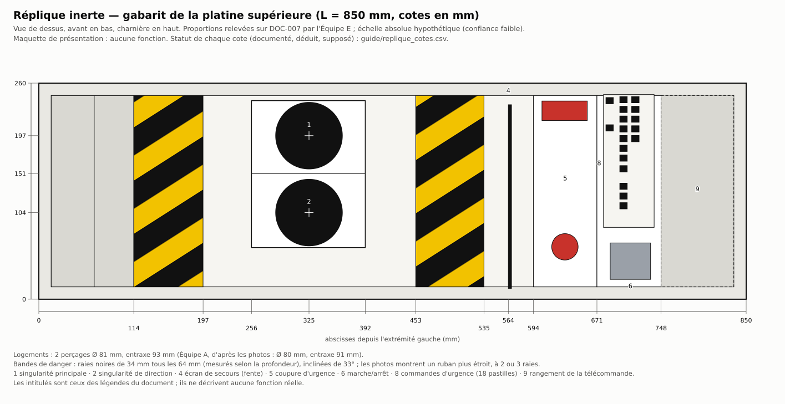
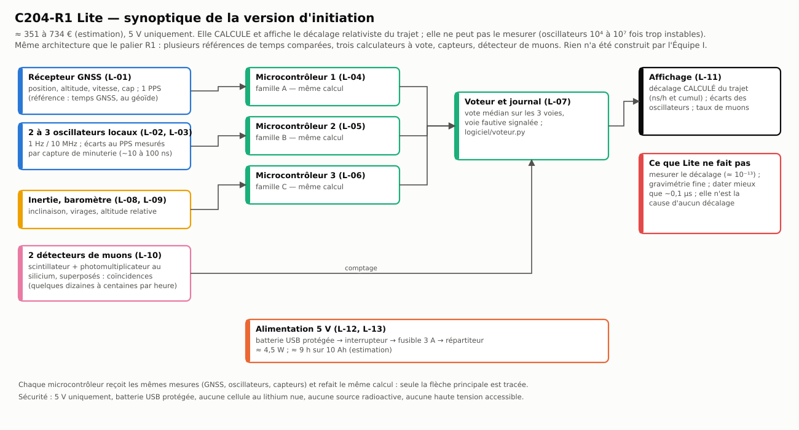
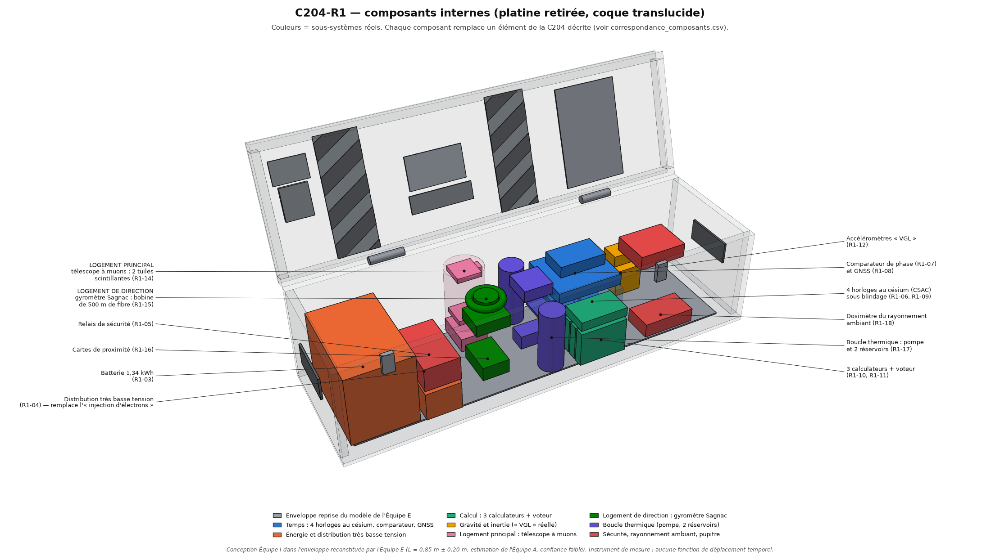
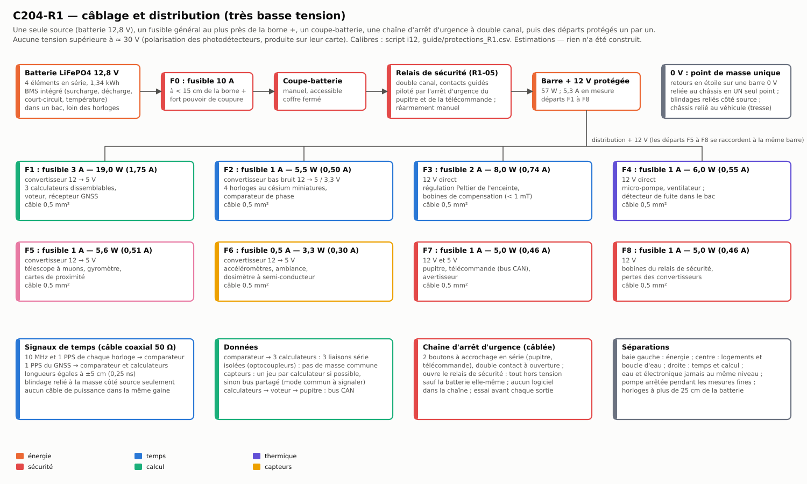

# Guide de construction — ce qui peut réellement être construit autour de la « C204 »

Version 1 — 11 novembre 2026 — Programme C204, Équipe I. Dossier : `10_machine_optimisee/`.

## À lire avant tout

**La machine décrite par les messages « John Titor » ne peut pas être construite.** Son cœur — deux micro-trous
noirs dans un coffre de 227 kg — est exclu par la physique connue (rapports des Équipes B et C du dossier). Ce
guide ne prétend donc pas la reproduire. Il explique comment construire **ce qui peut l'être** :

| | Construction | Ce que l'objet fait | Ce qu'il ne fait pas | Coût (estimation) | Temps (estimation) | Niveau |
|---|---|---|---|---|---|---|
| **A** | Réplique inerte du coffre | rien : maquette de présentation fidèle aux documents | tout le reste | 140 à 240 € | 15 à 25 h | menuiserie légère |
| **B** | C204-R1 Lite | calcule et affiche le décalage relativiste du trajet ; compare des oscillateurs ; fait voter trois calculateurs ; compte des muons cosmiques | mesurer ce décalage ; agir sur le temps | 350 à 730 € (170 à 410 € sans détecteur de muons) | 40 à 80 h | électronique d'amateur |
| **C** | C204-R1 complet | la même chose avec quatre horloges atomiques miniatures, un gyromètre à fibre et une comparaison à mieux que 0,1 ns | mesurer le décalage de son propre trajet sans module externe ; agir sur le temps | ≈ 49 k€ (44 à 64 k€) | 300 à 600 h | confirmé, métrologie |

**Trois vérités à garder en tête du début à la fin :**

1. **Aucun de ces objets ne voyage dans le temps, ni n'y envoie quoi que ce soit.** Ce sont des instruments de
   mesure et de démonstration.
2. **Le seul effet « temporel » réel est infime et n'est pas produit par l'appareil.** Tout objet transporté
   voit son horloge se décaler de l'ordre d'**une nanoseconde par heure** par rapport à une horloge restée au sol
   (0,50 ns/h de moins à 130 km/h vers l'est ; 0,39 ns/h de plus à 1 000 m d'altitude). **Un lest de même masse
   posé à la place de l'appareil subit exactement le même décalage.** Jamais vers le passé : selon le trajet,
   l'objet vieillit un peu moins ou un peu plus que la référence.
3. **Rien de ce qui suit n'a été construit ni essayé par nous.** C'est une étude de conception : coûts, masses,
   durées et performances sont des **estimations** ; attendez-vous à des écarts et à des mises au point.

Seul le logiciel de référence (`logiciel/`) a été exécuté et testé (47 tests, voir §5).

### Règles de sécurité communes aux trois constructions

- **Très basse tension uniquement** : 5 V (construction B), 12,8 V (construction C). Rien au-dessus de 30 V.
  Pas de tube à haute tension, pas de piège électrostatique, pas de canon à électrons.
- **Batterie au lithium** (construction C) : chimie LiFePO4, avec son circuit de protection ; **fusible au plus
  près de la borne positive** ; coupe-batterie accessible ; bac de rétention ; **jamais de charge sans
  surveillance**, ni dans un véhicule fermé au soleil. En B : une batterie USB protégée, aucune cellule nue.
- **Aucune source radioactive.** Les détecteurs comptent le rayonnement naturel (muons cosmiques, fond ambiant).
- **Laser de classe 2 au plus** hors laboratoire ; le gyromètre de la construction C utilise une source
  entièrement fibrée de classe 1.
- **Pas de marquage réglementaire trompeur** : ne collez ni trèfle radioactif, ni plaque de danger normalisée,
  ni mention « explosif » sur un objet qui circule. Marquez « MAQUETTE » ou « INSTRUMENT DE MESURE » sous le
  couvercle. Un coffre à bandes jaunes et noires dans une voiture attire l'attention : prévoyez de l'expliquer.
- En véhicule : arrimage par sangles, jamais sur un siège sans retenue ; pas de manipulation en roulant.

### Conventions

- **[DOC]** lisible sur un document archivé · **[DÉD]** déduit en croisant des documents · **[HYP]** supposé ·
  **[MAQ]** inventé pour la maquette (aucune source). Les « documents » sont des images et des textes anonymes
  de 2000-2001, non authentifiés.
- Repère : origine au coin avant-gauche-bas du corps ; **x** le long du coffre, **y** de l'avant vers la
  charnière, **z** vers le haut. Cotes en millimètres.
- Les chemins de fichiers sont relatifs à ce dossier ; `../02_reconstruction/` et `../06_modele_3D/` sont les
  dossiers des Équipes A et E du même dépôt.

---

## A. Réplique inerte du coffre « C204 »

> Une maquette de présentation : un coffre peint, une platine décorée, deux « logements » ronds, une
> télécommande factice. **Aucune fonction.** Elle peut ensuite servir de boîtier aux constructions B ou C.

### A.1 Ce que montrent les documents

- Un **coffre allongé à couvercle articulé** sur le grand côté arrière [DOC : photos DOC-001 à 004, 013 ; plan
  DOC-007]. Extérieur sombre, au moins deux fermoirs en façade.
- Sur le dessus du corps, de gauche à droite : une zone unie, une **bande de danger**, un cadre contenant
  **deux logements circulaires l'un derrière l'autre** (« MAIN » côté charnière, « STEERING » côté avant), une
  seconde bande, puis un **pupitre** (fente d'écran, bouton rond, pastilles, interrupteur) et un **rangement**
  pour la télécommande.
- À l'intérieur du couvercle : deux bandes de danger, une plaque de texte, trois étiquettes — toutes illisibles.
- Une **télécommande** reliée par un cordon spiralé.
- **Aucune cote ne figure sur les documents.** L'échelle (L = 0,85 m) est une estimation de l'Équipe A, de
  confiance faible (plage 0,60 à 1,15 m).

Plans de l'Équipe A à avoir sous les yeux : `../02_reconstruction/plans/plan_01_vue_dessus.svg`,
`plan_02_vue_face.svg`, `plan_03_vue_cote.svg`, `plan_04_couvercle_ouvert.svg`. Vues 3D de l'Équipe E :
`../06_modele_3D/rendus/`. Gabarit coté de la platine produit pour ce guide :
`schemas/replique_platine_gabarit.svg`.



### A.2 Cotes à L = 0,85 m, et règle de proportion

Toutes les cotes du modèle sont des **proportions** multipliées par la longueur L. Pour une autre longueur :
`python calculs/i11_guide_replique.py 1.00` régénère les trois fichiers (`guide/replique_cotes.csv`,
`guide/replique_debit.csv`, le gabarit). À la main : *cote = rapport × référence*.

| Cote | Valeur à L = 850 | Règle | Statut |
|---|---|---|---|
| Longueur L | 850 | choisie | [HYP] (confiance faible) |
| Profondeur P | 260 | 0,3058 × L | [DOC] proportion (DOC-007) |
| Hauteur du corps | 209 (modèle E) ou 220 (photos, Équipe A) | 0,246 × L, ou 0,85 × P | [DOC] / [DÉD] |
| Profondeur de coque du couvercle | 32 (modèle E) ou 65 (Équipe A) | 0,125 × P, ou 0,25 × P | [DÉD], très incertain |
| Hauteur fermée | 242 ou 285 | somme | [DÉD] |
| Abscisse des deux logements | 325 | 0,382 × L | [DOC] |
| Ordonnée du logement de direction (avant) | 104 | 0,401 × P | [DOC] |
| Ordonnée du logement principal (charnière) | 197 | 0,757 × P | [DOC] |
| Diamètre des logements | 81 (Équipe A : 80) | 0,0952 × L | [DOC] |
| Entraxe des logements | 93 (Équipe A : 91) | 0,356 × P | [DOC] |
| Bandes de danger | de 114 à 197 et de 453 à 535 | 0,134–0,232 et 0,533–0,629 × L | [DOC] ; plus étroites sur les photos |
| Raies des bandes | noires, 34 de large tous les 64, inclinées de 33° | proportions de P | [DOC] ; 2 ou 3 raies sur les photos |
| Cadre des logements | x de 256 à 392 ; y de 62 à 239, séparation à 151 | — | [DOC] |
| Fente de l'écran de secours (4) | x = 564, largeur 4 | 0,664 × L | [DOC] |
| Panneau 5 (coupure d'urgence) | x de 594 à 671 ; bouton rond Ø 32 en (632 ; 63) | — | [DOC] |
| Panneau 8 (pastilles) et interrupteur 6 | x de 671 à 748 | — | [DOC] |
| Rangement 9 | x de 748 à 835, profondeur 85 | — | [DOC] existence, [HYP] profondeur |
| Télécommande | 82 × 86 × 25 (Équipe A : 83 × 119) | 0,0965 × L × 0,1007 × L | [DOC] contour, [HYP] épaisseur |
| Ouverture du couvercle | 108° | — | [DOC] ± 6° |

Les deux équipes divergent de 4 cm sur la hauteur : choisissez, et notez votre choix sur la maquette. Liste
complète (une centaine de cotes, avec source) : `guide/replique_cotes.csv`.

### A.3 Nomenclature (prix : estimations 2026, non vérifiées — `guide/replique_nomenclature.csv`)

| Désignation | Quantité | Ordre de prix | Statut |
|---|---|---|---|
| Contreplaqué de 9 mm (≈ 1,0 m² utile) | 1 panneau de 1 220 × 1 220 | 30–50 € | [MAQ] : le coffre réel n'est pas identifié |
| Contreplaqué ou PVC expansé de 3 mm (≈ 0,25 m²) | 1 | 8–15 € | [MAQ] |
| Tasseaux de 10 × 10 mm | 2,5 m | 4–6 € | [MAQ] |
| Charnières de ≈ 60 mm, ou charnière à piano | 2 | 8–15 € | [DOC] deux charnières sur DOC-007 |
| Fermoirs à levier et poignées encastrées | 2 + 2 | 20–35 € | [DÉD] |
| Compas ou chaînette de retenue du couvercle | 1 | 5–8 € | [MAQ] |
| Apprêt et peinture satinée très sombre | 1 | 15–25 € | [DOC] extérieur sombre ; teinte inconnue |
| Ruban de signalisation jaune et noir de 50 mm | 1 rouleau | 6–10 € | [DOC] |
| Étiquettes imprimées sur papier adhésif | 1 planche | 8–12 € | [DOC] présence ; textes illisibles |
| Pupitre factice (bouton rouge, interrupteur, 18 pastilles, plaquette rouge) | 1 lot | 12–20 € | [DOC] disposition |
| Deux « dômes » noirs à sommet jaune, 60 à 80 mm | 2 | 6–12 € | [DOC] DOC-013 |
| Télécommande : boîtier, clavier 4 × 4 factice, cordon spiralé | 1 | 12–20 € | [DOC] |
| Colle, vis, pâte à bois, abrasifs | 1 lot | 8–12 € | — |
| **Total** | | **≈ 140 à 240 €** | |

Masse de la maquette : 6 à 8 kg (estimation). Le récit annonce 227 kg : la maquette n'essaie pas de les imiter.

### A.4 Outillage

Scie circulaire sur rail ou scie sauteuse (ou débit en magasin) ; perceuse ; **scie cloche ou trépan de 80 mm** ;
serre-joints ; équerre, réglet, compas ; ponceuse ou cale à poncer ; pinceaux ou bombe ; cutter ; lunettes et
masque antipoussière.

### A.5 Liste de débit (`guide/replique_debit.csv`)

| Pièce | Qté | Variante « modèle E » | Variante « photos A » | Épaisseur |
|---|---|---|---|---|
| Corps — fond | 1 | 850 × 260 | 850 × 260 | 9 |
| Corps — grands côtés | 2 | 850 × 200 | 850 × 211 | 9 |
| Corps — extrémités | 2 | 242 × 200 | 242 × 211 | 9 |
| Couvercle — dessus | 1 | 850 × 260 | 850 × 260 | 9 |
| Couvercle — grands côtés | 2 | 850 × 23 | 850 × 56 | 9 |
| Couvercle — extrémités | 2 | 242 × 23 | 242 × 56 | 9 |
| Platine supérieure | 1 | 832 × 242 | 832 × 242 | 3 |
| Rangement 9 — fond et cloison | 1 + 1 | 93 × 242 et 85 × 242 | idem | 3 |
| Tasseaux sous la platine | — | 2,1 m au total | idem | 10 × 10 |

Les côtés reposent sur le fond et sous le dessus (d'où des hauteurs réduites de 9 mm). Surface : ≈ 0,93 à
1,03 m² de 9 mm et 0,24 m² de 3 mm.

### A.6 Étapes

1. **Choisir** L et la variante de hauteur ; régénérer cotes et débit si L ≠ 0,85 m.
2. **Débiter** les panneaux ; repérer chaque pièce au crayon ; poncer les chants.
3. **Assembler le corps** : coller et visser les grands côtés puis les extrémités sur le fond ; vérifier
   l'équerrage par les diagonales (écart < 2 mm).
4. **Assembler le couvercle** de la même façon (boîte peu profonde).
5. **Poser les tasseaux** à l'intérieur du corps, leur dessus à 12 mm + 3 mm sous le bord supérieur : la platine
   affleure alors à 12 mm sous le bord [DÉD : retrait visible sur DOC-004].
6. **Tracer la platine** d'après le gabarit : reporter les abscisses (114, 197, 256, 392, 453, 535, 564, 594,
   671, 748) et les centres des logements (325 ; 104) et (325 ; 197).
7. **Percer les deux logements** au trépan de 80 mm ; ébavurer. Découper l'ouverture du rangement 9
   (de x = 748 au bord droit).
8. **Peindre** corps et couvercle en teinte sombre (apprêt, deux couches) ; platine en gris clair ; cadre des
   logements et panneaux 5 et 8 en blanc cassé.
9. **Poser les bandes de danger** sur la platine (deux) et à l'intérieur du couvercle (deux) : ruban jaune et
   noir, ou raies peintes au pochoir à 33°.
10. **Garnir les logements** : coller sous chaque perçage une coupelle noire, y fixer un dôme noir à sommet
    jaune [DOC : DOC-013]. Aucune pièce mobile, aucun éclairage n'est documenté.
11. **Monter le pupitre factice** : fente noire de 4 mm (écran 4), plaquette rouge et bouton rouge de 32 mm
    (panneau 5), 18 pastilles noires en deux colonnes et deux isolées (panneau 8), interrupteur à bascule (6).
    Rien n'est câblé.
12. **Habiller l'intérieur du couvercle** : plaque de texte (repère 7) à droite, étiquette blanche à liseré rouge
    et étiquette orange au centre, étiquette jaune et petit boîtier gris à gauche. Les textes d'origine étant
    illisibles, laissez-les en faux texte ou écrivez « MAQUETTE — AUCUNE FONCTION ».
13. **Monter le couvercle** : deux charnières sur le chant arrière (vers x = 165–233 et 620–687), compas de
    retenue réglé à 108°, deux fermoirs en façade, deux poignées en bout.
14. **Télécommande** : boîtier de 82 × 86 × 25 mm, clavier 4 × 4 factice, touches rouge et verte, cordon
    spiralé entrant dans le rangement 9.
15. **Finition** : vernis mat ; mention « MAQUETTE » et date sous le couvercle.

### A.7 Points de contrôle

| Contrôle | Critère |
|---|---|
| Rapport longueur / profondeur | 3,27 ± 0,08 (850 / 260) |
| Diagonales du corps | égales à 2 mm près |
| Centres des logements | à ± 1 mm du gabarit ; entraxe 93 ± 1 mm |
| Couvercle | ferme sans jeu, tient ouvert à 108° ± 6° |
| Comparaison visuelle | maquette posée ouverte à côté de `../06_modele_3D/rendus/02_ouvert_aspect.png` |

### A.8 Documenté, déduit, inventé

| Élément | Statut |
|---|---|
| Forme générale, couvercle articulé, proportions en plan, position et taille des logements, bandes, zones du pupitre, plaque 7, télécommande à cordon | **[DOC]** |
| Hauteur du corps, profondeur du couvercle, fermoirs, poignées, dômes des logements | **[DÉD]** |
| Échelle absolue, épaisseur des parois, profondeur du rangement, épaisseur de la télécommande, teintes exactes | **[HYP]** |
| Matériau (contreplaqué), tasseaux, compas, textes des étiquettes, tout ce qui est sous la platine | **[MAQ]** |

Les documents ne montrent **rien de cohérent sous la platine** : la maquette est vide, et c'est exact.

### A.9 Sécurité

Poussières de bois (masque), outils coupants, solvants de peinture (aération). Aucun risque électrique.

---

## B. « C204-R1 Lite » — la version d'initiation

> Même architecture que le palier R1, avec des composants à quelques euros : plusieurs références de temps
> comparées entre elles, trois petits calculateurs qui votent, des capteurs, un détecteur de muons, et un
> afficheur qui montre le **décalage relativiste calculé** du trajet.



### B.1 Ce que cette version fait — et ne peut pas faire

| Elle fait | Elle ne fait pas |
|---|---|
| reçoit position, altitude, vitesse et cap d'un récepteur GNSS | mesurer le décalage relativiste (≈ 10⁻¹³) : un quartz compensé (≈ 2 × 10⁻⁶) est 10⁷ fois trop instable, un oscillateur thermostaté (≈ 10⁻⁹) encore 10⁴ fois |
| **calcule** le décalage du trajet en ns/h et en cumul (`logiciel/decalage_relativiste.py`) | « voir » son propre décalage par le signal PPS : celui-ci est asservi au temps du système de navigation |
| compare 2 ou 3 oscillateurs au signal PPS et montre lequel dérive | dater mieux que ≈ 0,1 µs |
| fait refaire le calcul par trois microcontrôleurs différents et vote (`logiciel/voteur.py`) | tolérer une panne commune aux trois (même alimentation, mêmes capteurs) |
| compte les muons cosmiques en coïncidence (de l'ordre de 100 à 300 par heure, estimation) | démontrer seule la dilatation du temps : il faut comparer deux altitudes pendant des heures |
| mesure inclinaison, virages, altitude barométrique | la moindre gravimétrie fine (résolution ≈ 10⁻³ m/s²) |

Les valeurs entre parenthèses sont des ordres de grandeur de fiches techniques, **non vérifiés par nous**.

### B.2 Nomenclature (`nomenclature_R1_Lite.csv` — prix : estimations 2026)

| Repère | Désignation | Qté | Prix unitaire | Rôle dans l'architecture |
|---|---|---|---|---|
| L-01 | récepteur GNSS à sortie 1 PPS + antenne active | 1 | 20–45 € | référence de temps et de position |
| L-02 | oscillateur à quartz compensé, sortie 1 Hz (module d'horloge temps réel de précision) | 2 | 4–10 € | « horloges » locales à comparer |
| L-03 | oscillateur thermostaté 10 MHz d'occasion (optionnel) | 1 | 15–40 € | troisième référence |
| L-04 à L-06 | trois microcontrôleurs de **familles différentes** | 3 | 5–25 € | trois calculateurs |
| L-07 | nano-ordinateur à carte unique + carte mémoire | 1 | 25–60 € | voteur, journal, affichage |
| L-08 | centrale inertielle à microsystèmes | 1 | 5–20 € | capteurs de gravité, direction |
| L-09 | baromètre numérique | 1 | 4–12 € | altitude |
| L-10 | détecteur de muons (scintillateur 5 × 5 × 1 cm + photomultiplicateur au silicium + carte) | 2 | 90–160 € | logement principal |
| L-11 | afficheur, 3 boutons, 3 voyants, avertisseur | 1 | 10–25 € | pupitre |
| L-12 | batterie USB 5 V protégée, 10 à 20 Ah | 1 | 20–40 € | batterie |
| L-13 | interrupteur général, fusible 3 A, répartiteur 5 V | 1 | 8–15 € | arrêt, distribution |
| L-14 | boîtier ou réplique A, platine, entretoises | 1 | 15–40 € | coffre |
| L-15 | plaques d'essai ou circuit imprimé, connecteurs, câbles | 1 | 25–50 € | câblage |
| | **Total** | | **≈ 350 à 730 €** | ≈ 260 à 570 € avec un seul détecteur ; ≈ 170 à 410 € sans muons |

Le poste « muons » pèse la moitié du budget. Le résumé de l'article qui décrit ce type de détecteur (Axani,
Frankiewicz & Conrad 2018, arXiv:1801.03029, vérifié) annonce moins de 100 dollars de matériel par détecteur ;
les prix de 2026 n'ont pas été vérifiés.

Consommation : ≈ 4,5 W (estimation), soit ≈ 9 h sur une batterie USB de 10 Ah.

### B.3 Outillage

Fer à souder à température réglée, multimètre, pince à dénuder, plaque d'essai, ordinateur ; un oscilloscope
(même modeste) aide beaucoup pour le PPS et les impulsions des détecteurs.

### B.4 Étapes

1. **Lire `logiciel/LISEZMOI.md` et lancer les tests** sur votre ordinateur : vous saurez ce que chaque
   calculateur doit reproduire.
2. **Alimentation** : batterie USB → interrupteur → fusible 3 A → répartiteur 5 V. Vérifier 5,0 ± 0,25 V à vide
   et en charge. *Contrôle : aucun échauffement, coupure franche à l'interrupteur.*
3. **Récepteur GNSS** : alimenter, placer l'antenne sous le ciel, attendre le point. Relier la sortie série au
   nano-ordinateur ; observer le PPS (une impulsion par seconde). *Contrôle : position stable à quelques mètres.*
4. **Oscillateurs** : alimenter les deux modules à quartz compensé (et l'oscillateur thermostaté s'il y en a
   un), sortir leur signal à 1 Hz ou le diviser.
5. **Mesure des écarts** : sur un microcontrôleur, dater par capture de minuterie chaque front du PPS et de
   chaque oscillateur ; publier chaque seconde les écarts oscillateur − PPS. *Contrôle : écarts qui dérivent
   régulièrement (quelques microsecondes par seconde au plus pour un quartz à 2 × 10⁻⁶).*
6. **Trois calculateurs** : programmer sur les trois microcontrôleurs la même formule (fonction `taux` de
   `decalage_relativiste.py`, 15 lignes) à partir des mêmes trames GNSS. *Contrôle : chacun reproduit les
   scénarios de référence, par exemple −0,5013 ns/h pour 130 km/h plein est à 45° de latitude.*
7. **Voteur** : sur le nano-ordinateur, lire les trois résultats et appliquer `voteur.py` (vote médian, tolérance
   de 0,001 ns/h). *Contrôle : débrancher un calculateur → mode dégradé ; forcer une valeur fausse → voie
   désignée, sortie inchangée.*
8. **Capteurs** : relier centrale inertielle et baromètre ; afficher inclinaison et altitude relative.
   *Contrôle : + 3 m en montant un étage, à 1 m près.*
9. **Détecteurs de muons** : monter les deux détecteurs, les superposer à 5 ou 10 cm, câbler la coïncidence.
   *Contrôle : quelques coups par minute chacun, coïncidences bien plus rares ; presque plus aucune si l'on
   écarte les deux détecteurs côte à côte de 30 cm.*
10. **Affichage** : décalage calculé (taux et cumul depuis le départ), sens (« vieillit moins / plus »), écarts
    des oscillateurs, voie fautive éventuelle, taux de muons.
11. **Intégration** dans le boîtier ou la réplique : détecteurs sous le logement arrière, antenne au-dessus,
    batterie à part, câbles de PPS courts.
12. **Essais** (§B.5), puis une sortie : un trajet routier avec enregistrement de la trace, rejouée ensuite par
    `decalage_relativiste.py --trace`.

### B.5 Essais et critères

| Essai | Méthode | Critère (estimations) |
|---|---|---|
| Calcul | rejouer `logiciel/exemples/trace_route_est_1h.csv` | −0,501 ns en une heure, à 1 % près, sur les trois voies |
| Vote | injecter une erreur sur une voie, puis sur deux | une voie : sortie correcte et voie désignée ; deux voies : sortie invalide signalée |
| Oscillateurs | 24 h immobile | écart linéaire dans le temps ; pente = écart de fréquence de chaque oscillateur |
| Aberration | chauffer légèrement un oscillateur | il est désigné par la comparaison aux deux autres |
| Muons | 2 × 12 h à deux altitudes différentes (si possible > 1 000 m d'écart) | taux plus élevé en altitude, d'un facteur de l'ordre de 1,2 à 1,5 pour 1 000 m — **sans dilatation du temps, le facteur dépasserait 4,6** |
| Témoin | 24 h immobile | décalage calculé nul |

### B.6 Sécurité

5 V uniquement ; batterie USB protégée (aucune cellule nue) ; fusible 3 A ; pas de source radioactive ; la
polarisation des photomultiplicateurs au silicium (≈ 30 V, quelques microampères) est produite sur la carte du
détecteur et reste enfermée. Tenir les scintillateurs à l'abri de la lumière (ruban noir), sans les chauffer.

### B.7 Limites à dire à qui regarde l'appareil

L'afficheur montre un nombre **calculé** à partir de la position et de la vitesse. Aucun composant de cette
version ne peut le vérifier par une mesure. Et ce nombre vaudrait autant pour un sac de sable posé à côté.

---

## C. « C204-R1 » complet

> La version décrite dans `RAPPORT_I.md` (§3) et chiffrée dans `nomenclature_R1.csv` : 27 lignes, 35,7 kg,
> 57 W, ≈ 49 k€ en configuration « coffre seul ». Ce budget est dominé par les quatre horloges atomiques
> miniatures (≈ 24 k€) et les accéléromètres (≈ 9 k€).

**Avant d'engager cette dépense, lisez ceci.** La version complète ne mesure toujours pas le décalage de son
propre trajet : ses quatre horloges au césium miniatures sont environ 500 fois trop bruitées pour cela. Elle
date mieux (≈ 1 µs sur 48 h), compare ses horloges à mieux que 0,1 ns, mesure la rotation et la pesanteur plus
finement, mais le résultat affiché reste **calculé**. La mesure exige un module externe (trois étalons à jet de
césium de 30 kg chacun, hors coffre) **et** une référence restée au sol : ≈ 394 k€ embarqués, ≈ 634 k€ au
total (voir §C.11). Si votre but est d'apprendre ou de montrer, la version B suffit.



### C.1 Sous-ensembles

| N° | Sous-ensemble | Lignes de nomenclature | Masse | Puissance | Coût (estimation) |
|---|---|---|---|---|---|
| SE1 | Coffre et châssis amorti | R1-01, R1-02 | 13 kg | — | 1,0 k€ |
| SE2 | Énergie : batterie, distribution | R1-03, R1-04 | 10,7 kg | 4 W | 0,75 k€ |
| SE3 | Sécurité : coupe-batterie, relais à double canal, arrêt d'urgence | R1-05 | 0,6 kg | 1 W | 0,25 k€ |
| SE4 | Temps : 4 horloges miniatures au césium, comparateur de phase, GNSS, enceinte blindée et régulée | R1-06 à R1-09 | 2,4 kg | 15,5 W | 29,7 k€ |
| SE5 | Calcul : 3 calculateurs dissemblables, voteur matériel | R1-10, R1-11 | 1,05 kg | 17 W | 1,25 k€ |
| SE6 | Gravité et ambiance : accéléromètres à quartz, baromètre, magnétomètre | R1-12, R1-13 | 0,8 kg | 3 W | 10,5 k€ |
| SE7 | Logement principal : télescope à muons | R1-14, R1-16 | 0,6 kg | 1,6 W | 0,75 k€ |
| SE8 | Logement de direction : gyromètre Sagnac à fibre | R1-15, R1-16 | 0,75 kg | 4 W | 2,8 k€ |
| SE9 | Thermique : pompe, 2 réservoirs, plaque froide, ventilateur | R1-17 | 1,6 kg | 6 W | 0,35 k€ |
| SE10 | Rayonnement ambiant : dosimètre à semi-conducteur | R1-18 | 0,3 kg | 0,3 W | 0,5 k€ |
| SE11 | Commande : pupitre, télécommande, câblage | R1-19 à R1-21 | 3,9 kg | 5 W | 1,1 k€ |

### C.2 Outillage

Celui de la construction B, plus : oscilloscope 200 MHz ou compteur d'intervalles de temps, alimentation de
laboratoire limitée en courant, pince à sertir, clé dynamométrique pour les cosses de batterie, soudeuse ou
connecteurs de fibre optique pour le gyromètre, thermomètres de contact, et — pour qualifier les horloges —
l'accès à une référence de fréquence (récepteur GNSS de temps, ou laboratoire).

### C.3 Ordre de montage

1. **Recevoir et qualifier chaque sous-ensemble sur table**, alimentation de laboratoire limitée en courant :
   on n'intègre rien qui n'ait fonctionné seul.
2. **SE1** : coffre (ou réplique A renforcée), châssis sur plots amortisseurs, bac de rétention de la batterie,
   passages de câbles ; platine supérieure découpée aux deux logements.
3. **SE2 + SE3 hors batterie** : barre + 12 V, barre 0 V, porte-fusibles F1 à F8, relais de sécurité, boutons
   d'arrêt ; essai avec l'alimentation de laboratoire à la place de la batterie.
4. **Batterie** : pose dans son bac, fusible F0 **à moins de 15 cm de la borne +**, coupe-batterie ; cosses
   serrées au couple, capots isolants. La batterie est raccordée **en dernier** et déposée **en premier**.
5. **SE9** : plaque froide, réservoirs, pompe ; essai d'étanchéité **à l'eau claire, électronique absente**,
   pendant 24 h.
6. **SE4** : enceinte en mu-métal sur la plaque froide, quatre horloges, comparateur ; câbles coaxiaux de même
   longueur à ± 5 cm.
7. **SE5** : trois calculateurs sur trois convertisseurs distincts, liaisons isolées, voteur.
8. **SE6, SE10** sous le pupitre ; **SE7** sous le logement principal (tuiles à 10 cm l'une de l'autre) ;
   **SE8** sous le logement de direction (bobine horizontale, axe vertical).
9. **SE11** : pupitre, télécommande, câblage final, étiquetage de chaque câble aux deux bouts.
10. **Essais de recette** (§C.8), puis fermeture.

### C.4 Implantation dans le coffre (L = 0,85 m — `guide/implantation_R1.csv`, `modele_c204_R1.json`)

Volume intérieur ≈ 35 L, occupé à 31 % ; aucune interpénétration (contrôle automatique du modèle).

| Zone (abscisses) | Contenu | Centre (x ; y ; z) | Encombrement |
|---|---|---|---|
| Baie gauche, 15–245 | batterie | (90 ; 130 ; 87) | 130 × 200 × 150 |
| | distribution, convertisseurs | (200 ; 115 ; 42) | 70 × 180 × 60 |
| | coupe-batterie, relais de sécurité | (200 ; 85 ; 105) | 70 × 120 × 50 |
| Logements, 256–392 | logement **principal** (arrière) : tuiles scintillantes à z = 75 et 175, carte de comptage dessous | (325 ; 197) | tube Ø 78 × 125 |
| | logement **de direction** (avant) : bobine de fibre à z = 172, boîtier optique à z = 130, carte dessous | (325 ; 104) | bobine Ø 76 |
| Boucle d'eau, 400–470 | réservoirs (432 ; 50) et (432 ; 210), pompe et échangeur (432 ; 130) | — | réservoirs Ø 50 × 130 |
| Temps, 480–620 | enceinte des 4 horloges | (550 ; 165 ; 58) | 140 × 140 × 80 |
| | comparateur de phase, puis GNSS au-dessus | (550 ; 165 ; 114 et 150) | 140 × 120 × 25 |
| Calcul, 480–580 | 3 calculateurs debout, voteur au-dessus | (530 ; 30, 52, 74 ; 50) | 100 × 18 × 75 chacun |
| Sous le pupitre, 630–745 | accéléromètres | (685 ; 200 ; 45) | 60 × 60 × 60 |
| | dosimètre | (690 ; 60 ; 30) | 110 × 60 × 30 |
| | électronique de façade | (690 ; 110 ; 165) | 100 × 80 × 30 |
| Rangement 9, 749–835 | télécommande | — | — |

Règles d'implantation : batterie d'un côté, horloges de l'autre (plus de 25 cm) ; eau et électronique jamais au
même niveau ni dans le même compartiment ; pompe coupée pendant les mesures fines ; rien au-dessus des tuiles
scintillantes que la platine et le couvercle.

Si votre coffre mesure 1,00 m ou plus, le gravimètre optionnel de classe microgal se range à l'intérieur ; en
dessous de 0,70 m, la batterie de 1,34 kWh n'entre plus (`encombrement_selon_L.csv`). Autres vues :
`modele_R1/rendus/R1_04_dessus.png`, `R1_05_face.png`, `R1_03_eclate.png`.

### C.5 Câblage et distribution



Départs et protections (`guide/protections_R1.csv` ; calibre ≥ 1,6 × courant nominal ; sections indicatives, à
vérifier selon la norme applicable chez vous) :

| Repère | Départ | Puissance | Courant côté batterie | Fusible | Câble |
|---|---|---|---|---|---|
| **F0** | général, à moins de 15 cm de la borne + (fort pouvoir de coupure) | 57 W | 5,3 A | **10 A** | 1,5 mm² au minimum, 2,5 mm² conseillé |
| F1 | 3 calculateurs, voteur, GNSS | 19,0 W | 1,75 A | 3 A | 0,5 mm² |
| F2 | 4 horloges, comparateur (rail à faible bruit) | 5,5 W | 0,50 A | 1 A | 0,5 mm² |
| F3 | enceinte des horloges (Peltier, bobines) | 8,0 W | 0,74 A | 2 A | 0,5 mm² |
| F4 | pompe, ventilateur | 6,0 W | 0,55 A | 1 A | 0,5 mm² |
| F5 | logements (muons, gyromètre) | 5,6 W | 0,51 A | 1 A | 0,5 mm² |
| F6 | capteurs, dosimètre | 3,3 W | 0,30 A | 0,5 A | 0,5 mm² |
| F7 | pupitre, télécommande | 5,0 W | 0,46 A | 1 A | 0,5 mm² |
| F8 | relais de sécurité, pertes | 5,0 W | 0,46 A | 1 A | 0,5 mm² |

Signaux : 10 MHz et 1 PPS en câble coaxial 50 Ω, longueurs égales (5 cm = 0,25 ns) ; liaisons série isolées
entre comparateur et calculateurs ; bus CAN vers le pupitre et la télécommande. Schéma fonctionnel :
`schemas/schema_fonctionnel_R1.svg`.

### C.6 Mise à la masse et protections

- **Un seul point de masse** : tous les retours vont en étoile à la barre 0 V, reliée au châssis en un seul
  endroit. Pas de boucle de masse par les blindages : chaque blindage n'est relié que du côté de la source.
- **Fusible général au plus près de la batterie** : une batterie de cette taille peut débiter des milliers
  d'ampères en court-circuit ; le fusible F0 protège le câble, il doit donc précéder tout le reste.
- **Arrêt d'urgence câblé, sans logiciel** : deux boutons à accrochage en série, relais de sécurité à double
  canal et réarmement manuel. À l'ouverture, tout est hors tension sauf la batterie elle-même : contrairement à
  la machine du récit, l'appareil a un **état sûr réel**.
- Protection contre l'inversion de polarité et écrêteur de surtension sur la barre + 12 V ; convertisseurs
  isolés pour les trois calculateurs.
- Champ magnétique : les horloges miniatures y sont sensibles (ordre de 10⁻¹⁰ par gauss, estimation) ; d'où le
  blindage, et l'interdiction de tout aimant permanent dans le coffre.
- Châssis relié à la masse du véhicule par une tresse, coffre arrimé par quatre sangles.

### C.7 Intégration thermique

57 W dans un coffre de 0,76 m² utile : + 9 K au-dessus de l'ambiance en régime établi (calcul, 8,5 W/m²/K), soit
≈ 29 °C pour 20 °C. La boucle d'eau glycolée (0,5 L) sert d'inertie et porte la chaleur de l'enceinte des
horloges vers l'échangeur ; le ventilateur rejette de l'air tiède par une ouïe. Objectif : enceinte des horloges
stable à ± 0,1 K. Ne pas laisser le coffre en plein soleil dans un habitacle fermé : ni les horloges ni la
batterie ne sont prévues au-delà de 45–50 °C. Une variante sans eau (caloducs et ventilateur) est acceptable et
plus simple ; elle perd la ressemblance avec « la pompe et les deux réservoirs » du document, rien d'autre.

### C.8 Mise en route

1. Coupe-batterie ouvert, arrêt d'urgence enfoncé. Contrôle visuel, serrages, absence d'outil oublié.
2. Mesure à l'ohmmètre entre barre + et barre 0 V : pas de court-circuit.
3. Fermer le coupe-batterie : seule la chaîne de sécurité est alimentée.
4. Réarmer : départs un par un (retirer puis remettre les fusibles F1 à F8), en relevant chaque courant.
5. Attendre le verrouillage des quatre horloges et du GNSS (quelques minutes) ; laisser stabiliser l'enceinte
   une heure.
6. Lancer l'auto-test : vote des calculateurs, écarts des horloges, comptage des muons, rotation mesurée.
7. Saisir le scénario à la télécommande (altitude et latitude de référence) et démarrer l'enregistrement.

### C.9 Essais de recette, un par un

| N° | Essai | Méthode | Critère d'acceptation (estimations) |
|---|---|---|---|
| R-01 | Isolement | ohmmètre, batterie débranchée | > 10 kΩ entre + 12 V et 0 V à vide ; continuité 0 V–châssis en un seul point |
| R-02 | Arrêt d'urgence | appui sur chaque bouton, en charge | tous les rails à 0 V en moins d'une seconde ; pas de réarmement sans action manuelle |
| R-03 | Courants des départs | pince ou shunt | chacun à ± 30 % de `guide/protections_R1.csv`, et < 60 % du calibre de son fusible |
| R-04 | Consommation et autonomie | décharge surveillée | 57 W ± 20 % ; ≥ 17 h en mesure |
| R-05 | Thermique | 6 h à 20 °C | + 9 K ± 3 K sur les parois ; enceinte des horloges à ± 0,1 K |
| R-06 | Étanchéité | 24 h, papier absorbant sous la boucle | aucune trace |
| R-07 | Bruit du comparateur | même signal sur deux voies | écart-type < 0,1 ns |
| R-08 | Horloges | 72 h, écarts deux à deux, écart-type d'Allan | ≤ 4 × 10⁻¹⁰ à 1 s ; aucune horloge désignée par `ensemble_horloges.py` avec étalonnage |
| R-09 | Détection d'une horloge fautive | décaler volontairement une horloge | désignée, exclue, le temps d'ensemble ne saute pas |
| R-10 | GNSS | ciel dégagé | PPS présent ; altitude stable à ± 10 m |
| R-11 | Vote | erreur injectée sur une voie, puis deux | une : sortie juste, voie désignée ; deux : état sûr |
| R-12 | Calcul | rejouer les deux traces de `logiciel/exemples/` | −0,501 ns (route, 1 h) et + 18,04 ns (montée, 48 h), à 1 % près |
| R-13 | Accéléromètres | retournement en six positions | module de g constant à 10⁻⁴ m/s² près après étalonnage |
| R-14 | Gyromètre | coffre immobile, puis plateau tournant | rotation terrestre verticale 10,6 °/h à 45° de latitude, à ± 20 % |
| R-15 | Muons | 24 h | ≈ 127 coïncidences par heure à ± 30 % ; taux quasi nul tuiles écartées |
| R-16 | Dosimètre | 24 h | fond ambiant plausible (0,05 à 0,3 µSv/h) |
| R-17 | Témoin nul | 48 h immobile près de la référence | décalage calculé nul ; écarts d'horloges dans leur bruit |
| R-18 | Sortie en altitude | 24 h en plaine, 24 h à + 2 000 m | rapport des taux de muons de l'ordre de 1,3 à 2 — très loin du facteur ≥ 21 attendu sans dilatation du temps |

Déposez vos prédictions par écrit avant chaque essai, et faites dépouiller les données par quelqu'un qui ignore
le scénario (protocole de la fiche EXP-12 de l'Équipe F). Un résultat conforme confirme la relativité, rien
d'autre.

### C.10 Pannes fréquentes (attendues ; aucune n'a été observée, puisque rien n'a été construit)

| Symptôme | Cause probable | Remède |
|---|---|---|
| Une horloge est « désignée » en permanence | écart de fréquence permanent pris pour une panne | fournir une période d'étalonnage au détecteur ; vérifier la température de l'enceinte |
| Les écarts d'horloges sautent de quelques nanosecondes | boucle de masse, câble coaxial pincé, connecteur desserré | masse en étoile ; resserrer ; éloigner des convertisseurs |
| Écarts qui oscillent avec la pompe | couplage thermique ou vibratoire | pompe à l'arrêt pendant les mesures ; plots amortisseurs |
| Les trois calculateurs sont d'accord sur une valeur absurde | panne de mode commun : même trame GNSS erronée | contrôle de vraisemblance en amont ; capteurs indépendants par voie |
| Désaccord entre calculateurs à la dernière décimale | arithmétique flottante différente d'une famille à l'autre | tolérance du vote médian (0,001 ns/h), ou calcul en virgule fixe |
| Coïncidences de muons trop nombreuses | fuite de lumière sur un scintillateur, seuil trop bas | étanchéité au ruban noir ; relever le seuil |
| Aucune coïncidence | tuiles non alignées, fenêtre de coïncidence trop courte | réaligner ; élargir à ≈ 100 ns |
| Le gyromètre dérive | gradient thermique dans la bobine | isoler la bobine ; attendre l'équilibre ; moyenner |
| Altitude qui dérive sans bouger | variation de pression atmosphérique | recaler sur le GNSS ; c'est normal |
| Le fusible F0 fond à la fermeture | appel de courant des convertisseurs | pré-charge par résistance ; fusible temporisé du même calibre |
| Coffre trop chaud | ouïe obstruée, soleil | dégager ; ombre ; mode transport (30 W) |

### C.11 Aller jusqu'à la mesure : la configuration B (hors coffre)

Pour **mesurer** les 19 ns d'un séjour de 48 h à + 1 000 m il faut, en plus du coffre : trois étalons à jet de
césium emportés (165 kg avec leur batterie et leur baie, ≈ 245 k€) et une référence restée au départ — trois
étalons identiques (≈ 240 k€, 90 kg) ou un lien de temps étalonné vers un laboratoire (≈ 15 k€, bruit estimé de
0,2 à 1 ns, non vérifié). Rapport signal sur bruit attendu : 6 à 8. Ces étalons mesurent 425 mm de large : ils
n'entrent dans le coffre à aucune échelle plausible. C'est un projet de laboratoire, pas d'amateur.

### C.12 Sécurité

Règles communes (début du guide), plus : batterie de 1,34 kWh — c'est le principal danger de l'appareil ; eau
glycolée à ne pas répandre ; charges de 36 kg à porter à deux ; fibre optique : ne jamais regarder une
extrémité de fibre alimentée, même en classe 1 ; aucune intervention sous tension sur la distribution.

---

## 5. Le logiciel de référence (`logiciel/`)

| Fichier | Rôle |
|---|---|
| `decalage_relativiste.py` | décalage cumulé et taux le long d'une trace ; scénarios du rapport en cas de test |
| `voteur.py` | vote majoritaire et médian sur trois voies, désignation de la voie fautive, état sûr |
| `ensemble_horloges.py` | comparaison de quatre horloges simulées, exclusion d'une horloge aberrante |
| `tests/` | 47 tests ; `exemples/` : deux traces |

```sh
cd logiciel
python3 decalage_relativiste.py --scenarios
python3 decalage_relativiste.py --trace exemples/trace_montee_1000m.csv
python3 -m unittest discover -s tests -v
```

Résultat des tests (11 novembre 2026) : **47 tests, tous réussis** avec Python 3.12 et numpy ; 36 réussis et un
module ignoré avec un Python sans numpy. Les valeurs recoupent le script `calculs/i01_deplacement_temporel.py`
du dossier à 10⁻⁹ près, ainsi que trois repères connus (GPS + 38,6 µs par jour, « Project GREAT » 22 ns,
Hafele-Keating). Détail : `logiciel/LISEZMOI.md`.

Ce logiciel n'a pas été porté sur les microcontrôleurs du guide : il sert de référence pour ce portage.

---

## 6. Ce que vous aurez construit

**Un instrument de mesure et de démonstration — pas une machine à voyager dans le temps.**

- Avec **A**, un objet de présentation qui montre honnêtement ce que les documents décrivent, et le vide qu'ils
  laissent sous la platine.
- Avec **B**, un appareil qui affiche en direct le décalage relativiste de votre trajet, **calculé** : de
  l'ordre de **0,5 nanoseconde par heure** sur autoroute vers l'est, **0,4 nanoseconde par heure** par
  kilomètre d'altitude. Il faut un peu plus de deux cents ans de route ininterrompue pour accumuler une
  milliseconde.
- Avec **C**, le même appareil avec des horloges atomiques, capable de dater et de comparer finement — et, avec
  un module de laboratoire hors coffre, de **mesurer** une vingtaine de nanosecondes après deux jours en
  montagne.

Dans les trois cas : **l'appareil n'est pas la cause du décalage. Un lest de même masse, posé à sa place, subit
exactement le même.** Ce décalage ne va jamais vers le passé : selon le trajet, on vieillit un peu moins ou un
peu plus que celui qui est resté sur place. Entre ce chiffre et les « dix ans par heure » du récit, il y a près
de dix-huit ordres de grandeur, et aucune amélioration de l'appareil ne les comble : ils tiennent à la physique,
pas à la construction.

---

## 7. Limites de ce guide

1. **Rien n'a été construit ni essayé.** Chaque étape est une proposition raisonnée ; aucune n'a été éprouvée.
2. **Prix, masses, durées, performances : estimations**, sans devis. Les seules données d'instruments relues
   sur fiche (par l'Équipe C) concernent l'horloge miniature au césium, l'étalon à jet de césium et le
   gravimètre relatif.
3. **Échelle du coffre** : L = 0,85 m ± 0,20 m, confiance faible ; deux hauteurs possibles.
4. **Aucun micrologiciel n'est fourni** pour les microcontrôleurs : seulement la référence en Python.
5. **Aucun schéma électronique de détail** (cartes, brochages) : le guide donne l'architecture, les départs et
   les protections. Les sections de câble et les calibres sont indicatifs : appliquez les règles en vigueur
   chez vous.
6. **Détecteur de muons** : taux et rapports selon l'altitude sont des ordres de grandeur ; le détecteur est un
   démonstrateur pédagogique, pas une mesure de la relativité.
7. Ce guide n'est pas un document de sécurité : en cas de doute sur une batterie ou un montage, faites-vous
   aider par une personne qualifiée.

## Fichiers du guide

| Fichier | Contenu |
|---|---|
| `guide/replique_cotes.csv`, `replique_debit.csv`, `replique_nomenclature.csv` | cotes, débit et nomenclature de la réplique (script `calculs/i11_guide_replique.py`) |
| `schemas/replique_platine_gabarit.svg` | gabarit coté de la platine |
| `nomenclature_R1_Lite.csv`, `schemas/synoptique_R1_Lite.svg` | version d'initiation |
| `nomenclature_R1.csv`, `modele_c204_R1.json`, `modele_R1/rendus/` | version complète |
| `guide/implantation_R1.csv`, `guide/protections_R1.csv`, `schemas/cablage_distribution_R1.svg` | implantation, départs, câblage (script `calculs/i12_guide_lite_cablage.py`) |
| `guide/synthese_constructions.csv` | coûts et durées des trois constructions |
| `logiciel/` | logiciel de référence et tests |
| `RAPPORT_I.md` | l'étude de conception dont ce guide découle |
