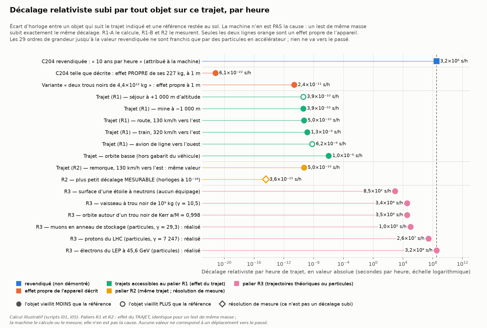
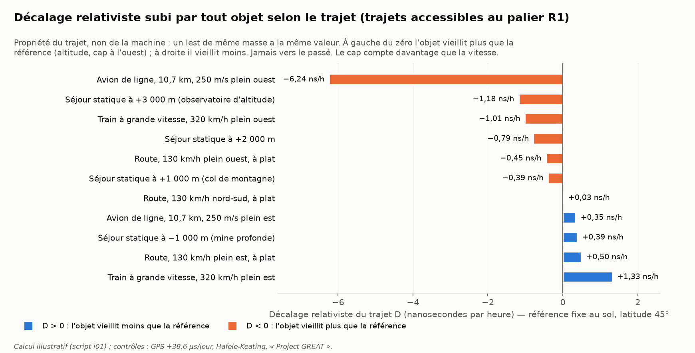
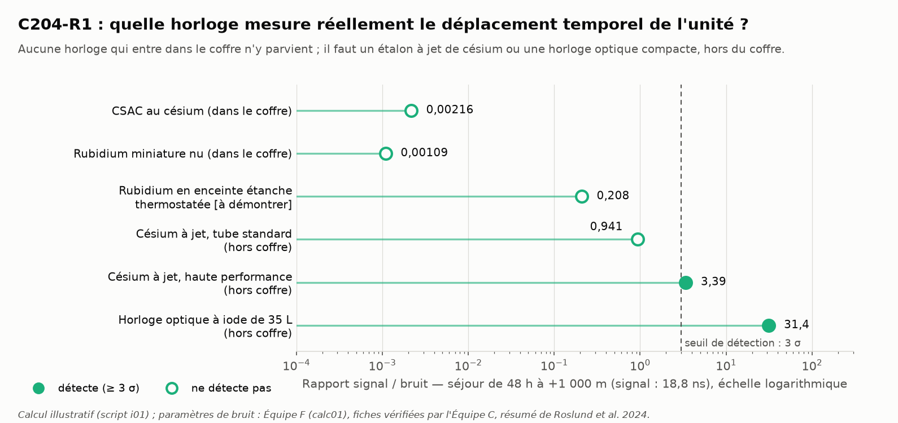
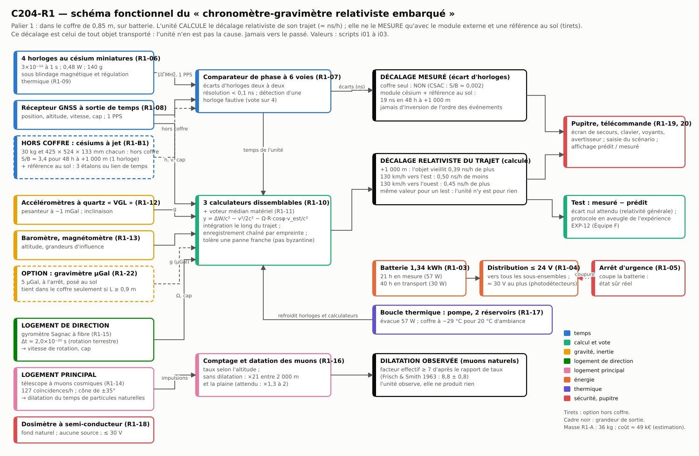
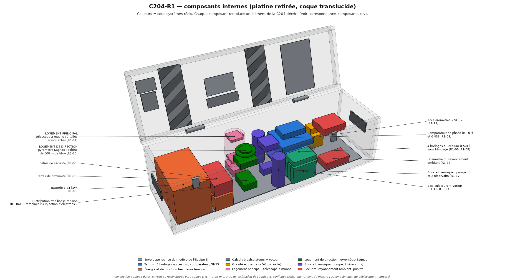
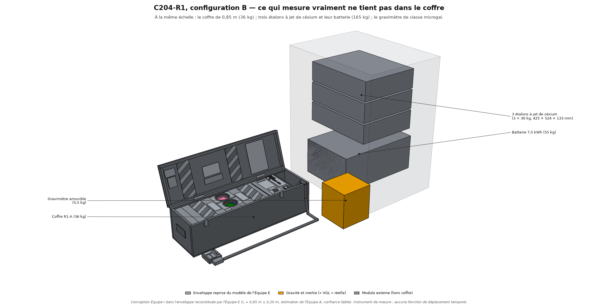
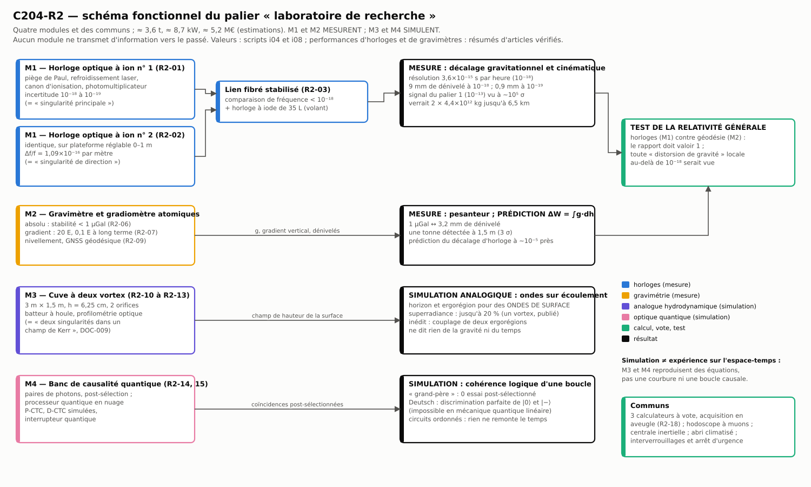
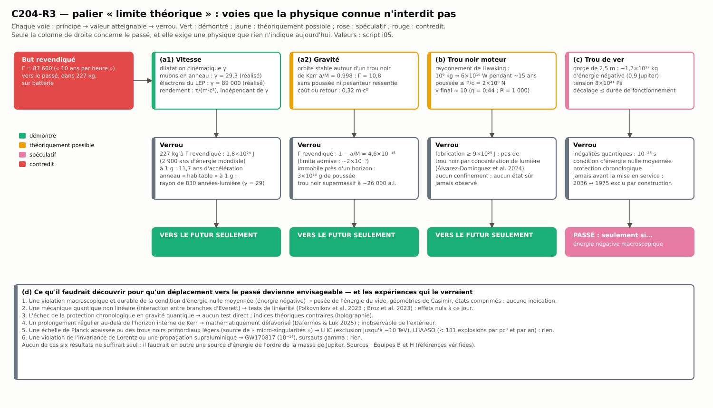
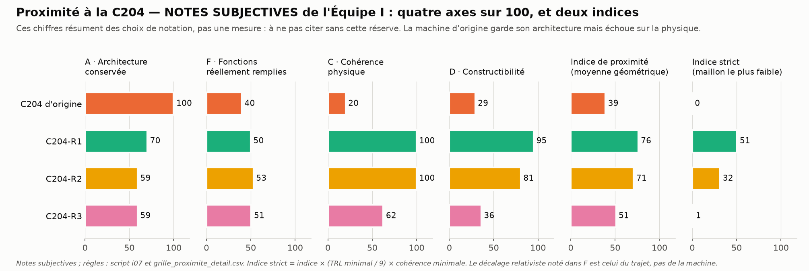

# Programme C204 — Rapport de l'Équipe I (Phase 6 : machine optimisée)

Version 1.1 — 10 novembre 2026 (v1 + corrections post-validation I-1 à I-5, journal au §12). Dossier : `10_machine_optimisee/`.

> **Cadre.** Aucune affirmation de « John Titor » n'est tenue pour vraie. Ce rapport ne cherche pas à « faire
> marcher » la C204 : les Équipes B et C ont établi que son cœur (deux micro-trous noirs dans 227 kg) est
> impossible. Il répond à une autre question : **quelle est la machine la plus proche de la C204 que les
> connaissances actuelles permettraient de construire, en gardant l'architecture et en remplaçant chaque
> mécanisme impossible par un mécanisme réel ?**
>
> **Honnêteté.** Aucune des variantes décrites ici ne permet un voyage vers le passé. Chacune est présentée par
> ce qu'elle *fait* (une grandeur mesurable, chiffrée) et par ce qu'elle *ne fait pas*.

Conventions du dossier de base : **[DOC]** documenté · **[DÉD]** déduit · **[HYP]** hypothèse de notre part ·
**[VÉR]** vérifiable indépendamment. Statut physique : Démontré / Théoriquement possible / Spéculatif / Contredit.
Tous les chiffres viennent des scripts `calculs/i01` à `i10` (sorties dans `calculs/resultats/`) ; les valeurs
d'instruments non relues en ligne sont marquées « estimation ».

---

## 0. Résumé

1. **La machine la plus proche réellement constructible est un instrument de mesure, pas un véhicule temporel.**
   Le palier 1 (C204-R1) loge dans le coffre de 0,85 m tous les sous-systèmes « classiques » du récit — quatre
   horloges au césium, trois calculateurs à vote, capteurs de gravité, batterie, télécommande, arrêt d'urgence,
   boucle à pompe et deux réservoirs — et remplace les deux « singularités » par deux démonstrateurs réels.
   Il pèse **36 kg**, consomme **57 W**, coûte environ **49 k€** (estimation).
2. **Le décalage relativiste que subit l'unité est réel et infime — et elle n'en est pas la cause.** C'est celui
   de *tout objet* qui suit le même trajet : un lest de même masse a exactement la même valeur. Il vaut de
   **0,4 à 1,3 nanoseconde par heure** selon le trajet (0,50 ns/h de moins que la référence à 130 km/h vers
   l'est ; 1,33 ns/h de moins en train à 320 km/h vers l'est ; 0,39 ns/h de moins au fond d'une mine de 1 000 m).
   **Jamais vers le passé : selon le trajet, l'unité vieillit un peu moins ou un peu plus que la référence**
   (0,39 ns/h de plus à +1 000 m ; 6,2 ns/h de plus en avion vers l'ouest). C'est **17,8 ordres de grandeur**
   sous les « 10 ans par heure » revendiqués (3,2 × 10⁸ s/h). Ce que R1 apporte en propre : il *calcule* ce
   décalage, il compte des muons et, avec un module externe, il le *mesure*.
3. **Critique de l'idée directrice : le coffre seul ne peut pas *mesurer* le décalage de son propre trajet.** Les seules
   horloges atomiques qui y entrent (horloges miniatures au césium) ont un rapport signal/bruit de 0,002 sur un
   séjour de 48 h à +1 000 m. Il faut un étalon à jet de césium (S/B ≈ 3,4) ou une horloge optique compacte
   (S/B ≈ 31), et **aucun des deux n'entre dans le coffre, quelle que soit l'échelle entre 0,60 et 1,20 m** (il
   faudrait L ≥ 1,55 m). Le coffre seul *calcule* ce décalage à ~1 % près ; il ne le *mesure* qu'avec un
   module externe (configuration R1-B, 206 kg embarqués, ≈ 394 k€) **et une référence restée au sol** : trois
   autres étalons (≈ 240 k€, 90 kg hors véhicule) ou un lien de temps étalonné (≈ 15 k€, estimation).
4. **Les deux « singularités » sont remplacées** par un **télescope à muons cosmiques** (logement principal : il
   observe une dilatation du temps d'un facteur ≳ 7 à 40 sur des particules naturelles, à travers un cône
   d'acceptance qui prend la place de l'« évent à rayons X ») et par un **gyromètre Sagnac à fibre** (logement de
   direction : il mesure un décalage temporel réel dû à la rotation et donne le cap, qui fixe le *signe* du
   décalage cinématique). Choix issu d'une grille de six candidats (93 et 89 sur 100, notes subjectives).
5. **Palier 2 (C204-R2, laboratoire, ≈ 3,6 t, 8,7 kW, 5,2 M€ — estimations)** : deux horloges optiques à ion
   piégé (résolution 10⁻¹⁸, soit 3,6 × 10⁻¹⁵ s par heure et 9 mm de dénivelé), gravimètre et gradiomètre à atomes
   froids (1 µGal), cuve à deux vortex analogue de Kerr, banc de simulation de courbes temporelles fermées. Il ne
   déplace rien, pas plus que R1 ; il mesure 10⁵ fois mieux, et il simule — sans la réaliser — la physique invoquée.
6. **Palier 3 (C204-R3, limite théorique)** : la physique connue autorise des facteurs de dilatation énormes
   vers le futur — muons en anneau (γ = 29,3, réalisé), électrons du LEP (γ = 89 000, réalisé, soit le facteur
   revendiqué), orbite autour d'un trou noir de Kerr rapide (Γ = 10,8 sans aucune poussée) — mais pour 227 kg
   le facteur revendiqué coûte 1,8 × 10²⁴ J. Vers le passé, une machine de taille finie sans singularité de
   courbure exigerait une énergie négative de l'ordre de la
   masse de Jupiter, que les inégalités quantiques interdisent, et l'on ne remonterait jamais avant la mise en
   service de la machine.
7. **Indice de proximité — notes subjectives de l'Équipe I, à ne jamais citer sans cette réserve** (architecture,
   fonctions, cohérence physique, constructibilité) : C204 d'origine 39 (indice strict 0) ; R1 76 (51) ; R2 71
   (32) ; R3 51 (1). Ces chiffres résument des choix de notation, pas une mesure ; ils sont à rejouer (§6). Le
   classement R1 > R2 > R3 > origine résiste au retrait de la fonction « ampleur du décalage », qui tient au
   trajet et non à la machine (41, 77, 72, 49).

Figure centrale : `figures/figure_de_merite.png` — elle porte sur le **décalage relativiste subi par tout objet
sur ce trajet** ; les paliers R1 et R2 n'en sont pas la cause.

---

## 1. Méthode, sources, échelle

- **Lectures** : dossier de base (errata §6 bis compris), rapports B, C, E, F, H et Red Team n° 1, fiche EXP-12,
  `02_reconstruction/DOSSIER_TECHNIQUE.md`, `INCOHERENCES.md` et `dimensions.json` de l'Équipe A, modèle 3D de
  l'Équipe E. Le dossier `05_simulations` ne contenait pas de rapport à notre démarrage ; nous avons utilisé son
  tableau `S09_tableau_ordres_de_grandeur.csv` comme contrôle (Γ = 10,79 à la dernière orbite stable de Kerr
  a/M = 0,998 : retrouvé).
- **Échelle** [DÉD, confiance faible, Équipe A] : L = 0,85 ± 0,20 m (plage 0,60–1,15 m), profondeur 0,26 m,
  hauteur fermée 0,285 m (Équipe A) ou 0,242 m (rapports de forme du modèle 3D de l'Équipe E reconstruit à
  0,85 m). Le palier 1 est dimensionné pour **L = 0,85 m en nominal** ; L est traité comme un paramètre de 0,60 à
  1,20 m (§3.8). Les deux jeux de rapports de forme sont testés ; le plus contraignant (E) sert au modèle 3D.
- **Incohérence à signaler** [DÉD] : 227 kg dans 0,063 m³ font 3 600 kg/m³ (4 250 kg/m³ avec la hauteur du
  modèle E). Le palier 1 réel pèse 36 kg, soit environ 600 kg/m³ : rien de constructible ne justifie 227 kg dans
  ce volume.
- **Calculs** : dix scripts Python (`calculs/i01` … `i10`, enchaînés par `run_all.sh`, ≈ 1 min) ; contrôles
  internes : GPS +38,6 µs/jour retrouvé ; Hafele-Keating −45 / +293 ns (observé −59 ± 10 / +273 ± 7) ; « Project
  GREAT » 22,1 ns ; modèle 3D sans interpénétration.
- **Références** : 39 notices relues par API (Crossref, arXiv) le 10 novembre 2026, dont 9 nouvelles
  (`references_I.csv`, `verification_refs/`). Aucune référence inventée. Les chiffres tirés d'un résumé sont
  signalés « résumé vérifié » ; ce qui est cité de mémoire l'est explicitement (§9).
- **Ce rapport ne refait pas** le « steelman » de la Red Team (§3 de son rapport), qui conserve des trous noirs et
  postule cinq éléments de physique nouvelle : il part au contraire de ce qui est mesurable.

---

## 2. Table de correspondance composant par composant

Tableau complet et chiffré : `correspondance_composants.csv` (15 colonnes) ; version graphique :
`schemas/correspondance_C204_R1.svg`. Les verdicts sont ceux des Équipes B et C.

| Élément d'origine | Fonction revendiquée [DOC] | Verdict physique | Remplaçant R1 | Ce que le remplaçant accomplit réellement | Remplaçant R2 |
|---|---|---|---|---|---|
| Singularité principale (DOC-007 r.1) | micro-trou noir de 300–500 MW, source de la distorsion | **Contredit** : 3,9–5,1 × 10¹² kg requis ; 227 kg s'évaporent en 4,8 ps | télescope à muons cosmiques | compte 127 muons/h dans un cône de ±35° ; montre une dilatation du temps ≳ 7 à 40 fois sur des particules naturelles ; ne produit rien | horloge optique à ion unique n° 1 (10⁻¹⁸–10⁻¹⁹) |
| Singularité de direction (r.2) | oriente le « sinusoïde » | **Contredit** : pas d'équilibre de deux trous de Kerr ; précession ≤ 4 × 10⁻⁹ rad/s | gyromètre Sagnac à fibre | Δt = 2,0 × 10⁻²⁰ s entre deux ondes contrarotatives (rotation terrestre) ; donne le cap, donc le signe du décalage cinématique du trajet | horloge n° 2 à hauteur réglable (1,09 × 10⁻¹⁸ par cm) |
| Logements et bobines magnétiques (DOC-008 r.1-2-3) | confiner et orienter des singularités chargées | **Contredit** : 5 × 10¹¹ T requis | carters, bobine de fibre, blindage mu-métal et bobines de compensation des horloges | protège les horloges du champ ambiant ; ne confine rien | piège de Paul : confinement réel d'un ion |
| Générateur, régulateur, collecteur d'injection d'électrons (r.4-5-6) | modifier masse et gravité | **Contredit** : ΔM/M ≤ 4,9 × 10⁻²² | distribution électrique ≤ 24 V (≈ 30 V au plus, pour les seuls photodétecteurs) | alimente 57 W ; aucun faisceau d'électrons, aucune haute tension | canon d'ionisation chargeant le piège |
| Capteur de singularité (r.7) | mesurer l'état des singularités | Spéculatif | photodétecteurs des deux démonstrateurs | détecte chaque muon ; lit un déphasage de ~10⁻⁵ rad | photomultiplicateur lisant l'état d'un ion |
| Refroidissement : enveloppe, pompe, 2 réservoirs (r.8-9-10) | refroidir les singularités | **Contredit** : 133–1 000 MW dans 0,13 m³ | boucle à eau glycolée, pompe 12 V, 2 réservoirs | évacue 57 W ; coffre à ≈ 29 °C | refroidissement laser de l'ion (≈ mK) |
| « Évent à rayons X » (DOC-009 r.5) | canaliser le rayonnement | **Contredit** : émission isotrope de γ, e±, ν | cône d'*acceptance* du télescope, dosimètre à semi-conducteur du fond naturel, évent d'air tiède | n'émet rien ; reçoit le rayonnement cosmique | hodoscope à muons |
| Capteurs de gravité VGL (r.11) | « verrouiller » la position | mesure Démontrée ; verrou **Contredit** | accéléromètres à quartz (mGal) ; gravimètre µGal amovible en option | g à ~1 mGal en continu, 5 µGal à l'arrêt ; fournit ΔW = ∫g·dh | gravimètre et gradiomètre à atomes froids |
| Quatre horloges au césium (texte) | base de temps | **Démontré** | 4 horloges miniatures au césium + comparateur (+ module externe à jet de césium et référence au sol) | datent à ~1 µs sur 48 h ; ne voient pas le décalage du trajet (S/B 0,002) ; avec module et référence : S/B 3,4 par horloge | horloges optiques + volant |
| Trois calculateurs à vote (texte) | calcul redondant | **Démontré** (« Borda » n'est pas un protocole de tolérance aux pannes) | 3 calculateurs dissemblables + voteur médian | tolère une panne franche, pas byzantine | idem + acquisition en aveugle |
| Batterie (r.12) | alimentation | suffisante pour l'électronique ; **Contredit** comme source de l'effet | LiFePO4 1,34 kWh | 21 h en mesure, 40 h en transport | secteur |
| Télécommande (DOC-007 r.3) | commande déportée | **Démontré** | boîtier filaire à bus CAN | saisie du scénario, lecture des écarts | poste de commande |
| Arrêt d'urgence (r.4-5-6-8) | mise en sécurité | circuit Démontré ; état sûr **Contredit** | relais de sécurité à double canal | état sûr *réel* : tout hors tension | + interverrouillages laser |
| Coffre de 227 kg (photos, texte) | unité portable « à masse stationnaire » | **Contredit** : 3 600 kg/m³ ; 10¹¹–10¹³ kg exigés ailleurs | coffre de 36 kg (206 kg avec module césium hors coffre) | transportable à deux personnes | remorque (tonnes) |

Lecture [DÉD] : six éléments sur quatorze sont conservés *tels quels* (horloges, calculateurs, batterie,
télécommande, arrêt d'urgence, coffre) — mais avec une fonction ramenée au réel pour la batterie, l'arrêt
d'urgence et le coffre ; deux gardent leur nature (refroidissement, capteurs de gravité) ; six changent de nature
(les deux singularités, leur confinement, l'injection d'électrons, le capteur de singularité, l'évent).

---

## 3. Palier 1 — C204-R1 « constructible aujourd'hui »

### 3.1 Idée directrice, et sa critique

L'idée proposée — un « chronomètre-gravimètre relativiste embarqué » — est **physiquement juste** : toute horloge
déplacée en altitude ou en vitesse prend un écart réel par rapport à une référence (Démontré : Hafele & Keating
1972 ; Chou et al. 2010 ; GPS). Quatre critiques, les trois premières chiffrées plus bas :

1. **L'effet est mesurable, mais pas par ce qui entre dans le coffre** (§3.3). C'est la limite principale.
2. **Un gravimètre ne mesure pas ce qui règle la marche d'une horloge.** L'horloge répond au *potentiel* de
   pesanteur W ; le gravimètre mesure son *gradient* g. Le lien est ΔW = ∫g·dh : il faut un dénivelé. Le rôle
   légitime de la « VGL réelle » est donc de fournir la *prédiction* classique à laquelle on compare l'horloge
   (c'est le principe de la géodésie chronométrique : Grotti et al. 2018 ; Takamoto et al. 2020), et de détecter
   une masse proche (une tonne à 1,5 m).
3. **Le sens du décalage n'est pas celui qu'on croit.** Monter rend l'unité *plus vieille* que la référence ;
   pour vieillir *moins* qu'elle il faut descendre, ou aller vite — et, au sol, **vers l'est** (§3.2).
4. **Ce décalage n'est pas une performance de la machine** (remarque de la Red Team, retenue) : c'est le trajet
   qui le produit. Un parpaing posé sur la banquette le subit à l'identique. L'apport propre de R1 se limite à
   le calculer, à le mesurer (configuration B) et à observer la dilatation de particules naturelles.

### 3.2 Décalage relativiste subi par tout objet selon le trajet (script i01)

**Grandeur propre au trajet, non à la machine.** Les valeurs ci-dessous valent pour n'importe quel objet qui suit
le trajet indiqué — le coffre R1, un lest de 36 kg ou le véhicule lui-même. R1 n'en est pas la cause.

Dans le repère géocentrique non tournant, dτ/dt = 1 − GM/(rc²) − v_I²/(2c²). Pour une unité à l'altitude h et de
vitesse sol (v_est, v_nord), comparée à une référence fixe au sol à la même latitude φ :

y = [GM/r₀ − GM/r]/c² − [(Ωr cos φ + v_est)² + v_nord² − (Ωr₀ cos φ)²]/(2c²).

y > 0 : l'horloge embarquée avance. On note **D = −y × 3 600 s** le décalage par heure (D > 0 : l'objet vieillit
moins que la référence ; D < 0 : il vieillit plus). Dans les deux cas, rien ne va vers le passé.
Hypothèses : champ faible, latitude 45° [HYP], potentiel sphérique (aplatissement négligé), séjour en mine
approché par g·Δh. Confiance élevée (trois contrôles indépendants, §1).

| Scénario | Gravité | Cinématique | Avance de l'horloge embarquée | **D** | Sens |
|---|---|---|---|---|---|
| Parking (témoin) | 0 | 0 | 0 | 0 | — |
| Séjour à +1 000 m | +1,09 × 10⁻¹³ | −1,9 × 10⁻¹⁶ | +0,39 ns/h | **−0,39 ns/h** | vieillit plus |
| Séjour à +2 000 m | +2,18 × 10⁻¹³ | −3,8 × 10⁻¹⁶ | +0,79 ns/h | −0,79 ns/h | vieillit plus |
| Séjour à +3 000 m | +3,28 × 10⁻¹³ | −5,7 × 10⁻¹⁶ | +1,18 ns/h | −1,18 ns/h | vieillit plus |
| Mine à −1 000 m | −1,09 × 10⁻¹³ | +1,9 × 10⁻¹⁶ | −0,39 ns/h | **+0,39 ns/h** | vieillit moins |
| Route, 130 km/h plein est | 0 | −1,39 × 10⁻¹³ | −0,50 ns/h | **+0,50 ns/h** | vieillit moins |
| Route, 130 km/h plein ouest | 0 | +1,25 × 10⁻¹³ | +0,45 ns/h | −0,45 ns/h | vieillit plus |
| Route, 130 km/h nord-sud | 0 | −7,3 × 10⁻¹⁵ | −0,03 ns/h | +0,03 ns/h | vieillit moins |
| Train, 320 km/h plein est | 0 | −3,69 × 10⁻¹³ | −1,33 ns/h | **+1,33 ns/h** | vieillit moins |
| Train, 320 km/h plein ouest | 0 | +2,81 × 10⁻¹³ | +1,01 ns/h | −1,01 ns/h | vieillit plus |
| Avion, 10,7 km, 250 m/s plein est | +1,17 × 10⁻¹² | −1,27 × 10⁻¹² | −0,35 ns/h | +0,35 ns/h | vieillit moins |
| Avion, 10,7 km, 250 m/s plein ouest | +1,17 × 10⁻¹² | +5,7 × 10⁻¹³ | +6,24 ns/h | **−6,24 ns/h** | vieillit plus |
| *Orbite basse, 420 km (hors palier)* | +4,3 × 10⁻¹¹ | −3,26 × 10⁻¹⁰ | −1 018 ns/h | *+1,02 µs/h* | vieillit moins |
| *Orbite GPS (hors palier)* | +5,29 × 10⁻¹⁰ | −8,3 × 10⁻¹¹ | +1 606 ns/h | *−1,61 µs/h* | vieillit plus |

**Le cap compte plus que la vitesse** [DÉD]. Le terme croisé −Ω R cos φ · v_est/c² (effet Sagnac d'une horloge
transportée) vaut 3,66 ps par kilomètre parcouru vers l'est à 45° de latitude, indépendamment de la vitesse ; il
domine v²/2c² tant que v < 2ΩR cos φ = 657 m/s. À 130 km/h, rouler vers l'est fait vieillir de 0,50 ns/h de moins que
la référence ; vers l'ouest, de 0,45 ns/h de plus ; du nord au sud, il ne reste que 0,03 ns/h.

Ce que ces chiffres ne sont pas : un déplacement vers le passé. Quel que soit le signe, l'ordre des événements
est conservé ; seul le *rythme* relatif de deux horloges change (Équipe B, §5.5).

### 3.3 Quelle horloge mesure réellement ce décalage ? (script i01, `detectabilite_horloges.csv`)

Aller-retour de 48 h, une horloge transportée comparée à une horloge identique restée en bas ; bruit
≈ √2·√[(a·√T)² + (plancher·T)²], environnement ajouté à part (modèle de l'Équipe F, calc01).

| Horloge | Bruit sur 48 h | Environnement | S/B à +1 000 m (18,8 ns) | à +3 000 m (56,5 ns) | Entre dans le coffre ? |
|---|---|---|---|---|---|
| Horloge miniature au césium (CSAC) | 1 235 ns | 8 640 ns (estimation) | 0,002 | 0,006 | oui (35 g) |
| Rubidium miniature nu | 245 ns | 17 280 ns (Équipe F) | 0,001 | 0,003 | oui |
| Rubidium en enceinte étanche thermostatée blindée [HYP, à démontrer] | 74 ns | 52 ns | 0,21 | 0,62 | oui |
| Césium à jet, tube standard | 20 ns | ≈ 0 | 0,94 | 2,8 | **non** |
| Césium à jet, tube haute performance | 5,6 ns | ≈ 0 | **3,4** | **10,2** | **non** (425 × 524 × 133 mm, 30 kg) |
| Horloge optique à iode de 35 L (Roslund et al. 2024) | < 0,6 ns | — | **31** | **94** | **non** |

Constat [DÉD, confiance élevée sur l'ordre de grandeur, moyenne sur les paramètres de bruit] :

- les **quatre horloges au césium du coffre** assurent la datation et le vote (fidélité au récit : ce sont
  littéralement des horloges au césium), mais elles sont **500 fois trop bruitées** pour voir le décalage du
  trajet ;
- un **étalon à jet de césium** le voit (c'est l'expérience « Project GREAT » : 22 ns prédits, ≈ 23 observés,
  d'après la page relue par l'Équipe F), mais sa largeur (425 mm) dépasse la profondeur intérieure du coffre
  (230 mm à L = 0,85 m ; 325 mm à L = 1,20 m) : il faudrait **L ≥ 1,55 m**. Aucun tiroir de baie 19 pouces n'entre
  dans la plage plausible 0,60–1,20 m. **Cette conclusion ne dépend pas de l'échelle** ;
- d'où deux configurations : **R1-A « coffre seul »**, qui *calcule* le décalage de son trajet (altitude, vitesse
  et cap mesurés, exactitude ≈ 1 %) ; **R1-B « coffre + module césium »**, qui le *mesure* — à condition de
  disposer aussi d'une **référence restée au sol** (trois étalons identiques, ou un lien de temps étalonné :
  §3.6 et §3.12).

### 3.4 Par quoi remplacer les deux « singularités » ? (script i03, `choix_demonstrateurs.csv`)

Six candidats sûrs, notés de 0 à 5 sur six critères pondérés (fidélité à l'architecture 2 ; lien réel avec le
temps ou la rotation relativistes 3 ; utilité pour la fonction 3 ; sécurité 3 ; intégration 2 ; maturité 1).

| Candidat | Archi. | Physique | Fonction | Sécurité | Intégr. | Maturité | Score |
|---|---|---|---|---|---|---|---|
| **Gyromètre Sagnac à fibre** | 4 | 4 | 5 | 5 | 5 | 5 | **93** |
| **Télescope à muons cosmiques** | 3 | 5 | 4 | 5 | 5 | 4 | **89** |
| Cellule à vortex (analogue de Kerr) | 4 | 3 | 1 | 4 | 1 | 3 | 53 |
| Rotor en lévitation magnétique | 5 | 1 | 1 | 3 | 4 | 4 | 53 |
| Lévitation diamagnétique passive | 2 | 0 | 0 | 5 | 5 | 5 | 49 |
| Piège de Paul à grain chargé | 5 | 2 | 1 | 1 | 3 | 3 | 44 |

Le couple de tête reste le même pour toute variation de ±1 d'un poids. Les notes sont des jugements de notre
part [HYP] ; leurs justifications figurent dans le fichier CSV.

**Logement principal → télescope à muons cosmiques.** Deux tuiles scintillantes de 50 × 50 × 10 mm, lues par des
photomultiplicateurs au silicium polarisés sous ≈ 30 V (tension produite sur la carte, quelques microampères), superposées à 10 cm sous l'ouverture du logement
(Ø 81 mm) ; matériel de type « CosmicWatch » (moins de 100 dollars par détecteur selon le résumé d'Axani et al.
2018).

- Facteur géométrique 5,0 cm²·sr ; cône d'acceptance de ±35° ; **127 coïncidences par heure** (±8,9 % en une
  heure), pour une intensité verticale de 70 m⁻² s⁻¹ sr⁻¹ (valeur usuelle, citée de mémoire).
- Sans dilatation du temps, la longueur de désintégration serait c·τ = 659 m : le taux à +2 000 m devrait valoir
  **au moins 21 fois** le taux en plaine (4,6 fois pour 1 000 m ; 95 fois pour 3 000 m). On attend un rapport de
  l'ordre de 1,3 à 2. Un rapport mesuré R donne γ_eff ≥ Δh/(c·τ·ln R) : R = 1,5 → γ_eff ≥ 7,5.
- 24 h à chaque altitude suffisent à distinguer un rapport de 1,5 d'un rapport de 1 à 17 σ.
- Repère publié [VÉR, résumé] : Frisch & Smith (1963), facteur de dilatation 8,8 ± 0,8 pour des muons de
  0,9950 à 0,9954 c. Un muon de 4 GeV a γ = 38 et parcourt 25 km en moyenne.
- **Ce qu'il fait** : il rend visible, dans l'unité, une dilatation du temps d'un facteur ≫ 1 — la seule à bord.
  **Ce qu'il ne fait pas** : il ne dilate rien ; ce sont des particules naturelles qui « voyagent vers le futur ».
  Le cône de DOC-009, qui devait *émettre* des rayons X, devient un cône qui *reçoit*.

**Logement de direction → gyromètre Sagnac à fibre.** Bobine de 500 m sur Ø 70 mm, source fibrée de classe 1.

- Facteur d'échelle 2πLD/(λc) = 0,473 s ; composante verticale de la rotation terrestre à 45° (10,6 °/h) :
  Δφ = 2,4 × 10⁻⁵ rad, soit **Δt = 2,0 × 10⁻²⁰ s** entre les deux ondes contrarotatives. Limite de grenaille
  (10 µW détectés) : 0,0008 °/√h ; un montage didactique réel fait 10 à 100 fois moins bien [HYP].
- Lien avec le temps : l'effet Sagnac est le même terme croisé (rotation × trajet) qui, pour l'unité entière,
  donne +0,50 ou −0,45 ns/h selon le cap. Le logement « de direction » indique donc réellement la direction dont
  dépend le signe du décalage.
- **Limite honnête** : pour prédire ce terme à 1 % il suffit de connaître le cap à ±8° : un récepteur GNSS y
  suffit. Le gyromètre est un *démonstrateur*, pas une nécessité.

**Candidats écartés, chiffres à l'appui** :

- *Piège de Paul* (grain de 30 µm, 10⁵ e) : 220 à 870 V crête selon la taille de l'anneau — au-dessus de la très
  basse tension de sécurité : exclu du palier 1. Il revient au palier 2 sous sa forme utile (horloge à ion).
- *Rotor en lévitation* (sphère d'acier Ø 50 mm, 1 000 tr/s) : l'image même de DOC-008 (bobines, régulateur,
  capteur, objet en rotation), mais son entraînement des référentiels à 10 cm vaut 1,2 × 10⁻²⁴ rad/s, onze ordres
  de grandeur sous les meilleurs gyromètres, pour 2,5 kJ d'énergie cinétique à confiner.
- *Cellule à vortex* de Ø 70 mm : horizon analogue à 1,2 mm, ergorégion de 15 mm, température de Hawking analogue
  3 × 10⁻¹⁰ K ; qualitative à cette taille, inutilisable en roulant : renvoyée au palier 2 (cuve de 3 m).

### 3.5 Architecture et schéma fonctionnel

`schemas/schema_fonctionnel_R1.svg` (généré par `i09`). Trois chaînes : *temps* (4 horloges → comparateur de
phase à 6 voies → écarts), *navigation et gravité* (GNSS, accéléromètres, baromètre, gyromètre → calculateurs à
vote → décalage calculé du trajet), *témoin relativiste* (télescope à muons → taux selon l'altitude). Servitudes : batterie,
distribution ≤ 24 V, boucle thermique, chaîne d'arrêt d'urgence. En tirets : ce qui reste hors du coffre
(module césium, référence au sol, gravimètre amovible).

### 3.6 Nomenclature (extrait de `nomenclature_R1.csv`, 27 lignes)

| Repère | Désignation | Remplace | Masse | Puissance | Coût (estimation) | Statut des valeurs |
|---|---|---|---|---|---|---|
| R1-01, 02 | coffre à couvercle articulé ; châssis amorti | coffre | 13 kg | — | 1,0 k€ | estimation |
| R1-03 | batterie LiFePO4 12,8 V, 1,34 kWh | batterie | 9,5 kg | — | 0,45 k€ | estimation |
| R1-04, 05 | distribution ≤ 24 V ; relais de sécurité | injection d'électrons ; coupure d'urgence | 1,8 kg | 5 W | 0,55 k€ | estimation |
| R1-06 | 4 horloges miniatures au césium | 4 horloges au césium | 0,14 kg | 0,48 W | 24 k€ | masse, puissance, 3 × 10⁻¹⁰ à 1 s : vérifié (Équipe C) ; prix : estimation |
| R1-07, 08 | comparateur de phase à 6 voies ; GNSS | — | 0,8 kg | 7 W | 4,5 k€ | estimation |
| R1-09 | enceinte des horloges (mu-métal, bobines de compensation, Peltier) | logement et bobines magnétiques | 1,5 kg | 8 W | 1,2 k€ | estimation |
| R1-10, 11 | 3 calculateurs dissemblables ; voteur médian | 3 calculateurs à vote | 1,05 kg | 17 W | 1,25 k€ | estimation |
| R1-12, 13 | accéléromètres à quartz ; capteurs d'ambiance | capteurs de gravité VGL | 0,8 kg | 3 W | 10,5 k€ | estimation |
| R1-14 | télescope à muons | singularité principale ; évent | 0,45 kg | 0,6 W | 0,45 k€ | matériel < 100 $ par détecteur : résumé vérifié |
| R1-15, 16 | gyromètre Sagnac à fibre ; cartes de proximité | singularité de direction ; régulateurs de champ ; capteur | 0,9 kg | 5 W | 3,1 k€ | estimation |
| R1-17 | boucle thermique (pompe, 2 réservoirs, évent d'air) | refroidissement | 1,6 kg | 6 W | 0,35 k€ | estimation |
| R1-18 | dosimètre à semi-conducteur du rayonnement ambiant, sans source (remplace le tube Geiger-Müller de la v1) | évent à rayons X | 0,3 kg | 0,3 W | 0,5 k€ | estimation |
| R1-19, 20, 21 | télécommande ; pupitre ; câblage | télécommande ; écran de secours | 3,9 kg | 5 W | 1,1 k€ | estimation |
| **Total R1-A** | | | **35,7 kg** | **57 W** | **≈ 49 k€** | |
| R1-22 (option) | gravimètre relatif de classe microgal, amovible | capteurs de gravité VGL | 5,5 kg | 5,2 W | ≈ 100 k€ | masse, puissance, < 5 µGal : vérifié (Équipe C) |
| R1-B1 à B3 | 3 étalons à jet de césium, batterie 7,5 kWh, baie | 4 horloges au césium | 165 kg | 150 W | ≈ 245 k€ | dimensions, masse, puissance des étalons : vérifié (Équipe C) |
| **Total R1-B embarqué** | | | **206 kg** | **≈ 212 W** | **≈ 394 k€** | |
| R1-B4 (essai T6, option a) | 3 étalons à jet de césium de **référence**, restés au point de départ | — | 90 kg, hors véhicule | 150 W (secteur) | ≈ 240 k€ | comme R1-B1 |
| R1-B5 (variante de B4, option b) | lien de temps GNSS vers une échelle de temps de laboratoire, 2 récepteurs étalonnés | — | 4 kg | 20 W | ≈ 15 k€ | estimation ; bruit du lien non vérifié |
| **Total R1-B avec sa référence** | | | **206 kg embarqués + 90 kg au sol** | | **≈ 634 k€** (≈ 409 k€ avec le lien de temps) | |

### 3.7 Bilans (script i02)

- **Masse** : R1-A 35,7 kg (structure 16,0 ; énergie 10,7 ; temps 2,4 ; calcul 1,1 ; reste 5,5). R1-B 206 kg
  embarqués, plus 90 kg de référence restée au sol pour l'essai T6.
- **Coût** (estimations) : R1-A ≈ 49 k€ ; R1-B embarqué ≈ 394 k€ ; avec les trois étalons de référence ≈ 634 k€,
  ou ≈ 409 k€ si un lien de temps étalonné les remplace.
  [DÉD] Un chronomètre relativiste réel à trois étalons de césium, autonome 45 h, pèse donc l'ordre de grandeur
  des « 500 livres » annoncées — mais occupe 456 L hors du coffre. Coïncidence d'ordre de grandeur, déjà relevée
  par l'Équipe C (216 kg) ; **sans valeur probante**.
- **Énergie** : 57 W en mesure, 30 W en transport ; autonomie 21 h et 40 h sur 1,34 kWh (rendement 0,9). Un séjour
  de 48 h demande le mode transport plus une recharge, ou une seconde batterie (elle tient à L ≥ 0,85 m).
- **Thermique** (convection naturelle et rayonnement, 8,5 W/m²/K, cinq faces libres, 20 °C d'ambiance) : +8,9 K,
  soit **29 °C** en mesure ; +4,7 K en transport. [DÉD] La température revendiquée (38–49 °C) correspondrait, pour
  un coffre de cette taille, à 115–186 W dissipés (128–208 W avec la géométrie de l'Équipe A) : celle d'un coffre
  d'électronique ordinaire, comme l'Équipe C l'avait noté à l'échelle de 1,20 m.

### 3.8 Encombrement selon l'échelle — « le contenu tient-il encore ? » (`encombrement_selon_L.csv`)

| L (m) | Volume intérieur | Ø logements | Occupation par R1-A | R1-A tient ? | Gravimètre µGal dans le coffre ? | Césium à jet ? |
|---|---|---|---|---|---|---|
| 0,60 | 12 L | 57 mm | 94–98 % | **non** (batterie trop haute) | non | non |
| 0,70 | 19–20 L | 67 mm | 58–60 % | limite | non | non |
| **0,85 (nominal)** | **35–36 L** | **81 mm** | **31–33 %** | **oui** | géométrie E : non (hauteur 228 mm pour 240) ; géométrie A : oui, à 3 cm près | non |
| 1,00 | 58–60 L | 95 mm | 19–20 % | oui | oui | non |
| 1,15 | 90–93 L | 109 mm | 12–13 % | oui | oui | non |
| 1,20 | 102–106 L | 114 mm | 11 % | oui | oui | non |

- **À L = 0,85 m, tout R1-A tient**, avec deux tiers du volume libre ; le gravimètre de classe microgal reste une
  option amovible (il ne tient de façon sûre qu'à partir de L ≈ 0,89 m).
- **Ce qui change à L = 1,20 m** : volume triplé ; gravimètre rangé à demeure ; deux à trois batteries (plus de
  60 h en mesure) ; logements de Ø 114 mm admettant des tuiles de 70 mm (taux de comptage × 3,8) et un gyromètre
  du commerce. **Ce qui ne change pas** : aucun étalon à jet de césium n'entre (L ≥ 1,55 m), donc toujours pas de
  mesure directe du décalage dans le coffre.
- **À L = 0,60 m** : R1-A ne tient plus tel quel ; il faut réduire la batterie à ≈ 0,4 kWh et renoncer à la
  boucle à réservoirs.

### 3.9 Modèle 3D et rendus (script i10)

`modele_c204_R1.json` reprend **le format de pièces primitives** de l'Équipe E. Le script relit (en lecture
seule) `06_modele_3D/modele_c204.json` reconstruit à L = 0,85 m, conserve les 109 pièces d'enveloppe (coque,
couvercle, platine, télécommande) et remplace les 64 pièces internes d'origine par 34 pièces réelles ; une
seconde variante ajoute, à la même échelle, les 6 pièces externes de la configuration B. Le dossier
`06_modele_3D` n'a pas été modifié (moteur de rendu importé sans écriture).

Contrôles automatiques : toutes les pièces dans le volume intérieur ; aucune interpénétration ; occupation 31 %.
Six rendus vérifiés visuellement, dans `modele_R1/rendus/` :

Autres vues : `R1_01_ouvert_aspect.png`, `R1_03_eclate.png`, `R1_04_dessus.png`, `R1_05_face.png`.
Limites : primitives seulement ; implantation valable pour L = 0,85 m (les composants ne changent pas d'échelle
avec L) ; visionneuse interactive non produite.

### 3.10 Ce que le palier 1 fait, et ne fait pas

| Fonction | R1-A (coffre seul) | R1-B (+ module césium) | Ne fait pas |
|---|---|---|---|
| Décalage relativiste subi (effet du trajet : un lest subit le même) | de 6,2 ns/h de plus à 1,3 ns/h de moins que la référence, selon le trajet | idem | le produire ; aller vers le passé ; 17,8 ordres de grandeur sous la valeur revendiquée |
| Le calculer | oui, à ≈ 1 % | oui | — |
| Le mesurer | **non** (S/B 0,002) | **oui, avec une référence au sol** : 18,8 ns en 48 h à +1 000 m, S/B 3,4 par horloge ; 5,9 avec 3 étalons emportés et 3 restés ; 7 à 8 avec un lien de temps de 0,2 à 1 ns (estimation) | résoudre nettement un trajet routier (5 ns en 10 h vers l'est : S/B ≈ 2 par horloge ; le retour annule l'effet) |
| Dilatation de particules naturelles | rapport de taux de muons : γ_eff ≳ 7 | idem | la produire |
| Rotation, cap | rotation terrestre (10,6 °/h) | idem | « orienter » un champ |
| Pesanteur | ~1 mGal en continu ; 5 µGal à l'arrêt (option) | idem | « verrouiller » une position |
| Rayonnement | fond naturel (~0,1 µSv/h, ordre de grandeur) | idem | en émettre |
| Sécurité | état sûr réel | idem | — |

### 3.11 Risques

| Risque | Gravité | Parade |
|---|---|---|
| Batterie au lithium (court-circuit, emballement) | élevée | chimie LiFePO4, BMS, fusible au plus près, bac, arrimage ; pas de recharge sans surveillance |
| Fuite de la boucle d'eau sur l'électronique | moyenne | 0,5 L seulement, bac de rétention, détecteur de fuite ; boucle remplaçable par de simples caloducs |
| Charge de 36 kg (206 kg en configuration B) dans un véhicule | moyenne | arrimage 4 points ; module B en baie antichoc |
| Laser du gyromètre | faible | classe 1, entièrement fibré |
| Rayonnements | nulle | aucune source ; le télescope et le dosimètre ne font que détecter |
| Haute tension | nulle | distribution ≤ 24 V ; seule tension supérieure : ≈ 30 V de polarisation des photodétecteurs au silicium (télescope à muons, dosimètre), produite sur carte sous quelques microampères ; pas de tube Geiger-Müller (il serait polarisé en interne à plusieurs centaines de volts : remplacé par un dosimètre à semi-conducteur) ; piège de Paul exclu |
| **Risque d'interprétation** : prendre un écart d'horloge pour un « voyage » | élevé | affichage systématique de la valeur *prédite* par la relativité à côté de la valeur mesurée ; protocole en aveugle |
| Risque métrologique : dérive d'horloge prise pour un signal | élevé | 3 horloges par site, schéma aller-retour, témoin au parking |

### 3.12 Plan d'essais

| N° | Essai | Durée | Signal attendu | Critère |
|---|---|---|---|---|
| T0 | recette : sécurité électrique, autonomie, échauffement | 2 j | 21 h ; +9 K | conforme à ±20 % |
| T1 | caractérisation des 4 horloges (6 écarts, variance d'Allan) | 72 h | 3 × 10⁻¹⁰/√τ | horloge fautive identifiée par le vote |
| T2 | témoin nul : 48 h au parking | 48 h | 0 | écart compatible avec le bruit |
| T3 | muons : 24 h en plaine, 24 h à +2 000 m | 3 j | R ≈ 1,3–2 (sans dilatation : ≥ 21) | R < 5 à plus de 10 σ ; γ_eff publié avec son intervalle |
| T4 | gyromètre : rotation terrestre, plateau tournant | 1 j | 10,6 °/h | à ±20 % |
| T5 | pesanteur : gradient à l'air libre entre étages ; masse d'une tonne à 1,5 m (option µGal) | 1 j | 309 µGal/m ; 3 µGal | à ±10 % |
| T6 | **R1-B : séjour de 48 h à +1 000 à +2 000 m, 3 césiums emportés ; référence au sol : 3 césiums restés (R1-B4) ou lien de temps étalonné (R1-B5)** | 4 j | 19 à 38 ns | mesuré − prédit compatible avec 0 ; S/B ≥ 5 |
| T7 | R1-B : trajet de 1 000 km vers l'est puis retour | 2 j | 3,7 ns à l'aller, annulé au retour | *non concluant attendu* (S/B < 3) : à dire d'avance |

**Référence de l'essai T6** (script i01, bloc « essai T6 ») — la configuration B emporte trois étalons ; il en faut
une contrepartie au sol, chiffrée désormais dans la nomenclature :

| Option | Bruit sur 48 h | S/B à +1 000 m | Surcoût | Remarque |
|---|---|---|---|---|
| (a) trois étalons identiques restés au point de départ | 3,2 ns | 5,9 | ≈ 240 k€ ; 90 kg hors véhicule | autonome ; méthode de « Project GREAT » |
| (b) lien de temps GNSS vers un laboratoire, 1 ns par comparaison | 2,7 ns | 7,0 | ≈ 15 k€ | bruit du lien : estimation non vérifiée ; dépend d'un laboratoire de temps |
| (b) idem, 0,2 ns par comparaison (phase de la porteuse) | 2,3 ns | 8,2 | ≈ 15 k€ | idem |

Protocole : celui de l'expérience EXP-12 de l'Équipe F (prédictions déposées avant l'essai, injections de signaux
connus, analyse en aveugle). **Un résultat conforme confirme la relativité générale, rien d'autre** — et un lest
embarqué à la place du coffre aurait subi le même décalage.

---

## 4. Palier 2 — C204-R2 « laboratoire de recherche »

Le palier 2 quitte le coffre : c'est une installation de laboratoire dont une partie est transportable en
remorque. Les deux « singularités » y ont deux descendances honnêtes : **deux ions piégés** qui *mesurent* le
temps (module M1) et **deux vortex** qui *simulent* un champ de Kerr pour des ondes (module M3).

### 4.1 M1 — Horloges optiques (script i04)

| Horloge (référence, statut) | Incertitude | Dénivelé équivalent | Résolution du décalage |
|---|---|---|---|
| Ion ²⁷Al⁺ (Marshall et al. 2025, résumé vérifié) | 5,5 × 10⁻¹⁹ ; 3,5 × 10⁻¹⁶/√τ | 5,0 mm | 2,0 × 10⁻¹⁵ s/h |
| Ion ¹⁷⁶Lu⁺ (Arnold et al. 2026, résumé vérifié) | 1,2 × 10⁻¹⁹ ; 4,8 × 10⁻¹⁶/√τ | 1,1 mm | 4,3 × 10⁻¹⁶ s/h |
| Réseau ⁸⁷Sr transportable (Koller et al. 2017, titre vérifié) | 7 × 10⁻¹⁷ | 0,64 m | 2,5 × 10⁻¹³ s/h |
| Horloge à iode de 35 L (Roslund et al. 2024, résumé vérifié) | < 300 ps/jour | 32 m en un jour | 1,3 × 10⁻¹¹ s/h |

- Une comparaison à 10⁻¹⁸ (atteinte en 34 h de moyenne avec l'instabilité de l'horloge Al⁺) résout **9,2 mm** de
  dénivelé ; les scénarios du palier 1 (10⁻¹³) sont vus avec un rapport signal/résolution de 10⁵.
- Surélever de 10 mm l'un des deux « logements » décale sa fréquence de 1,09 × 10⁻¹⁸ : c'est la version réelle,
  mesurable, d'un « décalage de masse » entre deux singularités.
- **Ce que R2 ne voit pas** : une masse de laboratoire. Le potentiel d'une tonne à 1 m vaut 7,4 × 10⁻²⁵ ; il
  faudrait 1,35 × 10⁹ kg à 1 m pour atteindre 10⁻¹⁸. Inversement, deux « singularités » de 4,4 × 10¹² kg
  seraient vues jusqu'à **6,5 km** : R2 est l'instrument qui *réfuterait* une C204 réelle.
- Aux distances cotées sur DOC-014 (5, 6, 8, 11 m) [DOC, Équipe A] : un dénivelé de 6 m décale les horloges de
  6,5 × 10⁻¹⁶ (mesurable par R2 à plus de 600 σ) ; à l'horizontale, rien. Un gravimètre n'y verrait une masse
  qu'au-delà de 11 à 54 t.
- Limite : une horloge optique est un étalon de *fréquence* à fonctionnement intermittent ; on mesure un taux
  (lien fibré stabilisé, ou comparaison locale avant et après), pas directement un temps cumulé.

### 4.2 M2 — Gravimètre et gradiomètre à atomes froids

Stabilité à long terme < 1 µGal (Ménoret et al. 2018, résumé vérifié), soit 3,2 mm de dénivelé ; une tonne
détectée à 3 σ jusqu'à 1,5 m, dix tonnes jusqu'à 4,7 m, les 227 kg de l'unité jusqu'à 0,7 m. Gradient vertical :
20 E en statistique (Stray et al. 2022), 0,1 E à long terme (Janvier et al. 2022). Rôle : fournir ΔW = ∫g·dh, limité
par le nivellement à ~10⁻⁵ en valeur relative, soit ~10⁻¹⁸ sur un signal de 10⁻¹³ — à la hauteur des horloges.

### 4.3 M3 — Simulateur analogique de Kerr à deux vortex (simulation ≠ expérience sur la gravité)

Cuve de 3 m × 1,5 m, profondeur 6,25 cm (celle de Torres et al. 2017), deux orifices de vidange à 0,60 m l'un de
l'autre, batteur à houle, profilométrie optique. Paramètres de conception [HYP] : 0,5 L/s et une circulation de
1,5 × 10⁻² m²/s par vortex.

- Célérité des ondes longues 0,78 m/s ; horizon analogue à r = 1,6 mm (dans l'orifice) ; ergosurface à
  r = 19 mm ; ondes amplifiables (critère idéal ω < mΩ) jusqu'à 6,5 Hz (m = 1) ; température de Hawking analogue
  5,9 × 10⁻¹⁰ K, inobservable dans de l'eau à 293 K : seuls les effets *stimulés* sont mesurables.
- Repère publié [VÉR, résumé] : amplification maximale de 20 % à 3,70 Hz avec *un* vortex (14 ± 8 % dans la
  version publiée selon l'Équipe F).
- Inédit à notre connaissance (question Q9 de l'Équipe H) : **deux** vortex en interaction — amplification
  successive par deux ergorégions, modes piégés entre elles (premier mode de cavité ≈ 0,65 Hz), instabilité de
  type « bombe à trou noir », asymétrie de diffusion selon que les vortex tournent dans le même sens ou non.
- **Ce que cela apprend** : la propagation d'ondes dans une géométrie effective à deux « trous » en rotation.
  **Ce que cela n'apprend pas** : quoi que ce soit sur la gravité, la dilatation du temps ou les courbes
  temporelles fermées (la métrique effective n'en contient pas à l'extérieur).

### 4.4 M4 — Simulateur quantique de courbes temporelles fermées (calcul matriciel exact, script i04)

- **Courbes à post-sélection (P-CTC)** : pour une rotation U(θ) sur la boucle, la fraction d'essais conservés
  vaut |Tr U|²/4 : 1 ; 0,85 ; 0,50 ; 0,15 ; 0,008 ; **0** pour θ = 0° ; 45° ; 90° ; 135° ; 170° ; 180°. Le « paradoxe
  du grand-père » (θ = 180°) n'est jamais post-sélectionné : il n'est pas évité, il est *jeté*.
- **Modèle de Deutsch (D-CTC)** : porte NON sur la boucle → point fixe maximalement mélangé (1 bit d'entropie).
  Circuit « échange puis Hadamard contrôlé » : |0⟩ et |−⟩, de recouvrement 0,5, sont distingués parfaitement,
  alors que la mécanique quantique linéaire impose une erreur ≥ 0,146. C'est la signature de la non-linéarité du
  modèle — que l'expérience ne *réalise* pas : elle la simule.
- **Interrupteur quantique** : un seul usage de deux portes suffit à dire si elles commutent (probabilité 1) ou
  anticommutent (0), contre deux usages pour tout circuit à ordre fixe (Procopio et al. 2015, résumé vérifié).
- **Ce que cela apprend** : la logique de cohérence d'un voyage temporel, les ressources qu'elle supposerait.
  **Ce que cela n'apprend pas** : si la nature contient des boucles causales. Aucune information ne remonte le
  temps ; l'ordre « indéfini » est plongé dans un espace-temps ordinaire.

### 4.5 Nomenclature et bilans (`nomenclature_R2.csv`, script i08 — estimations)

| Module | Masse | Puissance | Coût | TRL minimal |
|---|---|---|---|---|
| M1 horloges (2 optiques, lien fibré, horloge à iode, 4 CSAC) | 913 kg | 3,3 kW | 3,4 M€ | 5 |
| M2 gravité (absolu, gradiomètre, relatif, nivellement) | 310 kg | 1,0 kW | 1,3 M€ | 6 |
| M3 cuve à deux vortex | 730 kg | 0,9 kW | 0,11 M€ | 4 |
| M4 causalité quantique | 60 kg | 0,15 kW | 0,14 M€ | 6 |
| Communs (abri climatisé, calculateurs, hodoscope, sécurité) | 1 575 kg | 3,4 kW | 0,22 M€ | 9 |
| **Total** | **≈ 3,6 t** | **≈ 8,7 kW** | **≈ 5,2 M€** | 4 |

Énergie : 209 kWh par jour ; thermique : 8,7 kW à évacuer avec une stabilité de ±0,5 K. Seize fois la masse
revendiquée ; plus aucune autonomie sur batterie.

### 4.6 Risques et plan d'essais

Risques : lasers de classes 3B et 4 (cadre de laboratoire, interverrouillages) ; haute tension radiofréquence
des pièges ; 280 L d'eau près d'équipements électriques (différentiel 30 mA, séparation) ; risque
d'interprétation des modules de simulation (étiquetage « simulation » sur chaque résultat).

Essais : (1) comparaison des deux horloges côte à côte (écart nul à 10⁻¹⁸) ; (2) marches de 1 cm à 1 m de la
plateforme : pente attendue 1,09 × 10⁻¹⁶ par mètre ; (3) campagne de transport en altitude avec nivellement et
gravimétrie : test horloges contre géodésie ; (4) cuve : reproduire la superradiance à un vortex, puis deux
vortex de même sens et de sens opposés ; (5) banc quantique : retrouver p(θ), la discrimination de Deutsch et
l'interrupteur ; (6) hodoscope : durée de vie du muon et taux selon l'altitude.

---

## 5. Palier 3 — C204-R3 « limite théorique » (script i05)

### 5.1 (a1) Vers le futur par la vitesse — Démontré

| Cas | γ | D (s par heure de temps propre) | Énergie pour 227 kg | Statut |
|---|---|---|---|---|
| Station spatiale (cinématique seule) | 1 + 3,3 × 10⁻¹⁰ | 1,2 × 10⁻⁶ | 6,7 × 10⁹ J | Démontré |
| **Muons en anneau de stockage** (p = 3,094 GeV/c) | **29,3** | 1,0 × 10⁵ | 5,8 × 10²⁰ J | Démontré (particules) |
| Protons du LHC à 6,8 TeV | 7 247 | 2,6 × 10⁷ | 1,5 × 10²³ J | Démontré (particules) |
| Électrons du LEP à 45,6 GeV | 89 237 | 3,2 × 10⁸ | 1,8 × 10²⁴ J | Démontré (particules) |
| Vaisseau à 0,5 c ; 0,9 c ; 0,99 c | 1,15 ; 2,29 ; 7,09 | 557 ; 4 659 ; 21 920 | 3 × 10¹⁸ ; 2,6 × 10¹⁹ ; 1,2 × 10²⁰ J | Théoriquement possible |
| « 10 ans par heure » | 87 660 | 3,2 × 10⁸ | **1,8 × 10²⁴ J** | Théoriquement possible, vers le futur |

- **L'exemple réel des muons** [VÉR : Bailey et al. 1977 ; Bennett et al. 2006 ; Aguillard et al. 2023] :
  γ = 29,3 ; durée de vie portée de 2,197 à 64,4 µs ; anneau de 7,1 m de rayon sous 1,45 T ; accélération propre
  1,1 × 10¹⁸ g (valeurs recalculées à partir de p et B, cités de mémoire). Le facteur revendiqué par le corpus
  est, lui, celui d'un électron du LEP : **banal pour une particule, hors de portée pour 227 kg**.
- **Rendement** [DÉD] : temps gagné (γ − 1)τ divisé par énergie (γ − 1)mc² = **τ/(mc²), indépendant de γ**. Pour
  227 kg en croisière d'une heure : 1,76 × 10⁻¹⁶ s par joule. Gagner une seconde par heure coûte 5,7 × 10¹⁵ J
  (1,4 Mt de TNT) ; un jour par heure, 4,9 × 10²⁰ J (0,8 année d'énergie primaire mondiale) ; dix ans par
  heure, 1,8 × 10²⁴ J (2 900 années). Pour un muon : 1,3 × 10⁵ s par joule — le rendement varie comme 1/m.
- **Verrous** : à 1 g, atteindre Γ demande 11,7 ans de temps propre ; une fusée à photons idéale exige un
  rapport de masse de 1,75 × 10⁵ (3 × 10¹⁰ avec l'arrêt) ; un anneau de stockage « habitable » à 1 g aurait un
  rayon de 830 années-lumière pour γ = 29.

### 5.2 (a2) Vers le futur par la gravité — Théoriquement possible

| Lieu | Γ − 1 | D (s/h) | Coût du retour |
|---|---|---|---|
| Centre de la Terre contre surface | 3,5 × 10⁻¹⁰ | 1,3 × 10⁻⁶ | — |
| Surface du Soleil | 2,1 × 10⁻⁶ | 7,6 × 10⁻³ | — |
| Surface d'une naine blanche (0,6 M☉, 8 900 km) | 1,0 × 10⁻⁴ | 0,36 | — |
| Surface d'une étoile à neutrons (1,4 M☉, 12 km) | 0,235 | 847 | 0,19 mc² ; ~10¹¹ g sur place |
| Dernière orbite stable, Schwarzschild | 0,414 | 1 491 | 0,057 mc² |
| Dernière orbite stable, Kerr a/M = 0,9 | 1,70 | 6 107 | 0,156 mc² |
| **Dernière orbite stable, Kerr a/M = 0,998** | **9,79** | **35 250** | **0,321 mc²** |
| Dernière orbite stable, Kerr a/M = 0,9999 | 29,5 | 1,06 × 10⁵ | 0,382 mc² |

- La voie la plus proche de l'esprit du récit (« gravité », « masse stationnaire », pas de pesanteur ressentie)
  est **l'orbite au bord d'un trou noir de Kerr rapide** : Γ = 10,8 à la limite astrophysique admise
  (a/M ≈ 0,998, de mémoire), en chute libre, pour 0,32 mc² de retour — 31 fois moins cher que la vitesse à Γ
  égal. Mais il faut un trou noir supermassif (marée de 5 × 10⁻⁴ g sur 2 m autour de Sgr A*, contre 9 × 10⁷ g
  autour de 10 M☉), le plus proche étant à ~26 000 années-lumière (de mémoire).
- Pour que cette orbite donne Γ = 87 660, il faudrait 1 − a/M = 4,6 × 10⁻¹⁵. Immobile au-dessus de l'horizon de
  Sgr A*, il faudrait se tenir à 1,65 m de l'horizon sous 3,2 × 10¹⁰ g de poussée (cohérent avec l'Équipe B).

### 5.3 (b) Le trou noir comme source d'énergie — ce qui subsiste de l'idée du corpus

Puissances reprises de l'Équipe B (§4.1) : 10⁹ kg → 6,1 × 10¹⁶ W pendant ~15 ans ; 10¹² kg → 7,7 × 10⁹ W ;
4 × 10¹² kg → 4,8 × 10⁸ W (les « 300–500 MW »).

- Poussée maximale P/c : 2 × 10⁸ N pour 10⁹ kg (0,2 m/s² sur l'ensemble) ; **1,6 N** pour le trou noir « de
  Titor » de 4 × 10¹² kg, soit 4 × 10⁻¹³ m/s² : il ne propulse rien.
- Facteur de Lorentz final d'un vaisseau consommant tout son trou noir : γ = cosh(η ln R). Avec η = 0,44 (seuls
  γ et e± sont absorbables ; 55 % de neutrinos perdus) et un rapport de masse de 1 000 : **γ ≈ 10,5**. Le
  facteur revendiqué exigerait R = 1,75 × 10⁵ (η = 1) ou 8 × 10¹¹ (η = 0,44).
- Verrous : fabrication ≥ 9 × 10²⁵ J pour 10⁹ kg (1,4 × 10⁵ années d'énergie mondiale) ; pas de trou noir par
  concentration de lumière (Álvarez-Domínguez et al. 2024, résumé vérifié) ; 0,68 kg/s à faire avaler à un objet
  de 10⁻¹⁸ m pour l'entretenir ; aucun confinement ; aucun état sûr.
- **Ce qui subsiste** : un trou noir de 10⁹ à 10¹² kg rayonnant 10¹⁰ à 10¹⁷ W n'est pas interdit ; Crane &
  Westmoreland (2009) jugent le vaisseau « à la limite du possible » (résumé). Ce qui disparaît : les 227 kg, le
  confinement magnétique, l'injection d'électrons, l'évent, et toute action sur le temps autre que la dilatation
  due à la vitesse acquise.

### 5.4 (c) Trou de ver traversable — Spéculatif

| Gorge | Énergie négative requise | Tension | Durée permise (Ford-Roman) | Écartement de Casimir équivalent |
|---|---|---|---|---|
| 0,47 m (le coffre) | −3,2 × 10²⁶ kg (0,17 Jupiter) | 2,2 × 10⁴³ Pa | 6 × 10⁻²⁷ s | 2 × 10⁻¹⁸ m |
| 2,5 m (un véhicule) | −1,7 × 10²⁷ kg (0,89 Jupiter) | 7,7 × 10⁴¹ Pa | 1 × 10⁻²⁶ s | 5 × 10⁻¹⁸ m |
| 11 m (cote de DOC-014) | −7,4 × 10²⁷ kg (3,9 Jupiter) | 4,0 × 10⁴⁰ Pa | 3 × 10⁻²⁶ s | 1 × 10⁻¹⁷ m |

- Convertir un trou de ver en machine temporelle (Morris, Thorne & Yurtsever 1988) : une bouche déplacée à γ
  pendant la durée extérieure T prend un retard T(1 − 1/γ) **≤ T**. Un décalage de 36 ans demande au moins 36 ans
  de mouvement relatif (72 ans à γ = 2). Conséquence générale (résultat classique, de mémoire) : **on ne remonte
  jamais avant la mise en service de la machine** ; un départ de 2036 vers 1975 supposerait un trou de ver déjà
  ouvert en 1975.
- La formation de l'horizon chronologique fait diverger le tenseur énergie-impulsion du vide (Kim & Thorne 1991 ;
  Hawking 1992 ; Kay, Radzikowski & Wald 1997). Les seuls trous de ver traversables cohérents (Gao, Jafferis &
  Wall 2017 ; Maldacena, Milekhin & Popov 2023 ; Maldacena & Milekhin 2021) sont plus longs à traverser que le
  trajet extérieur : aucun usage temporel.

### 5.5 (d) Ce qu'il faudrait découvrir pour qu'un déplacement vers le passé devienne envisageable

| Physique nouvelle nécessaire | Pourquoi | Expériences qui la verraient | État en novembre 2026 |
|---|---|---|---|
| Violation macroscopique et durable de la condition d'énergie nulle moyennée | toute machine de taille finie **sans singularité de courbure** l'exige (Hawking 1992 ; avec singularités : Tipler 1977) | pesée de l'énergie du vide, géométries de Casimir, états comprimés | aucune indication ; théorèmes contraires en espace plat (Faulkner et al. 2016) |
| Mécanique quantique non linéaire | « changer de ligne d'univers » = faire interagir des branches (Polchinski 1991) | tests de linéarité (Polkovnikov et al. 2023 ; Broz et al. 2023) | effets nuls |
| Échec de la protection chronologique en gravité quantique | sinon l'horizon chronologique se détruit lui-même | aucun test direct | indices théoriques contraires |
| Prolongement régulier au-delà de l'horizon interne de Kerr | condition du « passage par l'anneau » | aucune (derrière un horizon) | défavorisé (Dafermos & Luk 2025) |
| Échelle de Planck abaissée, ou trous noirs primordiaux légers | seule source concevable de « micro-singularités » | LHC ; LHAASO, HAWC | exclusion jusqu'à ~10 TeV ; < 181 explosions par pc³ et par an |
| Violation de l'invariance de Lorentz | signaux supraluminiques | GW170817, sursauts gamma | rien |

Aucun de ces résultats ne suffirait seul : il faudrait encore réunir une énergie de l'ordre de la masse de
Jupiter, et la machine ne desservirait que les dates postérieures à sa construction. Sources : Équipes B (§6–7)
et H (§4–7, références vérifiées).

### 5.6 Architecture, bilans, risques et « essais » du palier 3

- **Variante retenue pour la grille de proximité** : le vaisseau à trou noir (la seule qui garde une vraie
  « singularité » comme source). Masse ≥ 10⁹ kg ; puissance 6 × 10¹⁶ W ; pas de nomenclature chiffrable au-delà.
- **Bilan énergétique** : fabrication 9 × 10²⁵ J ; rendement de propulsion ≤ 0,44 ; décalage atteint
  ≈ 3,4 × 10⁴ s par heure (γ ≈ 10,5) : le voyageur vieillit moins, rien ne va vers le passé.
- **Risques** : 6 × 10¹⁶ W de rayonnement γ, e± et neutrinos non modulable ; explosion finale ; aucun arrêt.
- **« Plan d'essais »** : il se réduit aux programmes d'observation qui testent les hypothèses — recherche de
  trous noirs primordiaux en évaporation, tests des conditions d'énergie, de la linéarité quantique, de la
  gravité à courte distance (détail : `RECHERCHES_COMPLEMENTAIRES.md`).

---

## 6. Indicateur de proximité à la C204 — notes subjectives (script i07, `grille_proximite.csv`, `grille_proximite_detail.csv`)

> **Réserve à reporter partout où l'indice est cité.** Cet indice est une moyenne de **notes subjectives** de
> l'Équipe I : il donne un chiffre à ce qui est un choix de notation. La Red Team déconseille de le reprendre
> dans le dossier final ; s'il l'est, ce ne doit être qu'avec la mention « notes subjectives ».

**Règles.** A, architecture conservée (par élément : 1 = même nature et même rôle ; 0,75 = même nature,
technologie changée ; 0,5 = même emplacement, rôle analogue, nature différente ; 0,25 = emplacement seul ; 0 =
absent ; poids 2 pour les singularités). F, fonctions effectivement remplies (dix fonctions pondérées ; l'ampleur
du décalage relativiste est notée sur une échelle logarithmique entre le potentiel propre de l'unité,
6,1 × 10⁻²² s/h, et la valeur revendiquée ; pour R1 et R2 ce décalage est celui du *trajet*, non imputable à la
machine : la dernière colonne donne donc l'indice calculé sans cette fonction). C, cohérence physique (Démontré 1 ; Théoriquement possible 0,6 ; Spéculatif 0,2 ;
Contredit 0). D, constructibilité (niveau de maturité de 0 à 9, divisé par 9). Indice = moyenne géométrique des
quatre axes ; indice strict = indice × (maturité minimale / 9) × cohérence minimale.

| Conception (notes subjectives) | A | F | C | D | Indice | Cohérence min. | Maturité min. | Indice strict | Indice sans l'ampleur du trajet |
|---|---|---|---|---|---|---|---|---|---|
| C204 d'origine, fonctions prises telles que revendiquées (pour mémoire) | 100 | 100 | 20 | 29 | 49 | 0 | 0 | 0 | 49 |
| C204 d'origine, physique réelle | 100 | 40 | 20 | 29 | 39 | 0 | 0 | 0 | 41 |
| C204-R1 | 70 | 50 | 100 | 95 | 76 | 1 | 6 | 51 | 77 |
| C204-R2 | 59 | 53 | 100 | 81 | 71 | 1 | 4 | 32 | 72 |
| C204-R3 (vaisseau à trou noir) | 59 | 51 | 62 | 36 | 51 | 0,2 | 1 | 1 | 49 |

Lecture : la machine d'origine garde par définition toute son architecture, mais les trois quarts de ses éléments
(pondérés) ont une fonction contredite. R1 perd 30 points d'architecture (les six éléments du cœur changent de
nature) et gagne tout le reste. R3 est la plus proche par l'ampleur du décalage, pas par la faisabilité. Le classement
R1 > R2 > R3 > origine est le même avec une moyenne arithmétique (79, 73, 52, 47).

Réserve : les notes d'architecture, de fonctions et de maturité, ainsi que les poids, sont des jugements [HYP] ;
la grille détaillée permet de les refaire. La fonction « vers le passé » vaut zéro pour toutes les conceptions.
Ce que la grille établit sans ambiguïté tient en une phrase, sans chiffre : seule une conception dont tous les
éléments sont physiquement cohérents *et* constructibles peut être dite « proche et réalisable », et c'est R1.

---

## 7. Figure de mérite : décalage relativiste subi par tout objet sur ce trajet, par heure

**La machine n'est pas la cause de cette grandeur** [correction post-validation I-1]. Pour les paliers R1 et R2,
la valeur portée est celle du *trajet* : un lest de même masse, ou le véhicule vide, subit exactement le même
décalage. R1-A le calcule ; R1-B et R2 le mesurent. Seules les deux lignes « effet propre » décrivent ce qu'un
appareil produirait par lui-même.

Données : `figure_de_merite_donnees.csv` (avec une colonne « cause du décalage ») ; figure en tête du rapport.

| Cas | Décalage (s/h, valeur absolue) | Sens | Cause | Écart à la valeur revendiquée |
|---|---|---|---|---|
| C204 revendiquée | 3,2 × 10⁸ | passé ou futur (revendiqué) | attribuée à la machine, non démontrée | — |
| C204 telle que décrite : effet propre de ses 227 kg, à 1 m | 6,1 × 10⁻²² | vieillit moins | l'appareil | 29,7 ordres de grandeur |
| Variante à deux trous noirs de 4,4 × 10¹² kg : effet propre à 1 m | 2,4 × 10⁻¹¹ | vieillit moins | l'appareil | 19,1 |
| Trajet accessible à **R1** : route à 130 km/h vers l'est | **5,0 × 10⁻¹⁰** | vieillit moins | le trajet | **17,8** |
| Trajet accessible à R1 : train à 320 km/h vers l'est | 1,3 × 10⁻⁹ | vieillit moins | le trajet | 17,4 |
| Trajet accessible à R1 : séjour à +1 000 m | 3,9 × 10⁻¹⁰ | vieillit *plus* | le trajet | — |
| Trajet : orbite basse (hors gabarit) | 1,0 × 10⁻⁶ | vieillit moins | le trajet | 14,5 |
| Trajet accessible à **R2** : même valeur | 5,0 × 10⁻¹⁰ | vieillit moins | le trajet | 17,8 |
| R2, plus petit décalage *mesurable* | 3,6 × 10⁻¹⁵ | (résolution) | — | — |
| **R3**, orbite de Kerr a/M = 0,998 | 3,5 × 10⁴ | vieillit moins | la trajectoire | 4,0 |
| R3, vaisseau à trou noir (γ = 10,5) | 3,4 × 10⁴ | vieillit moins | la vitesse acquise | 4,0 |
| R3, muons en anneau (particules, réalisé) | 1,0 × 10⁵ | vieillit moins | l'accélérateur | 3,5 |
| R3, électrons du LEP (particules, réalisé) | 3,2 × 10⁸ | vieillit moins | l'accélérateur | 0 |

Le passage de R1 à R2 **ne change pas le décalage** — il dépend du trajet, pas des instruments — mais la
résolution avec laquelle on le mesure, de 10⁵ à 10⁸ fois meilleure. Aucune ligne ne va vers le passé.

---

## 8. Réponse à la question posée

> **Quelle serait la machine la plus proche de la C204 que les connaissances actuelles permettraient de
> construire ?**

**Un coffre de 0,85 m et de 36 kg, alimenté par batterie, contenant quatre horloges au césium, trois
calculateurs à vote, des capteurs de gravité et d'inertie, une boucle de refroidissement à pompe et deux
réservoirs, une télécommande et un arrêt d'urgence ; ses deux logements abritent un télescope à muons cosmiques
et un gyromètre Sagnac à fibre.** Il fait deux choses en propre : il *calcule* à 1 % près le décalage relativiste
de son trajet — de l'ordre de la nanoseconde par heure, que tout objet transporté subit comme lui et dont il
n'est pas la cause — et il *observe* la dilatation du temps de particules naturelles. Accompagné de trois étalons
à jet de césium (hors coffre, 206 kg embarqués) et d'une référence restée au sol, il *mesure* ce décalage en
altitude à quelques sigmas. Jamais vers le passé : selon le trajet, il vieillit un peu moins ou un peu plus que
la référence.

Il ne fait pas ce que le récit décrit : ni distorsion de gravité, ni voyage vers le passé, ni changement de
« ligne d'univers ». Au-delà, la physique connue ne propose que deux prolongements : mesurer mieux (palier 2), ou
dilater davantage vers le futur à un coût astronomique (palier 3). La marche vers le passé n'est sur aucun des
trois paliers.

---

## 9. Limites et points à faire vérifier

1. **Paramètres de bruit des horloges** : seul « 3 × 10⁻¹⁰ à 1 s » (horloge miniature) et le plancher de l'étalon
   haute performance sont vérifiés (Équipe C) ; planchers, sensibilités à l'environnement et paramètres du
   rubidium sont ceux de l'Équipe F ou des estimations. La conclusion (facteur 500 pour l'horloge miniature) y
   est insensible ; le S/B de 3,4 de l'étalon à césium l'est davantage (±50 %).
2. **Encombrement de l'étalon à jet de césium** : 425,5 × 523,9 × 133,4 mm d'après la fiche relue par l'Équipe C.
   Nous n'avons pas recherché de modèle plus étroit ; l'existence d'une horloge de cette classe en demi-baie
   renverserait la conclusion du §3.3 (voir `RECHERCHES_COMPLEMENTAIRES.md`, C1).
3. **Horloge à iode de 35 L** : performances lues dans le résumé (campagne en mer) ; masse, puissance, prix et
   disponibilité commerciale : non vérifiés.
4. **Muons** : intensité verticale (70 m⁻² s⁻¹ sr⁻¹) et énergie moyenne (≈ 4 GeV) citées de mémoire ; le rapport
   de taux attendu entre 2 000 m et la plaine (1,3 à 2) est un ordre de grandeur, non un calcul de transport ;
   la borne sur γ_eff suppose qu'aucun muon n'est produit entre les deux niveaux.
5. **Coûts, masses et encombrements** des composants du commerce (batterie, accéléromètres, gyromètre,
   comparateur de phase, coffre) : estimations 2026, à confirmer sur devis ; tout le palier 2 est estimé.
6. **Géométrie** : toute l'implantation repose sur L = 0,85 m (confiance faible) ; les deux jeux de rapports de
   forme (Équipes A et E) diffèrent de 4 cm sur la hauteur fermée, ce qui décide du rangement du gravimètre.
7. **Thermique** : coefficient d'échange global de 8,5 W/m²/K, sans soleil ni habitacle fermé.
8. **Formules de Kerr** (Bardeen, Press & Teukolsky 1972) citées de mémoire, contrôlées numériquement sur deux
   cas (a = 0 ; a/M = 0,998 contre l'Équipe D).
9. **De mémoire, non relus** : limite de spin 0,998 ; masse et distance de Sgr A* ; paramètres de l'anneau à
   muons (p, B) ; détail du protocole de Ringbauer et al. ; seuil de très basse tension de sécurité (50 V) ;
   énoncé « on ne remonte pas avant la création de la machine » (non relu dans Morris, Thorne & Yurtsever).
10. **Cuve à deux vortex** : aucun calcul de diffusion ; les paramètres sont des choix de conception et le
    critère de superradiance est idéalisé (ondes longues, sans dispersion ni viscosité).
11. **Grille de proximité** : notes et poids subjectifs ; à faire rejouer par la Red Team.
12. **Ajouts de la version 1.1** : bruit des liens de temps (0,2 à 1 ns par comparaison), coût des récepteurs
    étalonnés et sensibilité du dosimètre à semi-conducteur sont des estimations non vérifiées.
13. **Rien n'a été construit ni mesuré** : tout ce rapport est une étude de conception ; les figures sont des
    calculs illustratifs.

---

## 10. Références

Statuts complets : `references_I.csv` (39 notices relues par API le 10 novembre 2026 : auteurs, titre, revue,
DOI ou identifiant arXiv, origine, chiffres repris). **Aucune référence n'a été inventée.**

**Nouvelles (vérifiées par l'Équipe I, Crossref ou arXiv)**

- B. Rossi & D. B. Hall (1941), *Physical Review* 59, 223–228 — doi:10.1103/PhysRev.59.223.
- D. H. Frisch & J. H. Smith (1963), *American Journal of Physics* 31, 342–355 — doi:10.1119/1.1969508 (résumé lu).
- S. N. Axani, K. Frankiewicz & J. M. Conrad (2018), « The CosmicWatch Desktop Muon Detector » — arXiv:1801.03029 (résumé lu).
- S. Navas et al., Particle Data Group (2024), *Physical Review D* 110, 030001 — doi:10.1103/PhysRevD.110.030001 (valeurs citées de mémoire).
- G. W. Bennett et al. (2006), *Physical Review D* 73, 072003 — doi:10.1103/PhysRevD.73.072003.
- D. P. Aguillard et al. (2023), *Physical Review Letters* 131, 161802 — doi:10.1103/PhysRevLett.131.161802.
- B. Botermann et al. (2014), *Physical Review Letters* 113, 120405 — doi:10.1103/PhysRevLett.113.120405.
- S. B. Koller et al. (2017), *Physical Review Letters* 118, 073601 — doi:10.1103/PhysRevLett.118.073601 (titre lu).
- J. M. Bardeen, W. H. Press & S. A. Teukolsky (1972), *The Astrophysical Journal* 178, 347 — doi:10.1086/151796.

**Réutilisées (déjà vérifiées ; clés de `09_recherche_contemporaine/bibliographie_verifiee.csv` sauf mention)**

[HK72a], [HK72b], [Chou10], [Ashby03], [Roslund24], [Grotti18], [Takamoto20], [Marshall25], [Lu26], [Bothwell22],
[Menoret18], [Stray22], [Janvier22], [Templier22], [Wu19], [Bidel20], [QCTRL26], [Torres17], [Svancara24],
[Falque], [Lloyd11a], [Ringbauer14], [ASMY23], [Huang26], [Procopio15], [Goswami18], [Rozema24], [Deutsch91],
[CW09], [Kugel24], [MT88], [MTY88], [KT91], [Hawking92], [KRW97], [GJW17], [MMP18], [MM20], [VKD03], [FR96],
[FLPW16], [Polchinski91], [Polkovnikov23], [Broz23], [DL17], [Lyons62], [LSP82] ; Bailey et al. 1977 (*Nature*
268, 301 ; `03_physique_theorique/REFERENCES.md`) ; Van Baak 2007 et la page « Project GREAT »
(`07_experiences/REFERENCES.md`) ; fiches constructeur de l'horloge miniature au césium, de l'étalon à jet de
césium, du gravimètre relatif et du gravimètre atomique (`04_ingenierie/REFERENCES.md`, n° 56, 58, 65, 66).

---

## 11. Livrables et reproduction

| Fichier | Contenu |
|---|---|
| `RAPPORT_I.md` | ce document |
| `correspondance_composants.csv` | 14 éléments × 15 colonnes (verdict, remplaçants R1, R2, R3, ce que chacun accomplit) |
| `nomenclature_R1.csv`, `nomenclature_R2.csv` | nomenclatures chiffrées (masse, puissance, coût, statut des valeurs) ; R1 : 27 lignes dont la référence au sol de l'essai T6 |
| `deplacement_scenarios.csv`, `detectabilite_horloges.csv`, `encombrement_selon_L.csv`, `choix_demonstrateurs.csv`, `palier3_dilatation.csv` | tableaux de calcul |
| `grille_proximite.csv`, `grille_proximite_detail.csv` | indicateur de proximité et toutes les notes |
| `figure_de_merite_donnees.csv` | données de la figure centrale |
| `figures/` | `figure_de_merite.png`, `R1_scenarios.png`, `R1_detectabilite.png`, `proximite.png` |
| `schemas/` | `schema_fonctionnel_R1.svg`, `_R2.svg`, `_R3.svg`, `correspondance_C204_R1.svg` |
| `modele_c204_R1.json`, `modele_R1/rendus/` | modèle 3D du palier 1 (format de l'Équipe E) et 6 rendus |
| `calculs/i00` … `i10`, `run_all.sh`, `calculs/resultats/` | scripts exécutés et sorties (JSON, texte, journaux) |
| `references_I.csv`, `verification_refs/` | références et réponses brutes des API (données non fiables, jamais exécutées) |
| `RECHERCHES_COMPLEMENTAIRES.md` | recherches spécifiques à la machine optimisée (complète le livrable de l'Équipe H) |
| `GUIDE_CONSTRUCTION.md` | guide de construction en trois niveaux (réplique inerte ; C204-R1 Lite ; C204-R1 complet), ajouté le 11 novembre 2026 ; rien n'a été construit ni essayé |
| `guide/`, `nomenclature_R1_Lite.csv`, `schemas/replique_platine_gabarit.svg`, `schemas/synoptique_R1_Lite.svg`, `schemas/cablage_distribution_R1.svg` | données du guide (scripts `calculs/i11`, `i12`) : cotes et débit de la réplique, nomenclature d'initiation, implantation, protections, câblage |
| `logiciel/` | logiciel de référence testé (décalage relativiste d'une trace, voteur à trois voies, ensemble de quatre horloges) : 47 tests réussis |

Reproduire : `sh calculs/run_all.sh` (≈ 1 min ; nécessite le modèle de l'Équipe E à L = 0,85 m, lu sans être
modifié). Vérification des références : `python -I verification_refs/verifier_refs.py` (réseau requis).

---

## 12. Journal des corrections post-validation

Corrections demandées par la Red Team (`08_red_team/CORRECTIONS_A_APPLIQUER.md`, section 9 ; `RAPPORT_RED_TEAM_2.md`,
§9), appliquées le 10 novembre 2026. **Aucune n'est contestée.** Les chiffres vérifiés par la Red Team (§9 de son
rapport) sont inchangés ; `run_all.sh` a été relancé en entier et les figures revues.

| N° | Correction demandée | Décision | Ce qui a changé |
|---|---|---|---|
| I-1 | La figure de mérite crédite la machine d'un effet dû au seul transport ; l'indice de proximité ne doit pas être cité sans réserve | **appliquée** | Grandeur renommée partout « décalage relativiste subi par tout objet sur ce trajet » ; il est écrit que R1 n'en est pas la cause (un lest de même masse a la même valeur) : résumé (points 2, 3, 7), §3.1 (4ᵉ critique), §3.2, §3.3, §3.10, §7 (réécrit, colonne « cause »), §8. Figure `figures/figure_de_merite.png` régénérée (titre, sous-titre, libellés des lignes, légende, note) et vérifiée visuellement ; `R1_scenarios.png` et `proximite.png` retitrées. CSV : `deplacement_scenarios.csv` (en-têtes, colonne « cause »), `figure_de_merite_donnees.csv` (colonne « cause_du_decalage »), `grille_proximite.csv` (mention « notes subjectives » dans les en-têtes, colonne de réserve, indice recalculé sans l'ampleur du trajet : 41 / 77 / 72 / 49). Schéma `schema_fonctionnel_R1.svg` : cadres « décalage relativiste du trajet (calculé) » et « décalage mesuré ». L'indice porte la mention « notes subjectives » au résumé, au §6 (encadré), dans la figure et dans les CSV. Les noms de fichiers sont conservés pour ne pas rompre les liens. |
| I-2 | « ≤ 30 V partout », « ≤ 24 V partout », « haute tension : nulle » contredits par le tube Geiger-Müller | **appliquée (remplacement)** | R1-18 devient un **dosimètre à semi-conducteur** (diode PIN, polarisation ≤ 30 V) ; nomenclature, table de correspondance, modèle 3D, schémas et rendus mis à jour. Le §3.11 dit désormais : distribution ≤ 24 V, seule tension supérieure ≈ 30 V (polarisation des photodétecteurs, quelques microampères). R1-04 corrigé dans le même sens. |
| I-3 | L'essai T6 demande trois césiums restés au sol que la configuration B ne chiffre pas | **appliquée** | Lignes ajoutées à `nomenclature_R1.csv` : R1-B4 (3 étalons de référence, 90 kg hors véhicule, ≈ 240 k€) et R1-B5 (variante : lien de temps GNSS étalonné, ≈ 15 k€, bruit estimé). Calcul ajouté à `i01` : S/B 5,9 avec 3 étalons au sol ; 7,0 à 8,2 avec un lien de 1 à 0,2 ns (estimation non vérifiée). §3.3, §3.6, §3.7, §3.10, §3.12 mis à jour. |
| I-4 | « orienté vers le futur seulement » | **appliquée** | Résumé (point 2) et §8 : « jamais vers le passé : selon le trajet, l'unité vieillit un peu moins ou un peu plus que la référence » ; tableaux du §3.2 et du §7 : « vieillit moins / vieillit plus » ; dernière phrase de `RECHERCHES_COMPLEMENTAIRES.md` corrigée. Le schéma du palier 3 garde « vers le futur seulement » pour les voies (a) et (b), où le voyageur vieillit toujours moins que la référence éloignée. |
| I-5 | « toute machine de taille finie l'exige (Hawking 1992) » sans « sans singularité » | **appliquée** | §5.5 : « toute machine de taille finie **sans singularité de courbure** l'exige (Hawking 1992 ; avec singularités : Tipler 1977) » ; même précision au résumé (point 6). |

**Effet sur la nomenclature et les coûts** (estimations) : R1-A passe de 48 850 € à **48 950 €** (dosimètre à
500 € au lieu d'un tube à 400 €) ; masse (35,7 kg) et puissance (57 W) inchangées. R1-B embarqué : 206 kg,
≈ 394 k€, inchangé. **R1-B complet avec sa référence au sol : ≈ 634 k€ et 90 kg supplémentaires hors véhicule**
(ou ≈ 409 k€ avec un lien de temps étalonné). Nomenclature R1 : 27 lignes au lieu de 25. Nomenclature R2 : inchangée.

Remarques de la Red Team prises en compte sans correction demandée : le télescope à muons est un démonstrateur
pédagogique, pas une mesure (limite n° 4 du §9, maintenue) ; la coïncidence « 206 kg ≈ 500 livres » reste notée
« sans valeur probante ».
