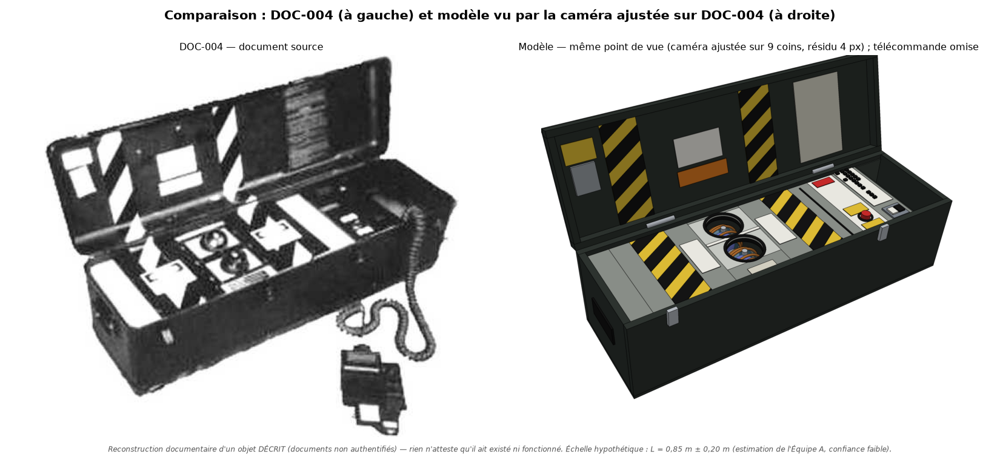
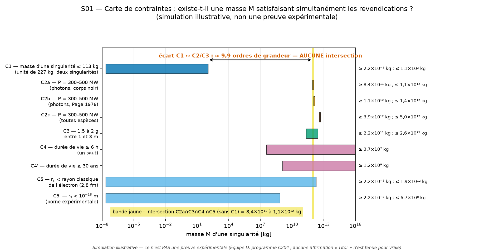
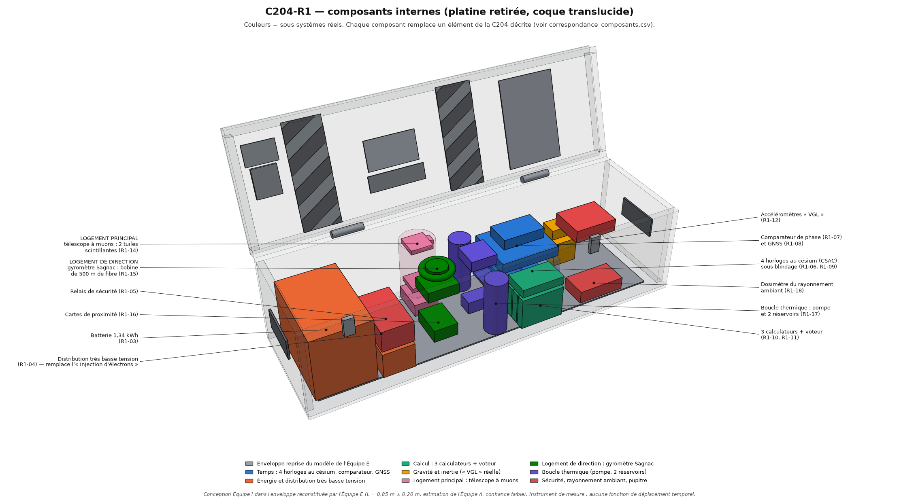

# Dossier scientifique — La « machine temporelle C204 » attribuée à John Titor

Programme de recherche multidisciplinaire — synthèse de la direction — 10 novembre 2026.
Ce document résume et relie les livrables des équipes A à I et des deux passages de la Red Team.
Chaque chiffre renvoie au rapport et au script qui le produisent ; les valeurs citées ici sont celles
**retenues après la validation contradictoire** (`../08_red_team/RAPPORT_RED_TEAM_2.md`, §2.1).

---

## Verdict en une page

1. **Les documents décrivent un objet, pas une machine.** Les sources montrent de façon cohérente l'extérieur d'un
   coffre allongé à couvercle articulé, avec deux logements circulaires, un pupitre et une télécommande filaire.
   Rien ne documente l'intérieur : l'écorché à 35 repères ne correspond pas au coffre, n'a pas de légende, et son
   origine reste inconnue.
2. **La machine telle que décrite est exclue par la physique connue**, avec des écarts de 10 à 30 ordres de
   grandeur que cinq équipes ont recalculés indépendamment. Aucune des erreurs relevées dans notre propre travail
   n'entame ce résultat.
3. **Les chiffres du récit ne sont pas inventés au hasard.** La puissance annoncée (300–500 MW), la « taille d'un
   électron » et la « masse d'une montagne » sont cohérentes entre elles : ce sont celles d'un trou noir primordial
   de quelques 10¹² kg, tel que la vulgarisation des années 1970-1990 le décrivait. L'auteur avait lu de la physique
   sérieuse. Mais ces chiffres sont incompatibles avec une unité de 227 kg, que l'auteur dit lui-même ne pas
   pouvoir être déplacée si la masse était celle-là.
4. **La périphérie est constructible, le cœur ne l'est pas.** Horloges atomiques, calculateurs à vote, gravimètre,
   refroidissement, télécommande, arrêt d'urgence : tout cela existe, mais ne tient dans le coffre qu'en version
   réduite. Les micro-trous noirs, leur confinement,
   l'injection d'électrons « modifiant la masse », l'évent à rayons X et le « verrou de gravité » n'ont pas de
   réalisation possible.
5. **Aucun mécanisme connu ne déplace un objet vers le passé.** Le déplacement vers le futur est démontré et
   mesuré, mais il est infime à notre échelle : la meilleure machine constructible dans le même coffre obtient
   environ 0,5 milliardième de seconde par heure, près de 18 ordres de grandeur sous les « 10 ans par heure »
   revendiqués.
6. **Ce qui reste réellement ouvert est documentaire et théorique**, pas technique : la provenance de deux pièces,
   l'échelle exacte du coffre, l'identité de l'auteur ; et, en physique, le statut de la protection chronologique
   et le sort de l'intérieur des trous noirs en rotation.

Degré de confiance global : **élevé** pour les points 2, 4 et 5 ; **élevé** pour l'extérieur de l'objet et
**faible** pour son échelle et son intérieur (point 1) ; **moyen** pour le point 3, qui est une inférence sur les
lectures de l'auteur.

---

## Comment lire ce dossier

**Étiquettes de preuve.** [DOC] lisible dans un document source ; [DÉD] déduit de plusieurs éléments documentés ;
[HYP] hypothèse de notre part ; [INT] interprétation de tiers ; [VÉR] fait vérifiable indépendamment.
**Statut physique.** Démontré / théoriquement possible / spéculatif / contredit par les connaissances actuelles.

**Ce que ce programme n'a pas fait.** Aucune expérience n'a été réalisée : les protocoles de l'Équipe F et les
machines de l'Équipe I sont des conceptions sur le papier. Les simulations sont illustratives. Les références ont
été vérifiées en ligne sur leurs métadonnées et leurs résumés, pas sur leur texte intégral.

**Arborescence.**

| Dossier | Contenu | Rapport d'entrée |
|---|---|---|
| `00_DOSSIER_DE_BASE.md` | Référence commune et errata E1–E16 | — |
| `01_archive/` | Originaux, copies alternatives, inventaire, transcriptions, historique | `INVENTAIRE.md` |
| `02_reconstruction/` | Dossier technique, plans 2D, dimensions, incohérences | `DOSSIER_TECHNIQUE.md` |
| `03_physique_theorique/` | Relativité générale, trous noirs, causalité | `RAPPORT_B.md` |
| `04_ingenierie/` | Sous-systèmes, bilans, faisabilité | `RAPPORT_C.md` |
| `05_simulations/` | Neuf simulations reproductibles | `RAPPORT_D.md` |
| `06_modele_3D/` | Modèle paramétrique, exports, visionneuse | `RAPPORT_E.md` |
| `07_experiences/` | Douze protocoles expérimentaux | `RAPPORT_F.md` |
| `08_red_team/` | Deux rapports critiques, corrections | `RAPPORT_RED_TEAM_2.md` |
| `09_recherche_contemporaine/` | Littérature 2001–2026, bibliographie vérifiée | `RAPPORT_H.md` |
| `10_machine_optimisee/` | Trois paliers de machine cohérente | `RAPPORT_I.md` |
| `11_dossier_final/` | Cette synthèse et l'index | — |

---

## 1. Historique et documentation de la C204

Détail et sources : `../01_archive/HISTORIQUE.md`.

- **2 novembre 2000** : premier message de « TimeTravel_0 » sur le forum du Time Travel Institute. 73 messages
  y sont archivés jusqu'au 17 mars 2001 [VÉR, d'après l'archive du forum].
- **4 novembre 2000** : les premières images circulent par des intermédiaires (une correspondante, puis
  l'administrateur d'un forum tiers). L'auteur ne les a jamais publiées sur un espace à son nom avant un album en
  ligne de mars 2001, aujourd'hui perdu. **La chaîne de possession des fichiers n'est donc pas maîtrisée.**
- **27 janvier 2001** : le nom « John Titor » apparaît sur un second forum (Post-to-Post). Dernier message connu
  le 24 mars 2001.
- **2003 et après** : sites de compilation, livre, enquêtes de presse, reprises culturelles.

**Identité de l'auteur : inconnue.** Personne n'a revendiqué les messages et aucune enquête n'a produit de preuve
directe. Des hypothèses de tiers existent ; elles ne sont pas démontrées et les personnes visées les ont démenties.
Nous ne les reprenons pas à notre compte.

**Idées reçues corrigées.**

| Affirmation courante | Constat |
|---|---|
| « La machine était dans une Corvette » | Le mot est absent des textes de l'auteur, qui écrit « a 1967 Chevrolet ». [INT] |
| « General Electric » partout | Un message de novembre 2000 écrit « GM » ; la compilation de 2023 imprime « GE » au même endroit |
| « La photo du laser prouve la courbure de la lumière » | Une courbure visible de 1° exigerait la masse de la Terre à 1 m (§10) |
| « Le manuel donne les dimensions du champ » | Seule une variante de 2003, de provenance non établie, porte des cotes (§2) |

**Prédictions datées.** Sur 23 prédictions vérifiables relevées dans le corpus, 11 sont réfutées (guerre civile
américaine en 2004-2005, conflit mondial en 2015, percée au CERN « d'ici un an », entre autres) et aucune réussite
n'est non banale. La clause des « lignes d'univers divergentes » rend le reste non réfutable
(`../08_red_team/tableau_predictions.csv`).

---

## 2. Archive des photographies et schémas

Inventaire complet : `../01_archive/INVENTAIRE.md` ; empreintes et provenance : `../01_archive/inventaire.csv`,
`../01_archive/journal_provenance.csv` ; transcriptions : `../01_archive/TRANSCRIPTIONS.md`.

- **Source de départ** : 12 pièces jointes d'un fil de forum de 2023 (11 documents uniques), archivées sans
  modification avec leurs empreintes SHA-256 dans `../01_archive/originaux/`.
- **Copies supplémentaires** : 225 fichiers récupérés dans quatre sources archivées (captures de 2002-2003
  notamment), dont 57 contenus distincts concernent la C204. Ils sont dans `../01_archive/copies_alternatives/`.

| Pièce | Nature | Attribution |
|---|---|---|
| DOC-001 à 003 | Photos de l'unité dans le second véhicule | Attribué à l'auteur |
| DOC-004, 015 | Cliché tramé de l'unité ouverte ; page entière qui le porte | Attribué à l'auteur (probable) |
| DOC-005 | Écorché à 35 repères, sans légende | Attribué à l'auteur ; **origine du dessin inconnue** |
| DOC-006 | Couverture du manuel, datée de mars 2034 | Attribué à l'auteur |
| DOC-007 | Vue de dessus à 9 repères légendés | Attribué à l'auteur |
| DOC-008 | « Basic components », 12 repères légendés | Attribué à l'auteur |
| DOC-009 | « Tipler sinusoid field », 12 repères, sans cotes | Attribué à l'auteur |
| DOC-011 | Insigne | Attribué à l'auteur |
| **DOC-012** | Photo dite « du laser » (252×206 px) | Attribué à l'auteur (probable) |
| **DOC-013** | Photo couleur de l'unité ouverte dans le premier véhicule | Attribué à l'auteur (probable) |
| **DOC-014** | Variante de DOC-009 **cotée en mètres** (6, 5, 8, 11 m) | **Non établie** : première trace en 2003 sur un site tiers |
| DOC-010, 017, 019 à 022 | Diagramme de divergence, montages, images dérivées | Tiers |
| DOC-016 | Lettre administrative concernant un véhicule | Transmise par une correspondante ; **contient des données nominatives de tiers, à ne pas rediffuser** |

**Recherches infructueuses**, à dire nettement : la légende des 35 repères de l'écorché, l'illustration dont il
pourrait dériver, l'insigne avec son texte, les fichiers d'origine de novembre 2000 et l'archive du forum
Post-to-Post n'ont pas été retrouvés.

**Examen des images.** Aucun indice de retouche des photographies n'a été décelé, mais les méthodes employées sont
peu probantes à cette résolution. Les photos montrent vraisemblablement un objet réel : un coffre aménagé.

---

## 3. Architecture d'origine et plans techniques reconstitués

Dossier : `../02_reconstruction/DOSSIER_TECHNIQUE.md` ; plans : `../02_reconstruction/plans/` (dessus, face, côté,
couvercle ouvert, implantation interne en deux variantes).

### 3.1 Ce que les documents établissent [DOC]

- **Enveloppe** : coffre parallélépipédique allongé, couvercle articulé sur le grand côté, rapport
  longueur/profondeur de 3,3 sur le dessin (3,6 sur les photos).
- **Dessus du corps**, de gauche à droite : compartiment, bande de danger, **deux logements circulaires l'un
  derrière l'autre** à 38 % de la longueur (« main singularity » côté charnière, « steering singularity » côté
  avant), seconde bande de danger, colonne de commande (écran de secours, coupure d'urgence), panneau de secours
  avec interrupteur général, rangement de la télécommande.
- **Couvercle** : bandes de danger, étiquettes, placard d'instructions (illisible).
- **Télécommande** filaire à cordon spiralé, à clavier.

### 3.2 Ce que le texte ajoute [DOC texte]

Six systèmes : logements magnétiques des deux micro-singularités ; collecteur d'injection d'électrons ;
refroidissement et évacuation des rayons X ; capteurs de gravité (« VGL ») ; quatre horloges au césium ; trois
calculateurs. Les horloges, les calculateurs et l'évacuation des rayons X ne figurent sur **aucune** image.

### 3.3 Ce qui n'est pas documenté

- **L'intérieur.** Le schéma à 12 composants (DOC-008) est un synoptique sans échelle ; à l'échelle de son propre
  dessin, ses composants n'occupent qu'environ 9 % du volume intérieur (3 L sur 35 L). L'écorché (DOC-005) est incompatible avec
  lui. Les deux implantations internes proposées sont [HYP].
- **L'échelle.** Aucune cote de l'unité ne figure dans les documents. Estimation retenue : **L = 0,85 m**
  (intervalle central 0,74–1,05 m, plage 0,65–1,25 m), profondeur ≈ 0,26 m, hauteur fermée 0,24 à 0,29 m selon
  l'équipe. Confiance faible : quatre méthodes non indépendantes, la plupart sur des étalons supposés. Les équipes A et E
  étiquettent cette longueur différemment ([DÉD] sur étalons [HYP] pour l'une, [HYP] pour l'autre) : les deux
  mentions désignent la même chose, une mesure déduite d'étalons dont la taille est supposée.
- **Le mode opératoire.** Le texte ne donne que : saisie de coordonnées, montée en puissance, compte à rebours,
  véhicule à l'arrêt.

### 3.4 Incohérences entre documents

21 incohérences sont recensées dans `../02_reconstruction/INCOHERENCES.md`. Les trois plus graves :

| Incohérence | Détail |
|---|---|
| Écorché contre coffre | Forme prismatique biseautée et mécanique dense, sans rapport avec le coffre plat |
| Masse contre volume | 227 kg dans ≈ 0,06 m³, soit ≈ 3 700 kg/m³ en moyenne |
| Étendue du champ | 3,0–3,7 m dans le texte ; 5 à 11 m sur la variante cotée (envergures déduites : 26 à 36 m) |

---

## 4. Modèle 3D

Dossier : `../06_modele_3D/` — ouvrir `visionneuse.html` pour la version interactive (rotation, états fermé /
ouvert / éclaté, coloration par niveau de preuve, fiche par pièce, variantes).

- **Modèle paramétrique** : toutes les cotes dérivent d'une seule longueur (`parametres.json`, `echelle.L`) ;
  `reconstruire.sh` régénère en une vingtaine de secondes les exports GLB, OBJ et STL, les rendus, la visionneuse
  et la nomenclature.
- **Variante A** (coffre) : 173 pièces. **Variante B** (écorché), modélisée à part : 40 pièces.
- **Honnêteté du classement**, après audit : 88 pièces [DOC], 52 [DÉD], 33 [HYP]. Les 88 pièces [DOC] sont toutes
  à l'extérieur ; 42 sont des motifs répétés (raies, pastilles) et 48 n'ont pour source que le dessin de dessus,
  les deux catégories se recoupant. **L'intérieur ne compte aucune pièce [DOC]** (34 [DÉD], 30 [HYP]).
- Livrables associés : `architecture_fonctionnelle.svg`, `schema_electrique_hypothetique.svg` (hypothétique, et
  marqué comme tel).

### 4 bis. Simulateur 3D interactif

`../06_modele_3D/simulateur.html` — fichier unique, à ouvrir dans un navigateur (three.js est chargé en ligne).
Quatre modes :

| Mode | Ce qu'il montre | Statut |
|---|---|---|
| 1 · Explorer | La C204 telle que décrite : fermée, ouverte, **vue éclatée** réglable, fiche de chaque pièce | Reconstitution documentaire |
| 2 · Si elle fonctionnait | Le récit mis en images : saisie de la date, montée en puissance, « champ » du schéma, lumière « courbée », noir, arrivée | **Fiction** — bandeau permanent : aucun phénomène observé |
| 3 · Ce que dit la physique | Les conséquences réelles des chiffres du récit, réglables par curseurs : masse, pesanteur, dose, température, dilatation | Calcul, formule affichée sous chaque nombre |
| 4 · C204-R1 | La version constructible : horloges, vote des calculateurs avec panne injectable, muons, décalage relativiste par trajet | Signaux **simulés**, annoncés comme tels |

Testé par son équipe dans Chrome à 1280×800 et 375×812 (143 contrôles réussis) et rouvert par la direction dans le
navigateur intégré. **Non testé** : Safari, Firefox, un vrai téléphone, un lecteur d'écran. Sans connexion, la 3D
ne s'affiche pas ; seuls les calculs restent.

---

## 5. Nomenclature des composants

- `../02_reconstruction/nomenclature.csv` : 82 lignes, repère par repère, avec nom d'origine, traduction, document
  source, fonction revendiquée et étiquette.
- `../06_modele_3D/NOMENCLATURE.md` et `nomenclature.csv` : pièces du modèle 3D.
- `../10_machine_optimisee/correspondance_composants.csv` : chaque élément d'origine face à son remplaçant réel.

Légendes d'origine retenues après double contrôle :

| Document | Repères |
|---|---|
| DOC-007 | 1 main singularity · 2 steering singularity · 3 remote control unit · 4 emergency view screen · 5 emergency disconnect · 6 main unit on/off switch · 7 unit control instructions · 8 emergency controls · 9 remote storage unit |
| DOC-008 | 1 singularity drive housing · 2 singularity magnetic field coil · 3 magnetic field generator / regulator · 4 electron mass injector manifold · 5 electron regulator · 6 electron generator · 7 singularity *status* sensor (confiance faible) · 8 singularity cooling housing · 9 singularity cooling pump · 10 singularity cooling supply · 11 gravity sensor unit · 12 battery supply |
| DOC-009 | 1 singularities in Kerr field · 2 à 4 output of negative / null / positive time field · 5 X-ray venting cone · 6 vertical safe distance · 7 mass offset · 8 rear mass dist. · 9 forward mass dist. · 10 à 12 negative / null / positive time event horizon |

---

## 6. Analyse physique de chaque sous-système

Détail : `../04_ingenierie/RAPPORT_C.md`, neuf fiches dans `../04_ingenierie/fiches/`,
`../04_ingenierie/tableau_faisabilite.csv` (21 lignes).

| Sous-système | Phénomène invoqué | Exigence chiffrée | Meilleure technologie réelle | Statut |
|---|---|---|---|---|
| Deux micro-singularités | Trou noir chargé en rotation | 3,9–5,1×10¹² kg chacune pour 300–500 MW | Aucun trou noir produit ni détecté en laboratoire | **Contredit** dans l'enveloppe annoncée |
| Logement et bobines magnétiques | Confinement électromagnétique | ≈ 5×10¹¹ T, ou 1,1×10¹¹ V/m à charge extrémale | 45,5 T en continu | **Contredit** : écart de 10 ordres de grandeur, et la charge réelle n'est que de quelques charges élémentaires |
| Injection d'électrons | Modifier masse et horizon interne | +1 % de masse = 5×10⁴⁰ électrons | Canons à électrons courants | Le canon est **démontré** ; la fonction est **contredite** (variation de masse ≤ 5×10⁻²²) |
| Rotation et orientation de l'axe | Modeler le « sinusoïde » | Réorientation en un temps utile | Aucune | **Contredit** (précession ≤ 4×10⁻⁹ rad/s) |
| Refroidissement | Évacuer la chaleur | Centaines de MW hors de ≈ 0,06 m³ | ≈ 0,1 à 1 MW dans ce volume | **Contredit** : 6 ordres de grandeur |
| « Évent à rayons X » | Canaliser le rayonnement | Tout le rayonnement dans un cône | Aucune optique pour des gamma de 5–70 MeV | **Contredit** : 55 % de neutrinos, émission non collimatable |
| Blindage (non mentionné) | Protéger l'équipage | 40–60 cm de plomb, 4 à 15 t | ≈ 9 cm logeables, 4,5 cm vers la face la plus proche | **Contredit** dans 227 kg |
| Capteurs de gravité « VGL » | « Instantané » du champ comme référence de position | ≈ 1 µGal | Gravimètres à 2–5 µGal | Mesurer g est **démontré** ; le « verrou de position » n'a **pas de base physique** |
| Quatre horloges au césium | Base de temps | Datation à un jour sur 60 ans | 4 horloges miniatures : 140 g | **Démontré**, largement satisfait |
| Trois calculateurs à vote | Tolérance aux pannes | Tenir 6 h | Redondance triple (aéronautique) | **Démontré** ; aucun « protocole de Borda » de ce type n'existe |
| Batterie | Alimentation | Auxiliaires : quelques centaines de watts | Pack lithium de quelques kWh | **Démontré** pour l'électronique ; **contredit** comme source de l'effet |
| Télécommande, arrêt d'urgence | Commande et sécurité | — | Standard industriel | Circuits **démontrés** ; aucun « état sûr » : un trou noir ne s'éteint pas |

Trois conséquences physiques directes des chiffres du récit, s'ils étaient vrais :

- **Rayonnement** : 3,3–3,8×10³ Gy/s à 1 m pour les seuls photons d'une singularité de 400 MW (≈ 380 Gy/s à 3 m),
  soit une dose létale en une milliseconde environ. Ce sont des gamma de 12–16 MeV, pas des rayons X.
- **Thermique** : les 38–49 °C rapportés autour du coffre correspondent à 0,15–0,30 kW dissipés, un million de
  fois moins que la puissance annoncée.
- **Gravité** : deux singularités de 3,9–5,1×10¹² kg donneraient 53 à 69 g à 1 m, et non 2 g ; leur poids
  traverserait le véhicule et le sol.

---

## 7. Équations et démonstrations

Rapport : `../03_physique_theorique/RAPPORT_B.md` ; démonstrations : `ANNEXE_B1_demonstrations.md` ; huit scripts
de vérification rejoués sans erreur (`verifications/executer_tout.py`).

**Micro-trou noir.**

$$r_s = \frac{2GM}{c^2},\qquad T_H = \frac{\hbar c^3}{8\pi G M k_B},\qquad P = f(M)\,\frac{\hbar c^6}{15360\,\pi\,G^2 M^2},\qquad \tau \propto M^3 .$$

Le facteur f(M) compte les espèces émises et les facteurs de corps gris : f ≈ 21,6 vers 10¹² kg (neutrinos 55 %,
électrons et positons 37 %, photons 7,5 %), d'où P ≈ 7,7 GW × (10¹² kg / M)². Recalculé par trois équipes, accord
à 0,02 % avec Page (1976).

| Masse | Rayon r_s | Puissance | Durée de vie |
|---|---|---|---|
| 227 kg (toute l'unité) | 3×10⁻²⁵ m | — | ≈ 4,7 ps, en libérant 2×10¹⁹ J (≈ 4,9 Gt de TNT) |
| 3,9–5,1×10¹² kg | ≈ 6–8 fm | 500–300 MW | ≈ 10¹³ ans |
| 10¹² kg | 1,5 fm | 7,7 GW | ≈ 1,2×10¹¹ ans |

**Charge.** La charge extrémale vaut Q_max = M√(4πε₀G), soit 86 C pour 10¹² kg. Un micro-trou noir se décharge
par création de paires : valeur typique ≈ 6 charges élémentaires, borne ≈ 137. L'« injection d'électrons » est
donc sans prise.

**Géométrie de Kerr-Newman.** Horizons en r± = m ± √(m² − a² − q²), avec m = GM/c². Pour un trou qui possède un
horizon, la région où des courbes temporelles fermées existent est derrière l'horizon interne ; l'extérieur est
stablement causal (démonstration D4, valable sous l'hypothèse a² + q² ≤ m²). Tout se joue à l'échelle de m :
≈ 10⁻¹⁵ m pour 10¹² kg. **Une zone à courbes temporelles fermées d'un mètre exige 1,35×10²⁷ kg**, soit 0,7 masse
de Jupiter.

**Deux trous noirs.** Il n'existe pas de configuration d'équilibre stationnaire de deux trous de Kerr
(Neugebauer et Hennig, 2009). Une paire en orbite reste newtonienne à l'échelle du mètre ; son temps de
coalescence dépasse 10²³ ans.

**Cylindre de Tipler.** Des courbes temporelles fermées apparaissent à l'extérieur d'un cylindre infini en
rotation si aR > ½, soit au moins 1,7×10²⁶ kg par mètre. Pour aR > ½, la solution extérieure est égale à r fois
une sinusoïde de ln r : c'est peut-être l'origine de l'expression « Tipler sinusoid », absente de la littérature
avant le récit. Ce rapprochement est une hypothèse de notre part [HYP].

**« 10 ans par heure ».** Le facteur revendiqué est Γ = dt/dτ ≈ 87 660.

- Par la gravité, il faudrait 6,7×10²⁶ à 2,5×10²⁷ kg entre 1 et 3,7 m.
- L'identité a = c²∇ln N relie l'accélération ressentie au gradient du facteur de dilatation. Avec au plus 2 g
  sur 3,7 m, dans un champ stationnaire, Γ − 1 ≤ 8×10⁻¹⁶ : **« 2 g » et « 10 ans par heure » sont incompatibles
  entre eux d'un facteur 10²⁰.**
- Par la vitesse, il faudrait 1,8×10²⁴ J pour 227 kg. Les électrons du collisionneur LEP atteignaient ce facteur
  (γ ≈ 89 000), mais pour des particules de 10⁻³⁰ kg.

**La dilatation ne mène jamais vers le passé** dans un espace-temps stablement causal (démonstration D1). Pour
fermer une courbe temporelle, il faut un autre ingrédient, par exemple un trou de ver traversable, donc de
l'énergie négative.

**Énergie négative.** Un trou de ver de 1 m de gorge demande l'équivalent de ≈ −10²⁷ kg. L'effet Casimir en
fournit environ 10⁴³ fois moins, et les inégalités quantiques bornent ce qu'on peut concentrer.

**Champs électromagnétiques comme source de gravité.** Par leur seul contenu en énergie, il faudrait 2,6×10²⁸ J
de champ pour produire 2 g à 1 m, et 3,5×10¹⁸ T pour une courbure forte à cette échelle.

---

## 8. Simulations numériques

Rapport : `../05_simulations/RAPPORT_D.md` ; `run_all.sh` relance tout en 2 min 30 s. Toutes les figures portent
la mention « simulation illustrative ».

| Simulation | Objet | Résultat |
|---|---|---|
| S01 | Thermodynamique d'un micro-trou noir | Aucune masse ne satisfait à la fois l'unité de 227 kg et les autres affirmations : écart de 9,9 ordres de grandeur |
| S02 | Géométrie de Kerr et de Kerr-Newman | Toute la structure d'un trou de 10¹² kg tient dans ≈ 10⁻¹⁵ m |
| S03 | Géodésiques dans Kerr | Le passage par le disque exige des conditions très particulières ; dt/dτ maximal sur orbite stable : 10,8 |
| S04 | Cylindre de van Stockum-Tipler | Avec 227 kg par mètre, il manque un facteur 7×10²³ |
| S05 | Champ de deux masses en rotation | « 2 g uniforme » impossible : 6 g de marée sur 1 m |
| S06 | Confinement électromagnétique | Le poids reste transmis au véhicule, quel que soit le piège |
| S07 | Énergie négative | Trou de ver ou bulle de distorsion : ≈ 10⁴³ fois l'effet Casimir |
| S08 | Reconstitution du schéma de champ | Ellipses génériques de même rapport d'axes, aucune sinusoïde ; résultat descriptif, sans valeur de preuve |
| S09 | Synthèse et Monte-Carlo | Sur 200 000 tirages, aucun ne concilie la masse de l'unité avec le reste |

**Réserves de la validation.** Les simulations se reproduisent à l'octet près. Plusieurs critères de test ont été
révisés après un premier échec ; l'audit les juge légitimes, sauf dans S08, où 17 « tests » sur 28 ne validaient
rien. Après correction, l'équipe annonce 160 tests de validation, tous passés, et 23 contrôles ou résultats tenus
hors décompte — un tri plus strict que celui que demandait l'audit (164 et 17).

**S08 rejouée sur les meilleures copies.** Onze énoncés descriptifs sur douze reçoivent la même réponse sur les
trois copies de la page. Une erreur de la première version est corrigée : le « grand contour » du schéma est en
réalité deux ellipses, confondues sur la copie de 318 px. Sur la variante cotée, l'échelle du dessin est de
12,2 px par mètre (dispersion 9 %), soit des demi-envergures de 13 à 18 m contre 3,0 à 3,7 m dans le texte.

---

## 9. Études énergétiques

Détail : `../04_ingenierie/bilan_energetique.csv`, fiche F5.

| Poste | Énergie ou puissance | Repère |
|---|---|---|
| Auxiliaires constructibles (horloges, calcul, capteurs, pompe) | 1,4–5,5 kWh par trajet | Une batterie suffit |
| Rayonnement annoncé pendant 6 h | ≈ 10¹³ J | Sans source identifiable dans l'unité |
| Fabriquer deux singularités donnant ensemble 2 g à 1 m | 2,6×10²⁸ J | ≈ 2×10⁸ ans d'électricité mondiale |
| Fabriquer deux singularités de 300–500 MW | 7–9×10²⁹ J | 30 à 40 minutes de luminosité solaire |
| Porter 227 kg au facteur 87 660 par la vitesse | 1,8×10²⁴ J | — |
| Ce qu'un collisionneur pourrait produire au mieux | ≈ 10⁻²³ kg vivant ≈ 10⁻²⁶ s | 35 ordres de grandeur sous le besoin |

Le texte dit que « l'énergie réelle est dans la création de la machine » : c'est exact, et c'est précisément ce
qui la rend infabricable.

---

## 10. Expériences réalisables en laboratoire

Rapport : `../07_experiences/RAPPORT_F.md` ; douze fiches dans `../07_experiences/fiches/`. Trois niveaux : N1
amateur éclairé (moins de 500 € environ), N2 salle de travaux pratiques universitaire, N3 laboratoire de
recherche. **Aucune n'a été réalisée** ; coûts et performances d'instruments sont cités de mémoire.

| N° | Expérience | Ce qu'elle montre | Ce qu'elle ne montre pas |
|---|---|---|---|
| 1 | Horloges et altitude | La dilatation gravitationnelle (22 ns avec trois césiums en montagne) | Un voyage dans le passé |
| 2 | Transfert de temps | Ce que « synchroniser » veut dire | — |
| 3 | Balance de Cavendish près d'un aimant | G ; l'absence de gravité électromagnétique mesurable | — |
| 4 | Gravimétrie locale | Ce qu'un « instantané de gravité » contient réellement | Une position |
| 5 | Effet Casimir | Une énergie de vide négative, minuscule | Une source d'énergie négative utilisable |
| 6 | Gravité analogue dans l'eau | Horizons et ergorégions analogues | La gravité quantique |
| 7 | Piège et lévitation | Le confinement d'une charge | Celui d'un trou noir |
| 8 | Déviation de la lumière | Une courbure visible par gradient d'indice dans un liquide (jusqu'à 23°) | Une courbure gravitationnelle ; ni l'origine de la photo du laser |
| 9 | Effet Sagnac | La mesure d'une rotation | L'entraînement des référentiels |
| 10 | Optique quantique et causalité | Des simulations de boucles temporelles | Des boucles temporelles |
| 11 | Bruit de fond radiologique | Qu'un compteur du commerce exclurait toute fuite au-delà de 10⁻⁷ W | — |
| 12 | Banc d'essai en aveugle | Un protocole pour tester tout dispositif candidat | Rien sur l'objet de 2000-2001, indisponible |

**Sécurité** : l'audit confirme le respect des règles fixées (pas de haute tension non encadrée, pas de source
radioactive, laser de classe 2 au plus hors laboratoire). Les seuils normatifs sont à relire avant tout montage.

**La photo du laser.** À 1 m d'une masse de 10¹² kg, la déviation gravitationnelle d'un faisceau est de
3×10⁻¹⁵ radian (10⁻¹⁴ radian pour les masses qu'exige la puissance annoncée) : indétectable. La photo montre
pourtant une courbure apparente d'environ 55° (lecture visuelle, confiance faible). Un gradient d'indice courbe
bien un faisceau de façon visible dans une cuve d'eau sucrée, mais dans l'air la réfraction est bornée à 1°
environ : elle n'explique pas non plus l'image. **Le procédé de cette photo reste non identifié** ; ce qui est
établi, c'est que la gravité d'un objet transportable ne peut pas en être la cause.

---

## 11. Rapport critique de la Red Team

- **Premier passage, indépendant** (`../08_red_team/RAPPORT_RED_TEAM_1.md`, errata dans
  `ERRATA_RAPPORT_RED_TEAM_1.md`) : huit objections fatales, neuf sévères ; 20 contradictions internes du corpus ;
  14 erreurs de physique dans les explications de l'auteur ; un « steelman » qui ne sauve les 2 g qu'en sacrifiant
  quatre paramètres du récit et en postulant cinq éléments de physique nouvelle.
- **Second passage, sur notre propre travail** (`RAPPORT_RED_TEAM_2.md`, `CORRECTIONS_A_APPLIQUER.md`) :
  reproductibilité confirmée (513 fichiers sur 515 identiques à l'octet) ; 58 corrections, dont 4 bloquantes ;
  89 usages de références audités : 71 conformes, 8 approximatifs, 2 mal employés, 8 introuvables en ligne,
  aucune référence inventée.

**Ce qui résiste à la critique**, à porter au crédit du récit :

- la cohérence entre puissance, « taille d'un électron » et « masse d'une montagne » ;
- la remarque qualitativement exacte sur les deux horizons des trous noirs chargés ou en rotation ;
- la cohérence arithmétique de la biographie ;
- l'absence d'indice de retouche des photos.

**Erreurs de l'institut relevées et corrigées**, pour mémoire : émission de Hawking sous-estimée d'un facteur 21
dans le dossier de base ; « cohérence mutuelle » des chiffres surestimée ; véhicule de 1967 déclaré absent du
texte à tort ; cotes en mètres d'abord ignorées, puis portées au crédit de l'auteur sans réserve de provenance ;
budget de masse de l'ingénierie sans budget de volume ; durée de vie à 100 kg fausse d'un facteur 10 dans le
premier rapport de la Red Team ; entraînement des référentiels d'une paire sous-estimé de huit ordres de
grandeur. Chaque rapport d'équipe se termine par un journal des corrections appliquées.

---

## 12. La machine optimisée

Rapport : `../10_machine_optimisee/RAPPORT_I.md`. Question posée : quelle est la machine la plus proche de la
C204 que la physique actuelle permettrait de construire ? **Aucun des trois paliers ne déplace quoi que ce soit
vers le passé.**

| Palier | Description | Ce qu'il fait réellement |
|---|---|---|
| **R1 — constructible** | Même coffre de 0,85 m ; 36 kg ; 57 W ; ≈ 49 k€ (estimation). Quatre horloges miniatures au césium, trois calculateurs à vote, accéléromètres, boucle thermique, batterie | Calcule le décalage relativiste de son propre trajet : +0,5 ns/h à 130 km/h vers l'est, −0,4 ns/h à 1 000 m d'altitude |
| **R2 — laboratoire** | ≈ 3,6 t ; ≈ 5 M€ (estimations). Horloges optiques, gravimètre atomique, cuve à deux vortex, banc quantique | Mesure ce décalage avec une résolution de 10⁻¹⁸, soit 9 mm de dénivelé |
| **R3 — limite théorique** | Ce que la physique n'interdit pas | Muons en anneau (γ = 29,3) et électrons du LEP (γ ≈ 89 000) : réalisés, pour des particules ; orbite autour d'un trou noir de Kerr : facteur ≈ 10 |

**Remplacement des deux « singularités »** dans R1 : un télescope à muons cosmiques, qui observe une dilatation
du temps réelle sur des particules naturelles, et un gyromètre à fibre optique, qui donne le cap dont dépend le
signe du décalage.

**Réserves, à lire avec le tableau.**

- Le décalage relativiste est celui de **tout objet** sur le même trajet : un lest de même masse subit la même
  valeur. R1 ne le produit pas ; il le calcule.
- Le coffre R1 ne peut pas *mesurer* son propre décalage : ses horloges miniatures sont trop bruitées, et une
  horloge capable de le mesurer ne tient pas dans le coffre.
- L'indice de « proximité à la C204 » calculé par l'équipe repose sur des notes subjectives.
- Rien n'a été construit ; coûts et masses sont des estimations.

### 12 bis. Guide de construction

Guide : `../10_machine_optimisee/GUIDE_CONSTRUCTION.md` ; logiciel de référence testé :
`../10_machine_optimisee/logiciel/` (47 tests réussis). Le guide dit dès sa première page que la machine d'origine
ne peut pas être construite, et décrit trois constructions réalisables. **Rien n'a été construit ni essayé** ; les
coûts et les durées sont des estimations sans devis.

| Construction | Ce que l'objet fait | Coût estimé | Temps estimé |
|---|---|---|---|
| **A — Réplique inerte** du coffre tel que documenté | Rien : maquette de présentation | 140 à 240 € | 15 à 25 h |
| **B — C204-R1 Lite**, version d'initiation | Calcule et affiche le décalage relativiste du trajet, compare des oscillateurs, fait voter trois calculateurs, compte des muons cosmiques | 350 à 730 € | 40 à 80 h |
| **C — C204-R1 complet** | La même chose avec quatre horloges atomiques miniatures et un gyromètre à fibre | ≈ 49 k€ (44 à 64 k€) | 300 à 600 h |

Le guide ne fournit ni micrologiciel ni schéma électronique de détail : architecture, départs électriques et
protections seulement. Toutes les constructions sont en très basse tension, sans source radioactive.

---

## 13. Recherches supplémentaires nécessaires

Listes argumentées : `../09_recherche_contemporaine/RECHERCHES_SUPPLEMENTAIRES.md` (12 questions ouvertes,
8 recherches documentaires) et `../10_machine_optimisee/RECHERCHES_COMPLEMENTAIRES.md`.

**Documentaires.**

1. Retrouver l'illustration d'origine de l'écorché, ou établir qu'il n'en existe pas.
2. Établir la provenance de la variante cotée en mètres (qui l'a produite, et quand).
3. Explorer l'archive du forum Post-to-Post, restée inaccessible.
4. Trouver un étalon certain dans les photos pour fixer l'échelle du coffre ; identifier le modèle du coffre.

**Physiques**, toutes réelles et actives :

1. La protection chronologique est-elle un théorème de la gravité quantique ?
2. Quel est le sort de l'horizon de Cauchy d'un trou noir réel en rotation ? Sa stabilité continue est démontrée ;
   sa nature singulière est suggérée, non établie.
3. Existe-t-il des trous noirs primordiaux en cours d'évaporation ? Aucun n'a été observé.
4. Jusqu'où descendent les mesures de la gravité de petites masses, et la gravité peut-elle intriquer deux masses ?
5. Jusqu'où iront les horloges optiques et nucléaires transportables ?

**Cinq pistes contemporaines** pour prolonger ce programme sans quitter la physique établie : chronométrie
relativiste ; simulateur analogique de Kerr à deux vortex ; simulateur quantique de causalité ; suite de capteurs
de type « VGL » ; banc d'énergie négative et de gravité des petites masses.

---

## Réponses aux dix questions fondamentales

| N° | Question | Réponse | Confiance |
|---|---|---|---|
| 1 | Architecture de la C204 selon les documents | Un coffre allongé à deux logements circulaires, pupitre et télécommande filaire ; six systèmes nommés par le texte. L'intérieur et l'échelle ne sont pas documentés | Élevée pour l'extérieur ; faible pour l'intérieur et l'échelle |
| 2 | Rôle des deux singularités | Dans le récit : source de gravité, « principale » et « de direction ». En physique : aucun rôle causal possible ; leurs effets se limitent à l'échelle de 10⁻¹⁵ m | Élevée |
| 3 | Énergie nécessaire | Quelques kWh pour ce qui est constructible ; 2,6×10²⁸ à 9×10²⁹ J pour fabriquer les singularités | Élevée, en ordre de grandeur |
| 4 | Les champs électromagnétiques peuvent-ils produire les effets gravitationnels décrits ? | Non : il faudrait 2,6×10²⁸ J de champ pour 2 g à 1 m, ou 3,5×10¹⁸ T pour une courbure forte | Élevée |
| 5 | Solutions connues des équations d'Einstein | Oui pour des aspects isolés (Kerr-Newman, van Stockum-Tipler, double Kerr, Gott, Morris-Thorne). Aucune ne réunit source compacte, masse modeste et courbes temporelles fermées accessibles | Élevée |
| 6 | Distorsion locale macroscopique de l'espace-temps | Oui au sens faible : elle est mesurée jusqu'au millimètre par les horloges. Non au sens fort avec des moyens humains | Élevée |
| 7 | Déplacer un objet dans le temps sans violer la causalité | Vers le futur : démontré. Vers le passé : des formulations cohérentes existent (auto-cohérence, modèle de Deutsch, post-sélection), sans mécanisme constructible ; la physique n'a pas tranché | Élevée pour le futur ; moyenne pour le passé |
| 8 | Composants constructibles aujourd'hui | Horloges, calculateurs à vote, télécommande, arrêt d'urgence, canon à électrons, bobines jusqu'à 20 T, enceinte, refroidissement jusqu'à une centaine de kW, gravimètre, batterie. Mais à pleine taille ces composants pèsent 209 kg et occupent 127 L, pour 35 L utiles dans le coffre : seule une version réduite de 36 kg y tient | Élevée pour la constructibilité ; faible pour le budget |
| 9 | Composants fondamentalement impossibles | Les singularités dans 227 kg et leur fabrication, leur confinement, l'injection « modifiant la masse », l'orientation de l'axe, l'évent à rayons X, le verrou de gravité, tout état sûr | Élevée |
| 10 | Version expérimentale | Pas de maquette réduite de l'effet : il n'y a pas d'effet à réduire. En revanche un banc de mesure en aveugle pour tout dispositif candidat, et un instrument de 36 kg dans le même coffre | Élevée pour le principe ; moyenne pour les performances, non mesurées |

---

## Ce qui est exploitable, ce qui relève de la fiction

| Idée du récit | Objet physique réel le plus proche | Verdict |
|---|---|---|
| Micro-singularité « de la taille d'un électron » | Trou noir primordial de ≈ 10¹² kg | Objet théorique sérieux, jamais observé ; ni fabricable ni transportable |
| Deux horizons d'un trou noir chargé ou en rotation | Géométrie de Kerr-Newman | Exact |
| Passer « par l'anneau » vers un autre univers | Extension analytique maximale de Kerr | Propriété mathématique de la solution idéale ; l'intérieur d'un trou noir réel n'est très probablement pas un passage |
| « Sinusoïde de Tipler » | Extérieur de van Stockum pour aR > ½ | Terme inexistant ; un fondement mathématique possible, par hypothèse |
| Lignes d'univers divergentes | Interprétation d'Everett appliquée aux boucles temporelles (Deutsch, 1991) | Idée discutée en physique ; la « divergence en pourcentage » n'a aucune définition |
| Verrou de gravité variable | Gravimétrie et navigation par carte de gravité | Les instruments existent ; la fonction décrite n'a pas de base physique |
| Quatre horloges au césium, trois calculateurs | Ensembles d'horloges et redondance triple | Réel, et bien vu pour 2000 |
| Dix ans par heure | Dilatation du temps | Réelle vers le futur seulement, et à ce taux uniquement pour des particules en accélérateur |
| Rayons X évacués par un cône | Rayonnement de Hawking | Ni des rayons X, ni collimatable |
| Percée au CERN vers 2001 | Recherches de micro-trous noirs au LHC | Aucun n'a été produit ; premier faisceau en 2008 |

---

## Limites du programme

- **Sources.** Tous les documents sont des copies de copies, de basse résolution, à chaîne de possession non
  maîtrisée. Les transcriptions des légendes les plus dégradées restent de confiance faible à moyenne.
- **Échelle.** Toutes les dimensions absolues reposent sur des étalons supposés. Les conclusions physiques n'en
  dépendent pas ; le budget de volume et le palier R1 en dépendent.
- **Expériences et machines.** Rien n'a été construit ni mesuré.
- **Références.** Vérifiées sur leurs métadonnées et, pour un échantillon, sur leurs résumés ; les textes
  intégraux n'ont pas été lus. Plusieurs résultats de 2025-2026 ne sont connus que par cette vérification en ligne.
- **Simulations.** Chacune isole une brique physique ; aucune ne modélise un dispositif.
- **Navigateur.** La visionneuse 3D a été testée dans un navigateur par son équipe ; les gestes tactiles réels et
  l'import des exports dans un logiciel de CAO n'ont pas été essayés.
