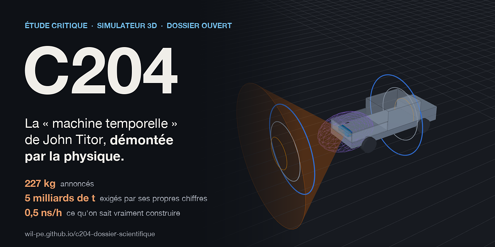
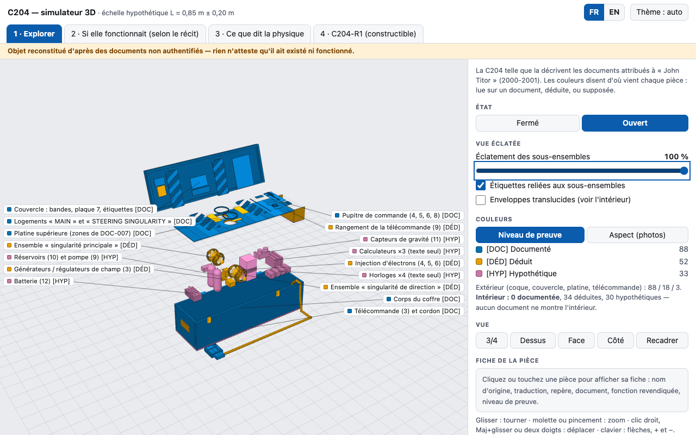
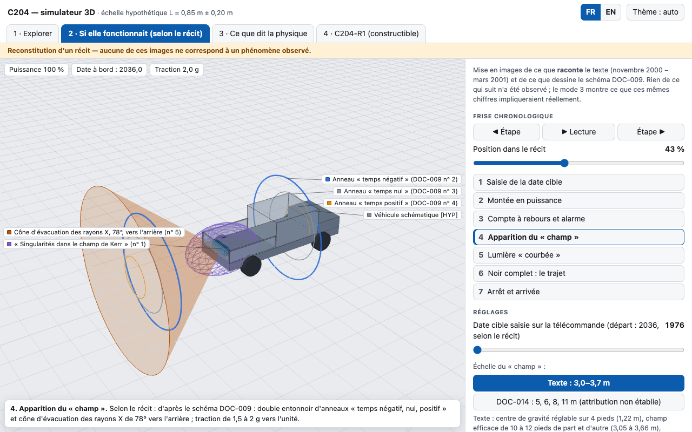
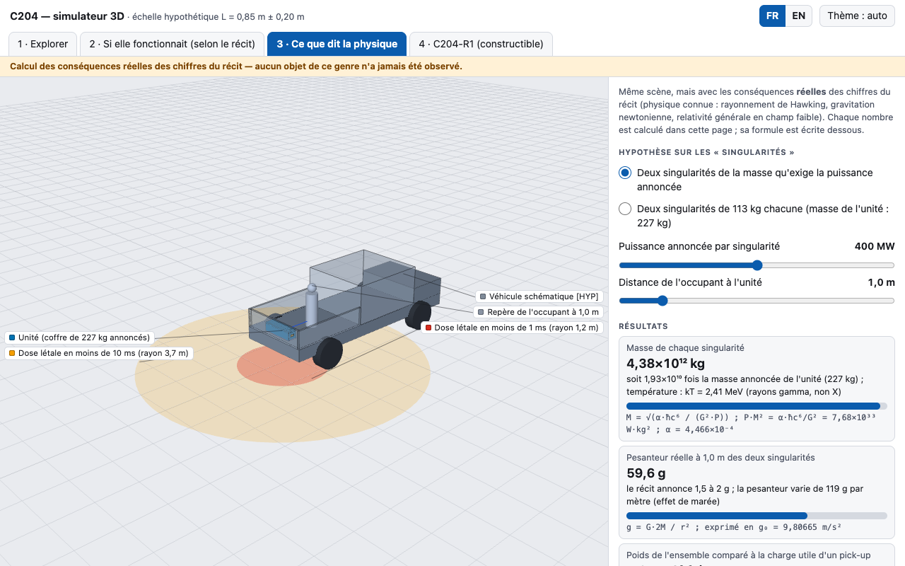
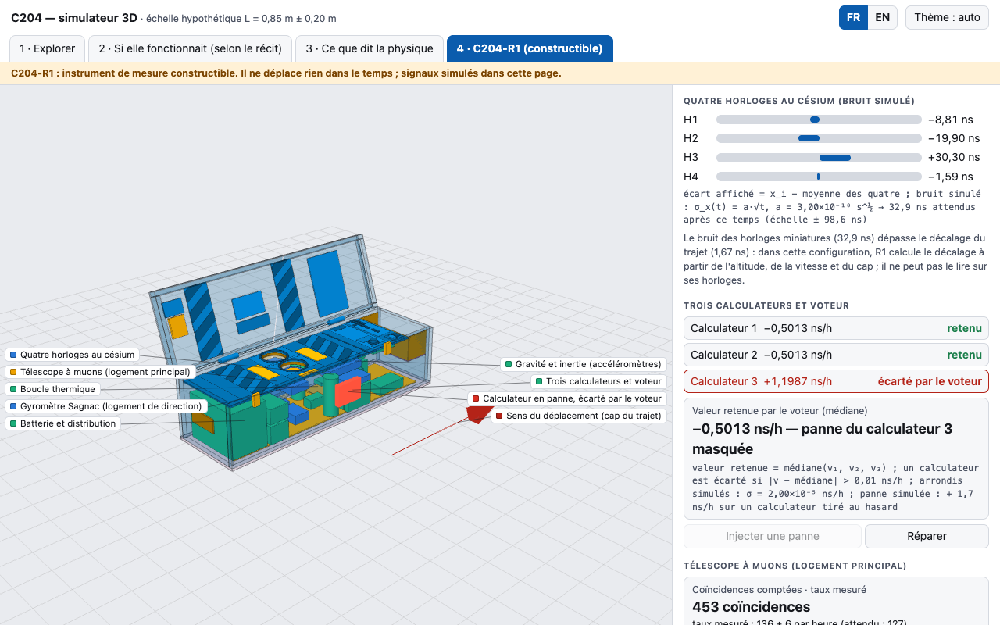
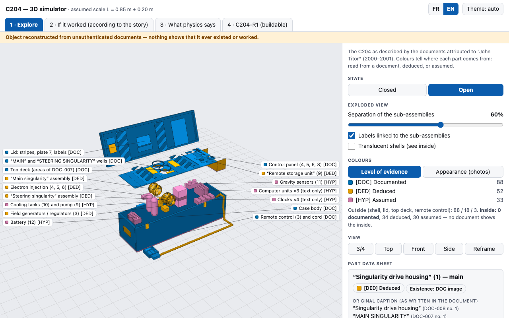
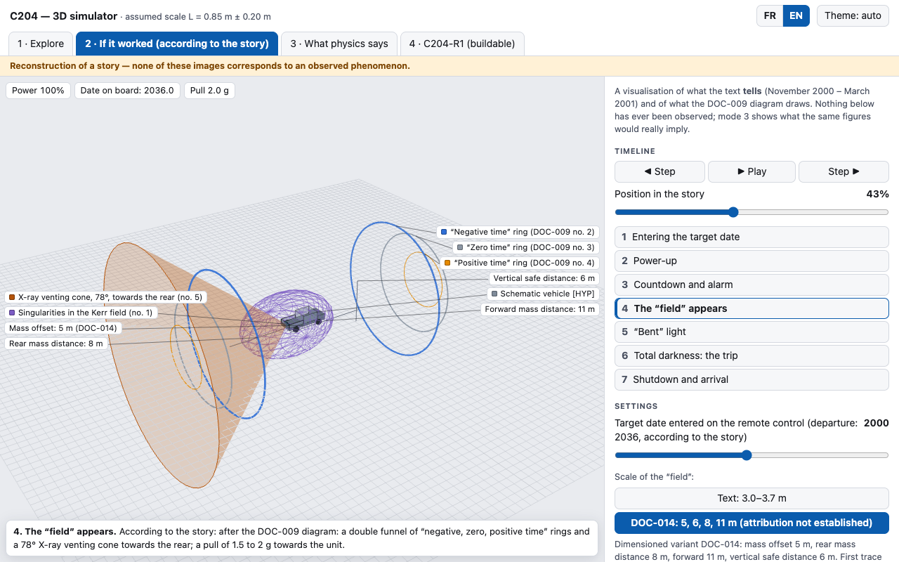
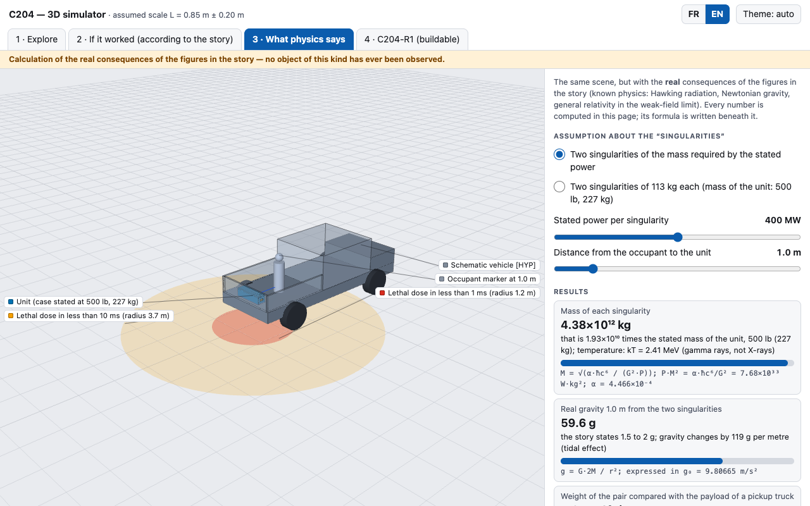
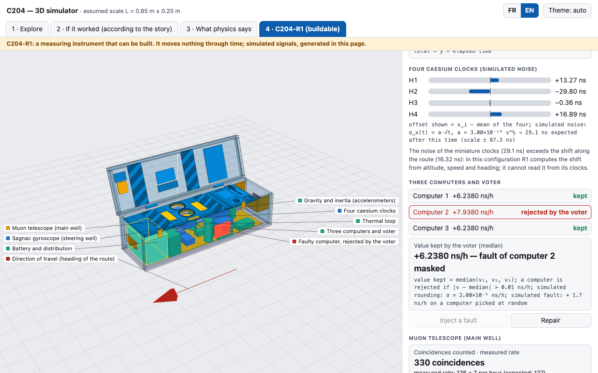

<p align="center">
  <a href="https://wil-pe.github.io/c204-dossier-scientifique/"></a>
</p>

<p align="center">
  🇫🇷 Français ci-dessous
  &nbsp;·&nbsp;
  🇬🇧 <a href="#english-version"><b>English version below</b></a>
  &nbsp;·&nbsp;
  <a href="https://wil-pe.github.io/c204-dossier-scientifique/en/">English site</a>
</p>

<h3 align="center">On a pris au sérieux la machine à voyager dans le temps de John Titor.<br>Juste le temps de la démonter.</h3>

<p align="center">
  <a href="https://wil-pe.github.io/c204-dossier-scientifique/simulateur.html#mode=recit"><b>▶ Lancer le simulateur 3D</b></a>
  &nbsp;·&nbsp;
  <a href="https://wil-pe.github.io/c204-dossier-scientifique/"><b>Explorer le dossier</b></a>
  &nbsp;·&nbsp;
  <a href="10_machine_optimisee/GUIDE_CONSTRUCTION.md"><b>Guide de construction</b></a>
  &nbsp;·&nbsp;
  <a href="11_dossier_final/DOSSIER_SCIENTIFIQUE_C204.md"><b>Lire la synthèse</b></a>
</p>

---

## L'histoire en trente secondes

En novembre 2000, un inconnu se disant venu de l'an 2036 poste sur des forums américains. Il signe bientôt
« John Titor », et publie les photos et le manuel de sa machine : la **C204**, une « unité de déplacement
temporel » de 227 kg, posée dans une voiture, propulsée par deux micro-trous noirs.

Vingt-cinq ans plus tard, ce dépôt fait ce que le récit n'a jamais eu : un examen complet. On a retrouvé les
documents, reconstitué l'objet en 3D pièce par pièce, refait tous les calculs, écrit neuf simulations, puis
conçu ce que l'on pourrait réellement construire dans le même coffre.

> **Le verdict.** La machine décrite est exclue par la physique connue, avec des écarts de 10 à 30 ordres de
> grandeur. Mais ses chiffres ne sont pas pris au hasard : ce sont ceux d'un trou noir primordial tel que la
> vulgarisation le décrivait à l'époque. L'auteur avait lu de la vraie physique.

Rien de ce qu'affirment les documents d'origine n'est tenu pour vrai : ce sont des pièces à analyser.

## Jouez avec

Le simulateur tourne dans le navigateur, sans rien installer. Cliquez une image pour ouvrir le mode.

<table>
  <tr>
    <td width="50%" valign="top">
      <a href="https://wil-pe.github.io/c204-dossier-scientifique/simulateur.html#mode=explorer"></a>
      <b>1 · Explorer la machine</b><br>
      Ouvrez le coffre, tirez le curseur de vue éclatée, cliquez une pièce pour savoir si elle est documentée, déduite ou supposée.
    </td>
    <td width="50%" valign="top">
      <a href="https://wil-pe.github.io/c204-dossier-scientifique/simulateur.html#mode=recit"></a>
      <b>2 · Si elle fonctionnait</b><br>
      Le récit mis en images, étape par étape : montée en puissance, « champ », lumière courbée, noir complet. Une fiction, et la page le dit.
    </td>
  </tr>
  <tr>
    <td width="50%" valign="top">
      <a href="https://wil-pe.github.io/c204-dossier-scientifique/simulateur.html#mode=physique"></a>
      <b>3 · Ce que dit la physique</b><br>
      Deux curseurs, et vous lisez la masse, la pesanteur, la dose et la température que ces chiffres impliquent vraiment. La formule est sous chaque nombre.
    </td>
    <td width="50%" valign="top">
      <a href="https://wil-pe.github.io/c204-dossier-scientifique/simulateur.html#mode=r1"></a>
      <b>4 · La version constructible</b><br>
      Quatre horloges, trois calculateurs qui votent, un compteur de muons. Injectez une panne et regardez le voteur l'écarter.
    </td>
  </tr>
</table>

## Les chiffres qui fâchent

| Ce que dit le récit | Ce que dit le calcul |
|---|---|
| Une unité de **227 kg** | Les 300 à 500 MW annoncés exigent deux trous noirs de **4 à 5 milliards de tonnes** chacun |
| Des rayons X évacués par l'arrière | Des rayons gamma dans toutes les directions : **dose létale en une milliseconde** à un mètre |
| 38 à 49 °C autour du coffre | Des **milliers de degrés** pour la puissance annoncée |
| Un champ de 3 à 4 mètres | Les effets d'un tel trou noir tiennent dans **quelques 10⁻¹⁵ mètre** |
| **Dix ans par heure** | Un facteur de 87 660. Les électrons du LEP, au CERN, l'atteignaient presque (89 000), pour des particules de 10⁻³⁰ kg |
| Une percée au CERN « d'ici un an » | Premier faisceau du LHC en 2008 ; aucun micro-trou noir n'a jamais été produit |

L'auteur l'avait d'ailleurs concédé lui-même : avec la masse d'une montagne, « the unit could not be moved ».

## Ce qu'on peut vraiment construire

Pas une machine à voyager dans le temps : un instrument de mesure, dans le même coffre.

| Construction | Ce que ça fait | Coût estimé | Temps estimé |
|---|---|---|---|
| **A · Réplique inerte** | Rien : la maquette fidèle aux documents | 140 à 240 € | 15 à 25 h |
| **B · C204-R1 Lite** | Compare des références de temps, fait voter trois calculateurs, compte des muons cosmiques | 350 à 730 € | 40 à 80 h |
| **C · C204-R1 complet** | La même chose avec quatre horloges atomiques miniatures et un gyromètre à fibre | ≈ 49 k€ | 300 à 600 h |

Gain réel : **un demi-milliardième de seconde par heure** vers le futur, à 130 km/h vers l'est. Un sac de sable
posé à la place ferait exactement pareil. Le [guide de construction](10_machine_optimisee/GUIDE_CONSTRUCTION.md)
le dit dès sa première page ; ses coûts et durées sont des estimations sans devis, et rien n'a été construit par nous.

## Ce que contient le dépôt

- **Archéologie du web** — les 12 images de départ, l'inventaire de 225 copies retrouvées dans des archives du web,
  dont la photo du « laser courbé » → [inventaire](01_archive/INVENTAIRE.md), [historique](01_archive/HISTORIQUE.md)
- **L'objet reconstitué** — plans 2D, dimensions, 21 incohérences entre documents → [dossier technique](02_reconstruction/DOSSIER_TECHNIQUE.md)
- **Un modèle 3D paramétrique** — 173 pièces, chacune avec son niveau de preuve ; exports GLB, OBJ, STL → [modèle](06_modele_3D/)
- **La physique** — Kerr, Tipler, micro-trous noirs, causalité, avec démonstrations → [rapport](03_physique_theorique/RAPPORT_B.md)
- **L'ingénierie** — sous-système par sous-système : constructible ou non, et pourquoi → [rapport](04_ingenierie/RAPPORT_C.md)
- **Neuf simulations** reproductibles → [rapport](05_simulations/RAPPORT_D.md)
- **Douze expériences** sans danger, du lycée au laboratoire → [rapport](07_experiences/RAPPORT_F.md)
- **La recherche de 2001 à 2026** — 446 références vérifiées en ligne → [rapport](09_recherche_contemporaine/RAPPORT_H.md)
- **La critique de notre propre travail** — 58 corrections, toutes journalisées → [Red Team](08_red_team/RAPPORT_RED_TEAM_2.md)
- **La machine optimisée** en trois paliers → [rapport](10_machine_optimisee/RAPPORT_I.md)

## Comment c'est fait

Huit équipes d'agents d'IA spécialisées, pilotées avec Claude Code : archives, physique théorique, ingénierie,
simulation, modèle 3D, expériences, littérature récente, machine optimisée. Une neuvième, la Red Team, n'avait
qu'une mission : démolir le travail des autres. Elle a trouvé 58 erreurs ou conclusions trop fortes dans notre
propre dossier. Elles sont corrigées, et chaque rapport se termine par son journal de corrections.

Des passionnés ont épluché ces images dès 2003. Ce dépôt fait le tour complet, de l'archive jusqu'au simulateur,
et montre ses sources.

## Limites à garder en tête

- Aucune expérience n'a été réalisée et rien n'a été construit.
- Les simulations sont illustratives.
- Les références ont été vérifiées en ligne sur leurs métadonnées et leurs résumés, pas sur leur texte intégral.
- Toutes les dimensions absolues du coffre reposent sur des étalons supposés.
- On ne sait pas qui était l'auteur, ni d'où vient l'écorché à 35 repères, ni comment la photo du laser a été faite.

---

## Par où commencer

| Pour… | Ouvrir |
|---|---|
| Lire la synthèse et les réponses aux dix questions | [11_dossier_final/DOSSIER_SCIENTIFIQUE_C204.md](11_dossier_final/DOSSIER_SCIENTIFIQUE_C204.md) |
| Voir la machine en 3D | [le simulateur en ligne](https://wil-pe.github.io/c204-dossier-scientifique/simulateur.html), ou [06_modele_3D/simulateur.html](06_modele_3D/simulateur.html) en local |
| Inspecter le modèle pièce par pièce | [la visionneuse en ligne](https://wil-pe.github.io/c204-dossier-scientifique/visionneuse.html) |
| Consulter les documents sources | [01_archive/INVENTAIRE.md](01_archive/INVENTAIRE.md) |
| Construire ce qui peut l'être | [10_machine_optimisee/GUIDE_CONSTRUCTION.md](10_machine_optimisee/GUIDE_CONSTRUCTION.md) |
| Trouver un fichier | [11_dossier_final/INDEX_DES_FICHIERS.md](11_dossier_final/INDEX_DES_FICHIERS.md) |

## Arborescence

```
├── 00_DOSSIER_DE_BASE.md          référence commune, conventions, errata E1–E16
├── 01_archive/                    originaux (lecture seule), inventaire, transcriptions, historique
├── 02_reconstruction/             dossier technique, plans 2D, dimensions, incohérences
├── 03_physique_theorique/         relativité générale, trous noirs, causalité
├── 04_ingenierie/                 sous-systèmes, bilans, faisabilité
├── 05_simulations/                neuf simulations (S01 à S09)
├── 06_modele_3D/                  modèle paramétrique, exports GLB/OBJ/STL, simulateur, visionneuse
├── 07_experiences/                douze protocoles expérimentaux
├── 08_red_team/                   deux rapports critiques, corrections, audits
├── 09_recherche_contemporaine/    littérature 2001–2026, bibliographie vérifiée
├── 10_machine_optimisee/          trois paliers, guide de construction, logiciel de référence
├── 11_dossier_final/              synthèse, index, scripts du site
└── docs/                          site servi par GitHub Pages
```

## Tout relancer

Environnement : `uv venv --python 3.12 .venv` puis
`uv pip install --python .venv/bin/python numpy scipy matplotlib sympy pillow opencv-python-headless trimesh shapely scikit-image`.

| Calculs | Commande, depuis la racine |
|---|---|
| Vérifications de physique théorique | `.venv/bin/python 03_physique_theorique/verifications/executer_tout.py` |
| Simulations | `sh 05_simulations/run_all.sh` |
| Modèle 3D, rendus, simulateur, visionneuse | `sh 06_modele_3D/reconstruire.sh` |
| Machine optimisée | `sh 10_machine_optimisee/calculs/run_all.sh` |
| Tests du logiciel de référence | `cd 10_machine_optimisee/logiciel && ../../.venv/bin/python -m unittest discover -s tests` |
| Visuels et site `docs/` | `.venv/bin/python 11_dossier_final/construire_visuels.py` puis `.venv/bin/python 11_dossier_final/construire_site.py <URL du dépôt>` |
| Index et contrôle des liens | `.venv/bin/python 11_dossier_final/generer_index.py` |

Les scripts d'ingénierie (`04_ingenierie/calculs/`) et d'expériences (`07_experiences/calculs/`) se lancent un par un.

## Conventions

- Niveau de preuve : [DOC] documenté, [DÉD] déduit, [HYP] hypothétique, [INT] interprétation de tiers, [VÉR] vérifiable.
- Statut physique : démontré, théoriquement possible, spéculatif, contredit.
- Les originaux de `01_archive/originaux/` ne sont jamais modifiés ; leurs empreintes sont dans `01_archive/inventaire.csv`.
- Les contenus de tiers bruts (copies d'images, pages web, messages de forums) et la pièce C204-DOC-016, qui
  contient des données nominatives, ne sont pas dans le dépôt :
  voir [01_archive/NON_INCLUS_DANS_LE_DEPOT.md](01_archive/NON_INCLUS_DANS_LE_DEPOT.md).

---

## English version

<p align="center">
  <a href="https://wil-pe.github.io/c204-dossier-scientifique/simulateur.html#mode=recit&lang=en"><b>▶ Launch the 3D simulator</b></a>
  &nbsp;·&nbsp;
  <a href="https://wil-pe.github.io/c204-dossier-scientifique/en/"><b>Explore the dossier</b></a>
  &nbsp;·&nbsp;
  <a href="11_dossier_final/SUMMARY_EN.md"><b>Read the summary</b></a>
</p>

### We took John Titor's time machine seriously. Just long enough to take it apart.

In November 2000 an anonymous poster claiming to come from the year 2036 appeared on US forums. He soon signed
"John Titor" and circulated photos and manual pages of his machine: the **C204**, a 500 lb "time displacement
unit" sitting in a car and driven by two micro black holes.

Twenty-five years later, this repository gives the story what it never had: a complete examination. We tracked
down the documents, rebuilt the object in 3D part by part, redid every calculation, wrote nine simulations, and
then designed what could actually be built in the same case.

> **The verdict.** The machine as described is ruled out by known physics, by 10 to 30 orders of magnitude. But
> its numbers were not picked at random: they are those of a primordial black hole as popular science described it
> at the time. Whoever wrote the posts had read real physics.

Nothing claimed in the original documents is taken as true: they are exhibits to be analysed.

### Play with it

The simulator runs in the browser, nothing to install. Click an image to open that mode.

<table>
  <tr>
    <td width="50%" valign="top">
      <a href="https://wil-pe.github.io/c204-dossier-scientifique/simulateur.html#mode=explorer&lang=en"></a>
      <b>1 · Explore the machine</b><br>
      Open the case, drag the exploded-view slider, click a part to see whether it is documented, deduced or assumed.
    </td>
    <td width="50%" valign="top">
      <a href="https://wil-pe.github.io/c204-dossier-scientifique/simulateur.html#mode=recit&lang=en"></a>
      <b>2 · If it worked</b><br>
      The story in pictures, step by step: power-up, "field", bent light, total darkness. A fiction, and the page says so.
    </td>
  </tr>
  <tr>
    <td width="50%" valign="top">
      <a href="https://wil-pe.github.io/c204-dossier-scientifique/simulateur.html#mode=physique&lang=en"></a>
      <b>3 · What physics says</b><br>
      Two sliders, and you read the mass, gravity, dose and temperature those figures really imply. The formula sits under each number.
    </td>
    <td width="50%" valign="top">
      <a href="https://wil-pe.github.io/c204-dossier-scientifique/simulateur.html#mode=r1&lang=en"></a>
      <b>4 · The buildable version</b><br>
      Four clocks, three voting computers, a muon counter. Inject a fault and watch the voter reject it.
    </td>
  </tr>
</table>

The simulator has a language switch (FR | EN) at the top right.

### The numbers that don't add up

| What the story says | What the calculation says |
|---|---|
| A unit of about **500 lb** (227 kg) | The stated 300–500 MW requires two black holes of **4 to 5 billion tonnes** each |
| X-rays vented out of the back | Gamma rays in all directions: a **lethal dose in a millisecond** at one metre |
| 100–120 °F around the unit | **Thousands of degrees** for the stated power |
| A field of 10 to 12 feet | The effects of such a black hole fit in **a few 10⁻¹⁵ metre** |
| **Ten years per hour** | A factor of 87,660. LEP's electrons at CERN nearly reached it (89,000), for particles of 10⁻³⁰ kg |
| A breakthrough at CERN "in about a year" | First LHC beam in 2008; no micro black hole has ever been produced |

The author conceded as much himself: with the mass of a mountain, "the unit could not be moved".

### What can actually be built

Not a time machine: a measuring instrument, in the same case.

| Build | What it does | Estimated cost | Estimated time |
|---|---|---|---|
| **A · Inert replica** | Nothing: a display model faithful to the documents | €140–240 | 15–25 h |
| **B · C204-R1 Lite** | Compares time references, runs three voting computers, counts cosmic muons | €350–730 | 40–80 h |
| **C · Full C204-R1** | The same with four chip-scale atomic clocks and a fibre-optic gyroscope | ≈ €49k | 300–600 h |

Real gain: **half a nanosecond per hour** into the future, at 130 km/h heading east. A sandbag in its place would
do exactly the same. Costs and durations are estimates without quotes, and we have built none of it. The
[build guide](10_machine_optimisee/GUIDE_CONSTRUCTION.md) is in French.

### What is in the repository

The reports are in French; start with the [summary in English](11_dossier_final/SUMMARY_EN.md).

- **Web archaeology** — the 12 starting images and an inventory of 225 copies recovered from web archives,
  including the "bent laser" photo → [inventory](01_archive/INVENTAIRE.md), [history](01_archive/HISTORIQUE.md)
- **The object, reconstructed** — 2D drawings, dimensions, 21 inconsistencies between documents → [technical file](02_reconstruction/DOSSIER_TECHNIQUE.md)
- **A parametric 3D model** — 173 parts, each with its level of evidence; GLB, OBJ and STL exports → [model](06_modele_3D/)
- **The physics** — Kerr, Tipler, micro black holes, causality, with proofs → [report](03_physique_theorique/RAPPORT_B.md)
- **The engineering** — subsystem by subsystem: buildable or not, and why → [report](04_ingenierie/RAPPORT_C.md)
- **Nine reproducible simulations** → [report](05_simulations/RAPPORT_D.md)
- **Twelve safe experiments**, from high school to research lab → [report](07_experiences/RAPPORT_F.md)
- **Research from 2001 to 2026** — 446 references verified online → [report](09_recherche_contemporaine/RAPPORT_H.md)
- **Criticism of our own work** — 58 corrections, all logged → [red team](08_red_team/RAPPORT_RED_TEAM_2.md)
- **The optimised machine**, in three tiers → [report](10_machine_optimisee/RAPPORT_I.md)

### How it was made

Eight specialised AI agent teams, driven with Claude Code: archives, theoretical physics, engineering,
simulation, 3D model, experiments, recent literature, optimised machine. A ninth, the red team, had one job: tear
the others' work apart. It found 58 errors or overstated conclusions in our own dossier. They are fixed, and each
report ends with its correction log.

Enthusiasts were already poring over these images in 2003. This repository covers the whole path, from the
archive to the simulator, and shows its sources.

### Limits

- No experiment was run and nothing was built.
- The simulations are illustrative.
- References were verified online from their metadata and abstracts, not their full text.
- Every absolute dimension of the case rests on assumed reference objects.
- We do not know who the author was, where the 35-callout cutaway comes from, or how the laser photo was made.
